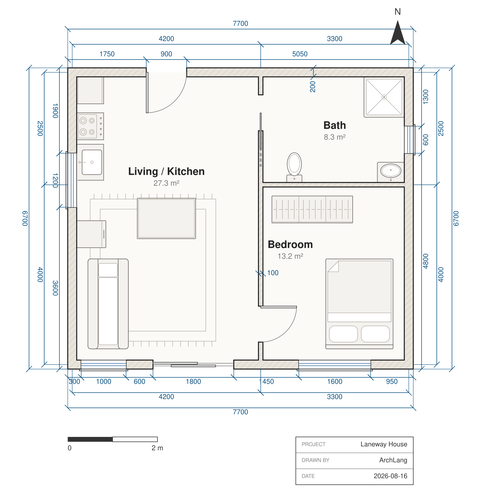
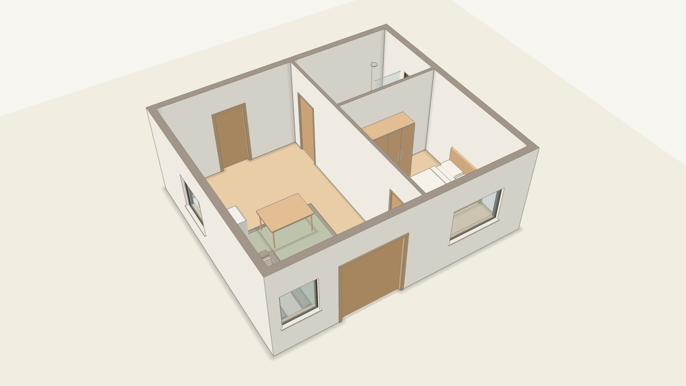
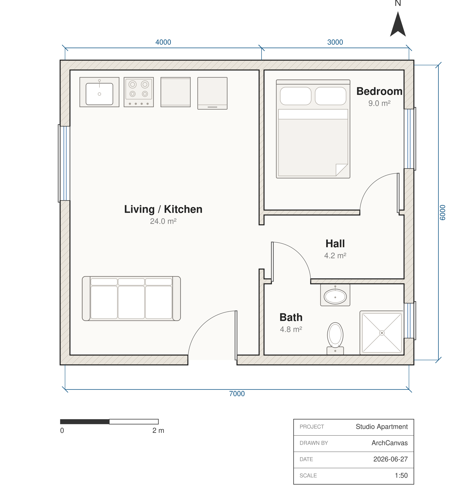
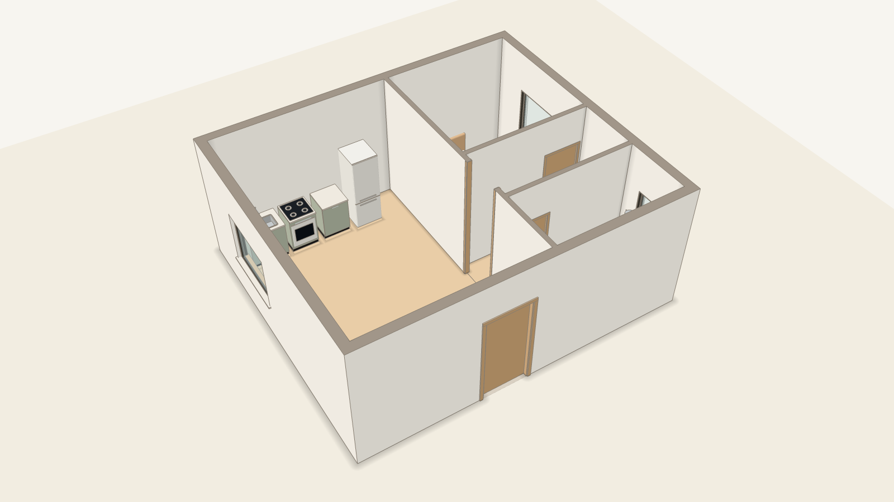
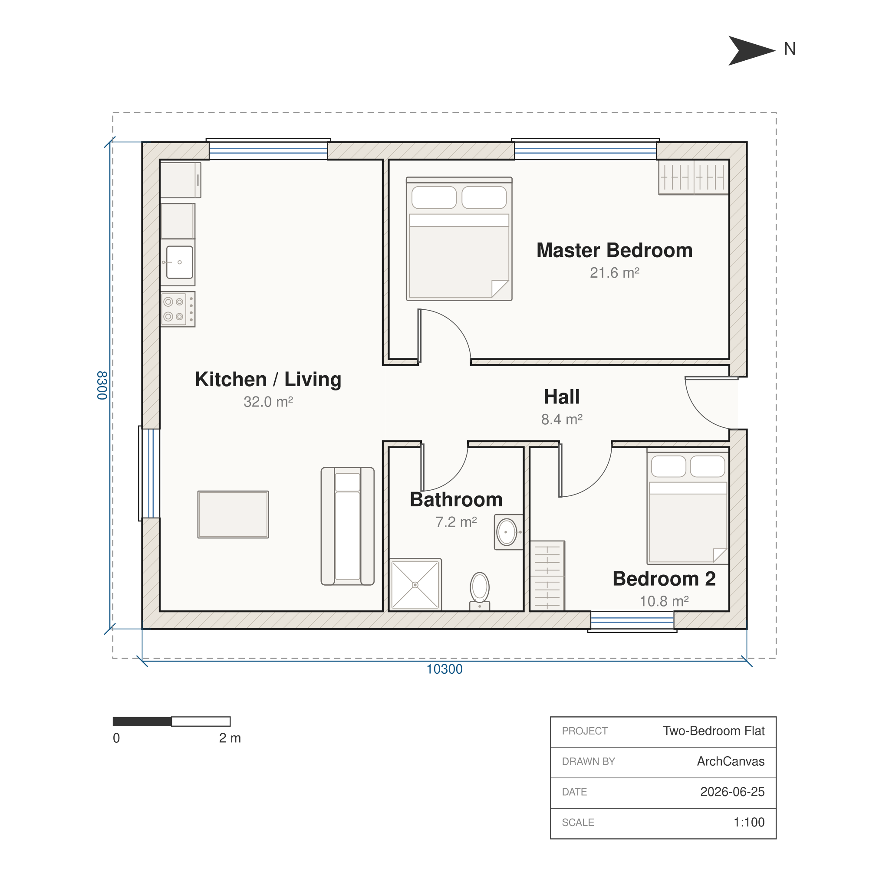
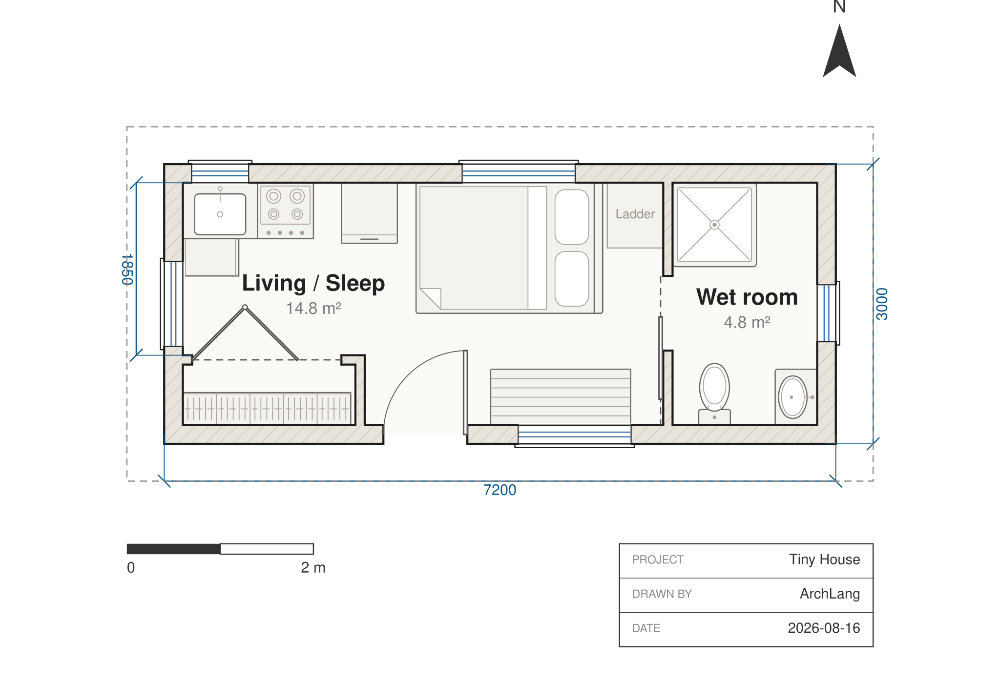
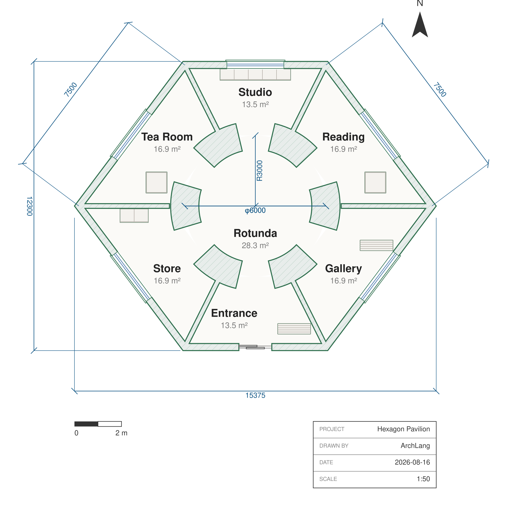

<div align="center">

<picture>
  <source media="(prefers-color-scheme: dark)" srcset="./brand/archlang-wordmark.svg" />
  
</picture>

# Floor plans as code.

ArchLang is an open-source (MIT) DSL for floor plans that compiles `.arch` source to SVG/DXF/PDF with linting and geometric validation — diffable, reproducible, and LLM-writable.

<a href="https://playground.archlang.uk"></a> <a href="https://archlang.uk"></a> <a href="https://archlang.uk/gallery"></a> <a href="https://www.npmjs.com/package/@chanmeng666/archlang"></a>

</div>

<a href="https://playground.archlang.uk"></a>

<!-- doors:start -->
## Try it

Just looking? [Open the playground](https://playground.archlang.uk) — no install.

**Your coding agent:** paste this prompt.

```text
1. Run: npx -y skills add ChanMeng666/archlang --yes
2. Run: npx -y @chanmeng666/archlang spec   (read it before writing anything)
3. Write my floor plan as plan.arch from this brief: <describe rooms, areas, adjacencies>
4. Run: npx -y @chanmeng666/archlang compile plan.arch -o plan.svg --json
   then describe plan.arch --json, validate plan.arch --strict --json (same prefix); fix, recompile
5. Run: npx -y @chanmeng666/archlang finish plan.arch, then compile again to export.
Starting from a photo or PDF? Read https://archlang.uk/from-an-image. To change one room without moving the others, use `impact --lock` (https://archlang.uk/edit-one-room).
```

Or add the MCP server: `claude mcp add --transport http archlang https://mcp.archlang.uk/mcp` (locally, `claude mcp add archlang -- npx -y @chanmeng666/archlang-mcp`). The skills are listed on [skills.sh](https://skills.sh/ChanMeng666/archlang).

- **ChatGPT, no install:** [ArchLang app in ChatGPT](https://chatgpt.com/plugins/plugin_asdk_app_6acf8381cca08191bfb3eb7305fb6970), then ask, for example: "Draw a two-bedroom flat of about 75 m² as an ArchLang plan, and check it."
- **claude.ai, no install:** add `https://mcp.archlang.uk/mcp` as a custom connector ([the steps](https://archlang.uk/start#door-claudeai))
- **VS Code:** [Marketplace](https://marketplace.visualstudio.com/items?itemName=ChanMeng.archlang) or [Open VSX](https://open-vsx.org/extension/ChanMeng/archlang)
- **Playground, in the browser:** https://playground.archlang.uk
<!-- doors:end -->

## What you get

Each drawing is compiled from a file in [`examples/`](examples). Click a plan to open its source in the playground, then change a number and watch it redraw; click a 3D preview to open it on the 3D view.

<table>
<tr>
<td align="center" width="50%"><a href="https://playground.archlang.uk/#z=jVZLbhtHEN3PKR7IjQ1QdIsS9UlsA05iIIAFJ3BsGFlpiuwip6NhN9Hd1FAxBHiVAwQ5Qw6QI-QoPklQ3TP8SLYcroY9Va_eq990Hy_gLB9MWHvnFqjJckM3mLoYac749PEvHJ9j8e8_iBVFeCYdQEGcsPRu7mkxLPpFH69drIydo2LPMAFLF0w0zrLG5AYVWT3Ey2v2N3BLtmIpRsaKQXQg-JWFNiGSnTKodnYOKvqwtGCNhuoaj0pn8VQen4Mini5deF4-HoAT7Mys48ozPAdXX3MAzcnYEAVapDkPSjhFH49KY_FUjp-D7LRyHp8-_l0OUHZOKaCcPR6ArEasGBOK1ZMuU0syXiTUZDTcKmJyU_RRhujNshyiDCYyPiBEzxxhnY8VbsskJyS02DjMaEq6_b-sySKuvJXkfpOOtHO-6ItVayPlGaSneU0h7LyZk9dsh0VC6V20ZfzRrQL38KEAVtbEgMWiAObeaIwVdn59LMnHVLAA8oxDpRArM70aIEh1ylm9ClW5yXJNVgtRkGRprAq0GlfLAtBmEUArqWtdF8Bnk1EUyGk2-llzKdIA8DqyN84jR7ccAkZK4QMeqYF6jEenY5Uebve8mUJ82Lvzyw8nY3UPI6fwYQbZ78sYDX-NRybxee9KnrAtxY73YfY-HrUq0sPnMKRJ_wfGaEfIqIUpkCfF6Gf-sjbXLFOWCQfzO0Mc1xITNU24Ru_CXMsgP8ErE6cV2x5WgQPqfHyVD6X8MhTQrrEJsRMxpyUUGqNjhaMjIVdIL245JC0p9Ggn6ncUq54YpmBic9eNNVrGasctD27LsR3jAlm3TJo468uZdzZCOrvtSYoYSeYyz3OlIHuOYZk8QiQfEZq0z2x0yInbQ2z7KtRGi1lCbs8E-3SDfXimVDJj1DyLeyBJU0srtQlFjE82rmcbWuK5T2jCupAJL7NnKVurofqKddonn_74M7NJk17m-N7Mq1gisEx52k5kuc4llL_B1SZv5QQ94do16cVvtJh826EIlxKNW9UaZBYwMdFWCotF3qrSF-X7y59_-v7Vy7eXb969Lof7sttudtMrjvvqz_fE79BOe8VY7Zrs0M6k5Pp4m-uRUnfstjWRknR26gG78dl4g3dyz67dSRRxON7EFbMCmK28NWmRzrzRc27X8N7Xp2XuZrPAEUdSbGO3DbaFCNFddwgPQYjmL0C0s3oZjL16CGKkvggxdSsb2X-VhdRgD6KPtxXDr9KNgCzevf7h5ZuLF78OoD01FhOeOc-5Cw3nDx5FGT2rJdMmSuPmrpyR9FUCjTSpWb48uDbBTOobsY1uCU-xYi8gFlWeSRPTTSdfBfKFRPBkQwxQm6tMM90z8i2H68DpqjOAlWMQps55bSxFHu7lRYTtCO7uGxMXo1scpHE1tktMXnZnSq2PjlNDbXGynh2gKUu-WWenwyOl1ufbdfdWzHv7fSLp-QqV9JlvCY3GLaFzpdap8h34L25G-9jtfurqnrbOMI1jS2_cYWzX8T6CdxPu2CW0ll10y0xNfnv0unzJ3lyf7NB7T14L3B35lWvYtwFkr-wEyEw3ATaqz-8UoZnijkyK1TAnsGvw0y5tx0qtT-8ATCgYi_sk2hpkHjskTpRaH4_Tzogm1nKLWnr3G0_jvVtempbLyQ16L_y0uiA770FTZPRGanRyoM4ODk96uC1ui_8A"></a><br><sub>Laneway house</sub></td>
<td align="center" width="50%"><a href="https://playground.archlang.uk/#z=jVZLbhtHEN3PKR7IjQ1QdIsS9UlsA05iIIAFJ3BsGFlpiuwip6NhN9Hd1FAxBHiVAwQ5Qw6QI-QoPklQ3TP8SLYcroY9Va_eq990Hy_gLB9MWHvnFqjJckM3mLoYac749PEvHJ9j8e8_iBVFeCYdQEGcsPRu7mkxLPpFH69drIydo2LPMAFLF0w0zrLG5AYVWT3Ey2v2N3BLtmIpRsaKQXQg-JWFNiGSnTKodnYOKvqwtGCNhuoaj0pn8VQen4Mini5deF4-HoAT7Mys48ozPAdXX3MAzcnYEAVapDkPSjhFH49KY_FUjp-D7LRyHp8-_l0OUHZOKaCcPR6ArEasGBOK1ZMuU0syXiTUZDTcKmJyU_RRhujNshyiDCYyPiBEzxxhnY8VbsskJyS02DjMaEq6_b-sySKuvJXkfpOOtHO-6ItVayPlGaSneU0h7LyZk9dsh0VC6V20ZfzRrQL38KEAVtbEgMWiAObeaIwVdn59LMnHVLAA8oxDpRArM70aIEh1ylm9ClW5yXJNVgtRkGRprAq0GlfLAtBmEUArqWtdF8Bnk1EUyGk2-llzKdIA8DqyN84jR7ccAkZK4QMeqYF6jEenY5Uebve8mUJ82Lvzyw8nY3UPI6fwYQbZ78sYDX-NRybxee9KnrAtxY73YfY-HrUq0sPnMKRJ_wfGaEfIqIUpkCfF6Gf-sjbXLFOWCQfzO0Mc1xITNU24Ru_CXMsgP8ErE6cV2x5WgQPqfHyVD6X8MhTQrrEJsRMxpyUUGqNjhaMjIVdIL245JC0p9Ggn6ncUq54YpmBic9eNNVrGasctD27LsR3jAlm3TJo468uZdzZCOrvtSYoYSeYyz3OlIHuOYZk8QiQfEZq0z2x0yInbQ2z7KtRGi1lCbs8E-3SDfXimVDJj1DyLeyBJU0srtQlFjE82rmcbWuK5T2jCupAJL7NnKVurofqKddonn_74M7NJk17m-N7Mq1gisEx52k5kuc4llL_B1SZv5QQ94do16cVvtJh826EIlxKNW9UaZBYwMdFWCotF3qrSF-X7y59_-v7Vy7eXb969Lof7sttudtMrjvvqz_fE79BOe8VY7Zrs0M6k5Pp4m-uRUnfstjWRknR26gG78dl4g3dyz67dSRRxON7EFbMCmK28NWmRzrzRc27X8N7Xp2XuZrPAEUdSbGO3DbaFCNFddwgPQYjmL0C0s3oZjL16CGKkvggxdSsb2X-VhdRgD6KPtxXDr9KNgCzevf7h5ZuLF78OoD01FhOeOc-5Cw3nDx5FGT2rJdMmSuPmrpyR9FUCjTSpWb48uDbBTOobsY1uCU-xYi8gFlWeSRPTTSdfBfKFRPBkQwxQm6tMM90z8i2H68DpqjOAlWMQps55bSxFHu7lRYTtCO7uGxMXo1scpHE1tktMXnZnSq2PjlNDbXGynh2gKUu-WWenwyOl1ufbdfdWzHv7fSLp-QqV9JlvCY3GLaFzpdap8h34L25G-9jtfurqnrbOMI1jS2_cYWzX8T6CdxPu2CW0ll10y0xNfnv0unzJ3lyf7NB7T14L3B35lWvYtwFkr-wEyEw3ATaqz-8UoZnijkyK1TAnsGvw0y5tx0qtT-8ATCgYi_sk2hpkHjskTpRaH4_Tzogm1nKLWnr3G0_jvVtempbLyQ16L_y0uiA770FTZPRGanRyoM4ODk96uC1ui_8A&3d"></a><br><sub>Laneway house, 3D preview</sub></td>
</tr>
<tr>
<td align="center" width="50%"><a href="https://playground.archlang.uk/#z=jVfbjttGEn3XVxxoHkaCNWNKo4s9hhdw7AkSrIEF7GTzaLfIotg7zW6iuzXSbGBgn_YL8i_7nk_JlwRVTUqUxot4XoYi-xxWV506XbzAG-SublQeEeK20A6qUT7WZCP--M9viBUhV9ZZnSuDNz6v3iu7Ae1V3Ri6HlwMLuSujpTHrVfGPCK4rS0walQIFPBZ-byC0TZ-Ht-CHsg_wjtXwzVkA1xZQiEnG70yqJQxk8EFgpM3r1WsoAMsw-BJ5RUViJV3202VVlDBZK9OlpdbDoNsblygAsoWgwuUOkYqsNOxYiaDUu_j1lN4xQtgHQrnPAypEmFH1AQ4Gx3KrbeaF17jI5nyKnc2Km2JOUfWQdeN8zGMOWYdJZvaUEDpXQ2FoO3GEErN2WqMshh-TImefvdhiF8HwNbqGFDXA2DjdYFFNgBCrgxheis_rPOxwrYZDIAL3O0jee08QkXG4Bm4YjpqZ8M1fqoI-9fzLMtQ6AddcN62Nkh-vv_5_XtUpDdV7GdYSHXAThlDhVREgufnRj9ou0FoVE4pyV7guTPb2iI0hmPXnKi2FHguVcRz4b4eQHhBXdCIlc7vLYWAWZbhV4yySTbGaJVlvYtllvF1dyGVxJeO7LDhHtk0kc07mvmR5ptxN-mtq-P1N0Pn8yM0XX_haklGdPHaf2ozqWK74fQX9L8JTLDnUGHUmgyG79Pa5_i7jnlFdogtt1JLcZ9unrCvqWA6Zu8y0LHzRvY3PfbvUqGGOP4JfVvAE14pZY83ZeXIO50feX9QxvRJW1qmOI2V27THmdLV41z2YlWx-gqnyDY1AxuHzSlp8OuSlU0Ybe8Dd2i7rJMrN3_XCddC2Wb_j__-lpA6sEMpthL2LH42yrXPt0aJICxREU4MZPyq_woh5dfIxtnEsKEIlWxIQNxzXaQchNwEOF_Fp1pp2-br5ijqnS5ixRLMzhus0nZDMFRGIOw4XM1i6WLXxWvXV2Oq6-rI-TLLzkV_HlJPbsv5QRYJ_uIpvA0pWUcKyW3jE9KeLpYHXfwVaX-fTMoNq23hdm2rzSQ0oEvY4jxhpwBpYF50yPDsGwCL2RGwOoR6AIgC2l5mO4Yyzm6k4snaefktnxX3-P1_CNE9EF_kbmsjeb4svS42hFHh1c5CBYTHeu1MGLNcDmdU5w2fhKpVzGS24AxIg71ITnOC6d6CrqTTl4sWJJjlVzApRPQws-yvMO0WjpjZ6ilmkQ36Tfjs0KcHngnuqYnIDSluHMmi6Eg0EE7zEVypUh4W2WR-czAaVsVehN4azUdXquEJVDQuYrxJCm-hLI797NRPhylodqsUbDtb_L9YLwN44nlEw5ofnW2BdSx-JqSdL4xvESq3Iw9t5WapPHLnLfkJ1ipoC7VR2oYoTw99MsEvb-ESJLhte96LQC2H1b18chpmYgwOq0WGupa5yhP7LE8HNnbrGmWTbfLk8ctbhKhswWNfiuVzGhqcqy9Dej2o2NAkjUsB3sXkoqPpi0xGzlyHSN62Pi3UCcchjzmOd3cffvzn3TvxVOZYq_wega9kmyrK0kueSyx5lConeBUr4s0qe6CVUnnKo-IZ7TLIGEreaEvHIDn8WZbVdRq3LuVAK6-OU8BhPrWqpuJMfqlg4pPiE8fj82UnQD4cenW7wzN8lA0EjFJ5x6e6lMIIJ9vOZD4_6aD5InFKUtqzrjo38yPbLk_t2EaQTufrtYuRR_SyDBTF0bpBZb_K2g59p2uygUsXomfZ3qaEigsGqLV7oAncA_nOC20MUJ6_DtKc6qkkTzZP1RjtdOSEjtE4zUuDjp1u11ttCm03lwH_-Pmnuw9S04DR_vXVNMuer6ZZNsFj-rHksawUm744r964q6iEI8FztQOr1kfOKT-U3hDVsMI8qYI7cqd8MRHSVO7G3bNDSZ4Pw0cXqCh5V2lDqe8aZfkl2hjUpILY7lFsbaf37sipzL5_0_5ftf_l8JcRQdft2c27Hl_9bdRecTnbws0WGSLtI4a8cNihVn3UkeIp6qaPyibLFpIm9LN38bmaUKuTd027iYWB08No-gS1FNQAiDoakg8joPHuX5THwzfTm-7jdCiP5TD8tH7EkL9B3yr7oEL7REXCcJbNllfZ8mq24rtfBl8GfwI"></a><br><sub>Studio flat</sub></td>
<td align="center" width="50%"><a href="https://playground.archlang.uk/#z=jVfbjttGEn3XVxxoHkaCNWNKo4s9hhdw7AkSrIEF7GTzaLfIotg7zW6iuzXSbGBgn_YL8i_7nk_JlwRVTUqUxot4XoYi-xxWV506XbzAG-SublQeEeK20A6qUT7WZCP--M9viBUhV9ZZnSuDNz6v3iu7Ae1V3Ri6HlwMLuSujpTHrVfGPCK4rS0walQIFPBZ-byC0TZ-Ht-CHsg_wjtXwzVkA1xZQiEnG70yqJQxk8EFgpM3r1WsoAMsw-BJ5RUViJV3202VVlDBZK9OlpdbDoNsblygAsoWgwuUOkYqsNOxYiaDUu_j1lN4xQtgHQrnPAypEmFH1AQ4Gx3KrbeaF17jI5nyKnc2Km2JOUfWQdeN8zGMOWYdJZvaUEDpXQ2FoO3GEErN2WqMshh-TImefvdhiF8HwNbqGFDXA2DjdYFFNgBCrgxheis_rPOxwrYZDIAL3O0jee08QkXG4Bm4YjpqZ8M1fqoI-9fzLMtQ6AddcN62Nkh-vv_5_XtUpDdV7GdYSHXAThlDhVREgufnRj9ou0FoVE4pyV7guTPb2iI0hmPXnKi2FHguVcRz4b4eQHhBXdCIlc7vLYWAWZbhV4yySTbGaJVlvYtllvF1dyGVxJeO7LDhHtk0kc07mvmR5ptxN-mtq-P1N0Pn8yM0XX_haklGdPHaf2ozqWK74fQX9L8JTLDnUGHUmgyG79Pa5_i7jnlFdogtt1JLcZ9unrCvqWA6Zu8y0LHzRvY3PfbvUqGGOP4JfVvAE14pZY83ZeXIO50feX9QxvRJW1qmOI2V27THmdLV41z2YlWx-gqnyDY1AxuHzSlp8OuSlU0Ybe8Dd2i7rJMrN3_XCddC2Wb_j__-lpA6sEMpthL2LH42yrXPt0aJICxREU4MZPyq_woh5dfIxtnEsKEIlWxIQNxzXaQchNwEOF_Fp1pp2-br5ijqnS5ixRLMzhus0nZDMFRGIOw4XM1i6WLXxWvXV2Oq6-rI-TLLzkV_HlJPbsv5QRYJ_uIpvA0pWUcKyW3jE9KeLpYHXfwVaX-fTMoNq23hdm2rzSQ0oEvY4jxhpwBpYF50yPDsGwCL2RGwOoR6AIgC2l5mO4Yyzm6k4snaefktnxX3-P1_CNE9EF_kbmsjeb4svS42hFHh1c5CBYTHeu1MGLNcDmdU5w2fhKpVzGS24AxIg71ITnOC6d6CrqTTl4sWJJjlVzApRPQws-yvMO0WjpjZ6ilmkQ36Tfjs0KcHngnuqYnIDSluHMmi6Eg0EE7zEVypUh4W2WR-czAaVsVehN4azUdXquEJVDQuYrxJCm-hLI797NRPhylodqsUbDtb_L9YLwN44nlEw5ofnW2BdSx-JqSdL4xvESq3Iw9t5WapPHLnLfkJ1ipoC7VR2oYoTw99MsEvb-ESJLhte96LQC2H1b18chpmYgwOq0WGupa5yhP7LE8HNnbrGmWTbfLk8ctbhKhswWNfiuVzGhqcqy9Dej2o2NAkjUsB3sXkoqPpi0xGzlyHSN62Pi3UCcchjzmOd3cffvzn3TvxVOZYq_wega9kmyrK0kueSyx5lConeBUr4s0qe6CVUnnKo-IZ7TLIGEreaEvHIDn8WZbVdRq3LuVAK6-OU8BhPrWqpuJMfqlg4pPiE8fj82UnQD4cenW7wzN8lA0EjFJ5x6e6lMIIJ9vOZD4_6aD5InFKUtqzrjo38yPbLk_t2EaQTufrtYuRR_SyDBTF0bpBZb_K2g59p2uygUsXomfZ3qaEigsGqLV7oAncA_nOC20MUJ6_DtKc6qkkTzZP1RjtdOSEjtE4zUuDjp1u11ttCm03lwH_-Pmnuw9S04DR_vXVNMuer6ZZNsFj-rHksawUm744r964q6iEI8FztQOr1kfOKT-U3hDVsMI8qYI7cqd8MRHSVO7G3bNDSZ4Pw0cXqCh5V2lDqe8aZfkl2hjUpILY7lFsbaf37sipzL5_0_5ftf_l8JcRQdft2c27Hl_9bdRecTnbws0WGSLtI4a8cNihVn3UkeIp6qaPyibLFpIm9LN38bmaUKuTd027iYWB08No-gS1FNQAiDoakg8joPHuX5THwzfTm-7jdCiP5TD8tH7EkL9B3yr7oEL7REXCcJbNllfZ8mq24rtfBl8GfwI&3d"></a><br><sub>Studio flat, 3D preview</sub></td>
</tr>
</table>

Same source, plan and 3D preview. The 3D preview is extruded from the same .arch file by the separate archlang-3d package, and checked against the plan: every 3D element comes from the plan's elements, and every solid is closed. [What the 3D preview shows →](https://archlang.uk/3d) · [Try it in 3D →](https://playground.archlang.uk/#z=jVZLbhtHEN3PKR7IjQ1QdIsS9UlsA05iIIAFJ3BsGFlpiuwip6NhN9Hd1FAxBHiVAwQ5Qw6QI-QoPklQ3TP8SLYcroY9Va_eq990Hy_gLB9MWHvnFqjJckM3mLoYac749PEvHJ9j8e8_iBVFeCYdQEGcsPRu7mkxLPpFH69drIydo2LPMAFLF0w0zrLG5AYVWT3Ey2v2N3BLtmIpRsaKQXQg-JWFNiGSnTKodnYOKvqwtGCNhuoaj0pn8VQen4Mini5deF4-HoAT7Mys48ozPAdXX3MAzcnYEAVapDkPSjhFH49KY_FUjp-D7LRyHp8-_l0OUHZOKaCcPR6ArEasGBOK1ZMuU0syXiTUZDTcKmJyU_RRhujNshyiDCYyPiBEzxxhnY8VbsskJyS02DjMaEq6_b-sySKuvJXkfpOOtHO-6ItVayPlGaSneU0h7LyZk9dsh0VC6V20ZfzRrQL38KEAVtbEgMWiAObeaIwVdn59LMnHVLAA8oxDpRArM70aIEh1ylm9ClW5yXJNVgtRkGRprAq0GlfLAtBmEUArqWtdF8Bnk1EUyGk2-llzKdIA8DqyN84jR7ccAkZK4QMeqYF6jEenY5Uebve8mUJ82Lvzyw8nY3UPI6fwYQbZ78sYDX-NRybxee9KnrAtxY73YfY-HrUq0sPnMKRJ_wfGaEfIqIUpkCfF6Gf-sjbXLFOWCQfzO0Mc1xITNU24Ru_CXMsgP8ErE6cV2x5WgQPqfHyVD6X8MhTQrrEJsRMxpyUUGqNjhaMjIVdIL245JC0p9Ggn6ncUq54YpmBic9eNNVrGasctD27LsR3jAlm3TJo468uZdzZCOrvtSYoYSeYyz3OlIHuOYZk8QiQfEZq0z2x0yInbQ2z7KtRGi1lCbs8E-3SDfXimVDJj1DyLeyBJU0srtQlFjE82rmcbWuK5T2jCupAJL7NnKVurofqKddonn_74M7NJk17m-N7Mq1gisEx52k5kuc4llL_B1SZv5QQ94do16cVvtJh826EIlxKNW9UaZBYwMdFWCotF3qrSF-X7y59_-v7Vy7eXb969Lof7sttudtMrjvvqz_fE79BOe8VY7Zrs0M6k5Pp4m-uRUnfstjWRknR26gG78dl4g3dyz67dSRRxON7EFbMCmK28NWmRzrzRc27X8N7Xp2XuZrPAEUdSbGO3DbaFCNFddwgPQYjmL0C0s3oZjL16CGKkvggxdSsb2X-VhdRgD6KPtxXDr9KNgCzevf7h5ZuLF78OoD01FhOeOc-5Cw3nDx5FGT2rJdMmSuPmrpyR9FUCjTSpWb48uDbBTOobsY1uCU-xYi8gFlWeSRPTTSdfBfKFRPBkQwxQm6tMM90z8i2H68DpqjOAlWMQps55bSxFHu7lRYTtCO7uGxMXo1scpHE1tktMXnZnSq2PjlNDbXGynh2gKUu-WWenwyOl1ufbdfdWzHv7fSLp-QqV9JlvCY3GLaFzpdap8h34L25G-9jtfurqnrbOMI1jS2_cYWzX8T6CdxPu2CW0ll10y0xNfnv0unzJ3lyf7NB7T14L3B35lWvYtwFkr-wEyEw3ATaqz-8UoZnijkyK1TAnsGvw0y5tx0qtT-8ATCgYi_sk2hpkHjskTpRaH4_Tzogm1nKLWnr3G0_jvVtempbLyQ16L_y0uiA770FTZPRGanRyoM4ODk96uC1ui_8A&3d)

3D preview: walls, openings, floors, stairs and furniture in flat colours; no pitched roofs yet, and no sections, elevations or BIM.

More plans from `examples/`:

<table>
<tr>
<td align="center" width="33%"><a href="https://playground.archlang.uk/#z=lVfbbttGEH3XVxwoD7EBWaVoS1GcJkBStCjQFn1o3qMROSI3oXaF3aVptwjQjyjQD-qf9EuKmSV1sV23ebJFzpyd2zk7fIa3iJ27WHPpnduCduTjlm1EZ2INQsE2empQOO9N6fwEnTcxsoXYB2yMD_F69AzAbIpYc3o-0X8HJ9DW2UoebXFGh8cmgNT-_JUi5FOsOmqagI1324S0mqCrTVGjZG9uOChwqLlp4Kz8MB6ujY2xDLIlCJKCicZZOKuwAPiG_R1CTZ5LcFnxBMHBOshxKMiictiaEIytUiyXKRu3Y2tsFSZgKmrULkQusb47pAoT8dEZG3C2Kp3zWHPsmO1qgpWz-FqM3ky_lkPfrPpErxL4pvXWxNbzdPQM32qI2gU5NMBtNmpVU9MM4eprE-AlGi4Ra-_aSho1dNB5dVpTrKejXUMW4_edu3jXv_6uoTjGbyOgtSYGbLcjoPKmxCzLRkAoqGHMrtMv63ys4U1Vx9EI_enla_-hMTfGVqCIs2ySnaciI5hfGVdZlt0usyxDQ2tuMP7BxKJmi6_wo3qN0QYO-NQ_TlAn6GsuZ4CiC1p_gKIvBP1ycUD_iUJkjz6_8QmOVO4YR_zOj3BmVwec76lpTr2lhMfe82zvnV9JFEc5viPpxP3z11zmQKrfhdugx6TGVBbR7RKYRHUK1vcqH0vRn-F9PwTwrQ0wNjptcd-DsKOCE12tg05gw7S5BtlhekGFdyFRp6tdwwp7yoZIMtieYs0yQWTR8CaChKIV7aYj4D41wbeRvXEel1l2RLtZluE3PXvgAvpeCEH3w_P5kN3GOxtT7BT3Q_88gClEsC1f9Qx2Gl4a9CN6TPE2eQe6C4ra1exZqBki2VK4SVECy1L8IZKPq2sIBVTieJJeKK1b-zyg43T0uaSu4KZ8XX5Iobohpak2V6IWGPboTBlrvMwy1MZWDMvk03EInaSt_UvOA_CjVVISPAz66IATPDF_Gk9H79_wlg_wKNb_FV_-ZfHl0vDO2NJ1qYBpEKbChOSVZyo7j9ikYYyYzx87bTZ_4Cf1UGSKyBeDE9tyOOrqMZd8unYxuu2AK0Y6T--4DIlk6cqpmcogbqS0eIXVpmlDvcKWKbSew2GcujTKxlr22FDBMlB76RfhTupp7L7rtqhFx93uQvNWaBgbOCrVVDZmyyy7zWcnsjE-Qe7Il96t-XHkNLgJOgHmWXa70Ko8EV3-NIYIY559SVB7wFT544wHpb6V0OCdaBTyF31LhnvFtxbU9AtGoq3e6mfKZWOr5wGBK91qLodtQqVUW3SWTZaq7O0O0Smy3mnnExSNkNclnUmT8upYemtqNsNr1aRIn1gEM7gN9dtIpHVzr-Mbb8qK-zuTKjJ2CHkvqPt4Reak7S9k7s2BECeAIbqbAe__As4vnwDs7-YPwdhP_xdwMXsCsHCtquOXRLhYPpWyVFjv5nw5zybzq_3dvJyfTuAvbkNj_CuQ9keBlnLHLwXniA_LA9B7sRyfAJ2GVLuOfT_XKrZPzvXLLLt9eY9tXXFSoIQzSFJfltliUADh2ov7fKVgLB4G8YCpV_NE9v0dzHTD4VpnOa3aZb9mm7Q4yC75XCSPUTQuyOYwtE5INk2bzwbuhn1NtsJ8QP_5hv3QahvDRPb1YEpWMUR0J7-vsZI_YYVdG2oOae9mW-6ckYu3jYrphi1Ih8jEw26kq7IG7I2VnSbsyA5JRN8yZpnM_l9_Yil_Y53WoXVrmlJYvVfwv3__Q53khkv2mcqQ26aNede0IWmAWKkwa8Eo7oOeKvS3t1TEJn0zkDex3nI0BQg12fJi-KBaRb6NK1QcAzrvUklLs9WyhL1OXbw504B61Rr0QefgxFpNHzEbAdHEhvUrANh595GL-Mhngr4uPXX2w_oO47e-qL8he0OhfyNqPM6zfHGRLS7yuTz9PPo8-gc"></a><br><sub>Two-bedroom flat</sub></td>
<td align="center" width="33%"><a href="https://playground.archlang.uk/#z=rVrvctvGEf_Op9iRpiMpJRnor22lTkexlcZTj9SR1fH0k3AAlsSVwB17dxDFZjKTh-gz9MHyJO3u3gGgnKRpU33w0MRh7_bfb3-7x324ghfzE3iC03kGLbS6dHZW2xbBGrAGocFHbOCH7_8BoUZ4e3t7N_vju5u3H2ZXN29nb95fX91d3by5BnxS7brB-WR_sg9XELTZQm07j6A9v1l0uqm0WcKmRoeAj-i20Oqm0S0Gx8uUW3ZYgX1ENwVvQYf0stPLOkz2Yd0oA8GCr-2GH4TaIUKjzLJTS4SFdS29oQIoh6AK2wX4bKHDZ-BUqNHRMwO-Vmu85KMCVNY6KJQzAPDD9_8Eu0YD2fwCABQ0qBYir1Zm6ckotO3XV2-uwS7480Y1DWjjA6qKvtMGdBhJ1gvbVCx5o6tQw_FFlkHYWJL9iPG0vEabYEmkdmA3hg-izVJE6RbKBpUDgEN1NPvysDgC4CNWukXjtTWw7poGSQyIHN7l3c3N9Z0ccqFK9Kz1x3oLSpTmQypTgbEBFNTaLMkHBn8P96QdBnDWtuSJ4_n5ObSkBs7hKi0lE032wW-0WZJ_tYGF7Rpx3Mc3XwxPyBk6gN8gruWxNc2WzrbaqC2fu0aJGpJPx5vsiwviO8YG2hXIv41EZU4KfKAtDo9ycBg6ZzyYjvS1LsaZsWYWj7vSpqLomuxD_vHhw8d3N394uP3qw_3dn9_cX7_NoVSGLIGPaECt182WjKkD70VmWiu36uNAfB-gVC3Cwtl2TmJ9o6sYszl4NJWnNcFulKv61w48LJQDNBUc0neeRDS4CJ_zi1Ba84gmaEs2yPnwOXQe_RQcRZpqrFmOpVHIBKce0XnVQKUdlvT20RQ2tS5r4LRLydgosyKn2S7UM1Se9nMGXQrqRj-Sndnz48wpVLniBJVVdhGgUVWFThI_T8mT005v767IvLPbm_d_mcNN9F2LyncOK1aDLHPJFqT8Qg-U2GSXXr3JvliZ9lsrgw1JrpzamBS1LBUbCpp3jBgbp0NAIxoXWCqCoXG48-ukft3xC9pU2gdtlp32tSoa8eVONpDH12pNyETb8mmsNiEZjERy9PvJfo9QAnVsKQripUVP35mIbGQssRtnmnKVs4UgIcNlmGkDDkv0fhrTkx3CoRjgeP4KnsjYlJQikSzXmUrcM9mHM2hPYNGQznmjTcgBn9ZYBk_HFmmiT6maho8fWNmN7f6NWQVZbaE5jKJtyWi65azYWMqFoOmpZyEKckG7nM18OUK5KaCiGFSNmItBMALcdLLP-JcgosfV7RhWexR5mWXQtgKWCpaqaXArIMoQ9bKHqGhZthR_S6FB_817NCXAWFsX_ByuDFhXaaPclhfkKVA9FBg2iCZBKtUhcr2Hre1g42zALyCP8giDvSiLppIQ0VRJIyRrQ1n2Sf0Qd8UdWzQBXGe8KEnu7gMp6ktQPgiIgbNw1oQ-PGUnWjjZT0uNdaEGX2METy-HMl1boBtX6hCrDZesKVTo9CNWUzDIub9dY0VQd69WCBfiELuAjXWrYNfJi1oOc3xy3i9IUO8Z6hI0sWO20QgLp6slDnVpR8VYM0uCIhtqClGGHEVxW-KQTQWash5yQZAONtpUdkP7nWUZVIhrSayLLLuMBYkdshIAoG_EqHQaSewwLorspBQeerD9wto-jguyGz2gLcc1n_eRaJ7sw-EFP17wYaZUm_50df_Nw_3t7cPN1d3d7cf8aD5h_rN3T-TqGyqTe_DtBKAzOniSArAP-dLpCs6zXDQ7Js2kCPbZ2peCY2IitS5XTLco159C55BoVokV5Ium83XOYtVSUTIKJVRU0qwhgFTNYsYiDHoPh_P5_Dw7gtJKLgWcRmSgrfhkAi3eqDXL_Xdl5Zry7ub-tk-H-QQgqjGBGLTdesIvzGazWYzg3_YkZ60JJcnif7XakLLCAcsAyoMPritZsdnuHwt8cZJlxH8zQqRU2WwXYvL4L-DiJa84IQ9p45n-UIzJKQjIDULZWI8VS7RdaLRBobA-VlYPrQ4u2iMiHxtRC1dNRStXAQ6fptsjAQbeQ1wgDISYdhmgRBMc8jYMMimVKDOMhdZy6QO7WMwiwCgDuTVMRFWA362t_5LZDhlbeEz1WjTCp4BOWweDY8lG38JhNs2O4PBFlo0-nLzM6HP6wHaA78RZYwZJFIXoXh-Gc7hRLSVHKtGcLX2R1h7qjkoCm6jYUrKxUKrVypSxSJOFF9r5kOxweH7KxxvrtXmgUwwJMCh2LIrFd-IH0WSsQ8SfS0qSHmVVpJtzuKYEEyISatwCGjGDpuDTTRP51IzswEKlJiup2Epwl5NbU7yYEp3BSjz-jAH4tSKc29GNeCX8nHrZ9CRjL52wxzJR77mMB_w5GaNX4-exlTgtST3_PMn-6z-Wd2tQILYi0iTmm4JvENfcABBnsXbF346KCFV3IsmJwK50KGs0kkBebf1lZEoqPeIugTE7gp_rGkx8ZkyD-25iRDgnEJuj6rV7aJXmQiRZAgBe_x2BAuqJTAWNKrCBvfci83P4QMrs8RvH51k2pTp5BD9y-p1dKJD5nRSyvMvxi2e7fIxZtwfyx2ILFeqRuyjN_k_uut-plIlJcL6P2sSdFm8g0ryMK68ONYU4UT2pOq6kmrtCXAshuYRXPdv4W6dcQDertC93OFrPFiQ9-32YE5DP5IzV6-ohJnOAw5MXfUhLn04bDRAsakiB9sL0zacYN4ecH-ZSHUcdB0UxJXCLyrCKpFKcqkgxNmQB-kYHlmtUi36YNvRdRBpEiP1ybfJk7tgI_tZY16oGqFBdjro5liqUv29MIg8YKBx3hnFcEBNDuq7AdH8FlgvGTqtHvY8fLb3IfjMm8amVU0H602bXBWQ7NpQ1IDhNjP2crM9-oKBOFodRa90Paj6FaZ4ecCdy4MejFp6yjPrw5Cxm02R6nlBEqs5ShW7vlKjkLYGBAmst4dWSifo5zjMdacc4CRI16QvF9Cwbz4VEUduFUZoKaf21iUpoH9lv9do8xD6CIv9FlgBrFPnj0GdOk5iR12b1TFaBFY-iAhyeDsKiVie7abQjq2DCNIjaPCy5-44oenyWjUU9O9bOm_5BCD-_eXb6LJWfHWLnTRREhWSKbEqxl968eLbn4BUx4CXNuhyUKqjG8vQylhGu1yMe_BPui6m0WHgMfR73BCcmEbPbAw9vrm_u765jPok5PS65W8z6CS2zZUn1zky5yaBTEVWSwpQGWalPWTvuZUsbR1j8oFeIOwNjYyMo_AvXoQbrhqHieOhS8Rxqo8tEkoN9pH-5Z1jTpIlxge1_4KlJnhJLZcl8pIZw7wDKzgWlzVAlYl_Itftc8Mo3uiUKzEV9xRNClZrQAw-n2XnqinrF5DgkU4gZT-eGOQ2FcoFLbbycPnW0MlVky8Q52RglNuiDWOMwOeT0E9NzQB5N-zbTdUbKSYGE1H1yXYJioWeiY2urrhE3SP9PCRLDV1QmBuzLGmkdBLWUSkkAtOic0UxqIpN4oA36Xm6UlkMcSSyyhQlwhdbsyBITxr9fIuv47Dz7CVnRqb9c1snpeRaJVZY9Xfyk4NJ2hlq4_yT4tD8kwQsLPiPB2VjwCItT5__rKdOfpMnuI1Mqs7cyPOKcH0ZQ_SpqlvkWRWr9MOSJY9qYR8r0I8zdDt3bFmXC5yg4qeAVW-IUlQT8xzcpV2OODYNYptA8RsFqiVPpbYc29CxNeWLlTznBg-6SW6c1NaeIlQdsCrsRyrQbW7Xd0CSKTM9UwJQ10RC7nnGuAAAPJcRTr7Ls6VWW7UjYlDsuZzHzwoZg23Fs955-kWUDgSiU12Zgr_h8IlJsPxltMCNY2Igf9E68LvIQrNgsqIBsLYLGxFqlccyd5acZjxuNhz2ehsQ5E2P5HgdFWvgqoxlj8NHP2suZD3wczRve6Prqwz17SdA-2iKkmcU0EfFP5_-9o8URPW8NaoU8wxc9KywbRUP8nAzJlUs1G7UdOtmZeqKBdCowlz3A-21b2CYiqoxTQAfBRbqzUGbZYL_xbniIf6hSX5ydZ9OT4yw1QGfnkrS9mfoYGmVvk1qvvo_8n7P3PZplqDfa42jIKLAsmcF6xWsimWAx-lDI0OOaxtrjKyEMw3Rg6MIPR36fiovJW0eXNJHJgHOTZ6xnwiNxDn82ZFqaq_TXSr0XpH473FBzghWcxFm5yJifQcsimT9jxTrMLF8nqjgroAob-wu6451xK8diG7W1XZCkoLuG_n6H5hvW4DNPCmcU2kWTtSn7UpxJuj2xSrGb_Qqr2Mg-8-8nuB9pYGSjZ0QET_sgIWb3RGIHuaasWfKPS-s7SW7SWdh5f8rjl1n2ROWo77nj6r10yuOXu8cUkBndmh14qFUo62lEtWG-zMEwnpVdRAePLrR4W5mipiuxdzcf3r297sFmSD_Ye8877g0pvSDXwKnAdmGfejwT9ogU1ugYyWiiiMHp0svdliMaoYM07NKzpsGu3A4RueFbgET101h3sK1YIHrq7OJ8JwIuBJmht206PfxoWe7vwH9Vl8TyvuHRUk2IuXPzSXdCHlQXbH4p3b38GIEg2LfphpKetyroEv7w1ef34FFSTmxjuzAjN-38HmIO1-me6Pbu7fUdrHW58pENVtjzeq6xNGvmGibTkf4K-P311_cpLe2CS__sy3h1lBiFNBN-h6zHMtBfFif2QLXCUc9J94Gjnhha5ZbaCFWQGyK-S1POaY4qyAM-hVzGDpvaNnE8naKUZR-_JNrmh5vgxBmoVR9-qSATT75rooMW22Th2jK7HX4TQfPIaUa_ijjpZ5Sx1l8wPaClLLMn4rMvx9PrgRjsLh6WpPW7i4cIpKPJkOH_ME3LZeqfiAgF2sH4lmGY0DsZi3KLlpPpcigbFX92Q1QLq0RDKu1VW-hlJ2yEMH70a58NKiethLN2Iftcxh4kOqKWqz4Fvis6VyiJlqIzS9XYDf2opkIRsWzU35mk6lDHGemCoYBmVySUDBd0aJDvrwDWzv4Vy7BztcUPGNUeii3sXbmyfq_MMn5PSuydZCcXs-zl7PiCvv1u8t3kXw"></a><br><sub>Tiny house</sub></td>
<td align="center" width="33%"><a href="https://playground.archlang.uk/#z=pVrvcttGkv_Op-iSKmX7jmRIUbRk7TlVdETb2tNKLkk5J19OGgJNYlbDGezMQCCzlao8xD7DPlie5Kp7ZgBQkp29LD_YItDof9N_f-A-zKDAjVgZLRSshM1RQykepJJGn4CTG_BWlPizkTkTKIVWogMr9UrqFQjIpM0qJSxY4yudi2Fvv7cP8we0WzC-QAu4EetSIUid_nTfgnSwqKTysLRmDRYzL_RKoevDAjNROQRfCE9kNf0vevuwVMZYKJXQULlKKLUF6YZwU0gHRiPRauMTL9ZpdvHT54_zq3kfhM5BesCNdN6BN-AKU_f2gxRfIPjagDZ6QI9LJTWySWYNS2PXDjKzLo1DqKUvyOrKPmAOtVDqhA2GQPzbr_-E0qjtymh4uelvX_GVzkeQE0olM-nZifDbr_8gt2SeNEIlMgRhUfRBiQUqEJ6Z__6HbMhQe2tk3gdtYGEqnZOEhdmA0Nu6QMuHQJRCuxrtrt50kgpBeHiZbfrZ9hVYkcvKkdZgiVs4gj4rCGsUrrKYg3DBALWFUl797wFzFTaLDohMrh4r3Djx8-z8HOanH-Z9yK2oNTEU4G2FcP0_H749_fE9cWMv33ycw8f5j7MPlxdwdg0XlzdwNf_ww_nsqg-zi1O4-Ti7oRtE9-ny7OJmCDOwGIIhBjqYZQjaddKstw-ZsBzXS1NZIpDewQNaLzN05JEtvIX__HYAV__h_mb9y8mrbw_45IQGaa3wkhNIV-sFWnL-ysocMqF7-3TcFp1jcmeYs1OmxByWIhM5OtD4gDb5s_G10FtfSL06AYeeA9xUnnS5grdwNB2NevtgNAiYjmC9DhIpylFkBWizlqQR0QHmK6QARgcLkd3TxUNyDHmbAoRzIBNKOf6ztx8ekw7UVupVSB5SoEMoPbMBZcy9AyXvSfG1dF7c4xCuDXhKS1egUk2uJ4Ung8PBFLyVnPIgtfMo8mEsGjvOAeexdHBI-ojMGudYmdej0QhyU-s-1IXMit4-CUlRSNoHpZE50kHiBpTQOVUKTgByV8pcgJdj4tg_Go1Gr-DleEwMxuHLtPP3uEMUrk92nuBvzPQ9xVE6X7OMKlGNMUvWvg_0yAg2MD6g_80DWqFUDKqkeQyoqLMrEH0wVUBdGIWwlkrJNXqOG3JyjpbiLsRM5VO98qLEUJln4DAzOm_SQfjGcYVQS3CZUAiO4lRqJ3ME6anKIreDtgUISwGBVENTi3Dwbn7zeT6_SBX1JCRUaaT2jiMzOqHyaDsJpvOmBkut2WJ0vX1YYCHDvTV7huPS2HD-0SvBy_2gPEdovBG078OEgwWxHMK13HA9Eqq3D64099TKKg1CGc4DhL8aqV0IHgFr4Yy2W8httYalDAlCTs9zFd1JfuHbMtwrhfVQG-sLsCi4_vpaZjiEs9DNrPQeucZdXsy5gVBIkOUO1zJ1094-3Amb3XHuOnjpQ_GmDgeZMg4HQg-oxlJ3OqFaShfzUFKTLsS0EOoBOV2le9UHQxVJhEaB1OVIeKyD7CcynCKS8je7H4aLsbMKWFpEyAojMzwJPKOnNTeTGFIvHJxdXM1Oz3647lPJ89FHL1xXcHw2dh2pXWblAvPQoYRPzPoUYKbKCh43lOIoJI9REqdgfBHDhr1FwdoZHRT6ICkOKLCgmL3jtheFU_frOOGOY40zTqyxo3OsNkl1Y3Ophd3CzGbFudAraiRGP6CmfhCsENxfX7jQjolYOu4BdPI7Duk3aWCR4i4U8mDiljlXlETCwez0z7Pv5xc3NMZ0DbOC5y1fCE12UFdwhbE-NLSQwyHzljRmcD2kcPAweU0VqRTOt-fZOc3MWI2WG-FkMj3cOVRwZImp3aMToTrVnEmq8aSJQvEQR0eLjuynq5UmNhhHjJT40rNX6LxyuYZcijWS_tHiu9iMuDHGtlkWkstDW7IyQZlhStRSr0LdKo2TdEbIrI0OlggP_1Vm_ru7dM61UPfBLs7TxRZmV9_D-fziw83H1M-Ph5PJ5Bs61QlVmZVFGmLd3yphkRtePKRQNMhUkQ41VRBKKm71VNdTWfZ0_FQbF2Td7OLi8mZ2c3Z5MYxNazxknzgQlTepfdw1oanVNtxZmxxjQSqC46mUcPauJJUGIufOITmA-UPNvpkfs0JI3edrV3R61GJKtJBL56XOPM96aUQg99PNzlpg1sPE94aj1ayZnH3KzB2phlTbxEbydK4kxqIcRpzJILi2qfYhAhPfMLyTjann0innco3a8THDu5_g4-zidAhznXM7gsur0_lVUyXKKjYooFxs_FD50EPapYSOcEnd1VbadRrH-fz9DemwFlzQaa0ZfOcNhwkVfQSUlJ6JdSmk5XGsFjZvW2AqjWES9oU11arYOSN4eff59vTsL7dnF9dnp3MKVu7xifFaUK3EgShpzRALaua1KF8NYRZlXL5_fz2_gUKwqxcIC7lapcIhfZjpTkJpqVTjjDigupj6pB9p-8JRbAefihWdpt_R94XjIx_gxiMVsHeXP_LxcSuKm4Arldi2Q1-mUFgZHcthEjsQanYH-XR8HBqT85Luh0mlExLNStlvehglUtx_1sKupIawE4k2UmCBdKIuROzBEC7CqUFBB0Q1KG0KAu48bvwdp57lICESHek1Ig-beNIZUlrd4vYa50IO5k7LSg4mFzixjdpMaGZPyyVnEa-I3E5QLal8UWOhznB1eXYa9GEDu7thqhC1sa7ZLcuwdz4IqThgeAplvw1ocGonPBo7XVPMWN8kgEvoolI0r1AnSbylDzlQSBUIqURQ3R7weaRQvwxDYyrx_WYobSXEqv_CNelZa9DUomtTqRxWhjePMDqzg0qqLeQUplpswzFyvtyF_Xrvt1__ucc7Ly2rd_1O5qc5Mk4GfEIL6TDzgSdJr6m79ckftdjCAn2NqFt3cJ-NqZ04h1Boh5RQrjGeAcendDRtYsd0UfnCWLjX1GidWSP3iy7b5nxzg5ws7XxaCoXeh7KCVtLOzaiLACd5A8uMojE9-IWGbQwEe_sHy9fLQ9wLExFpWeAGHoSqkKfzsFRyOPE6wlvHklO2D6XJCuzHhs4DtdbG864MUt-7YY-xnL2PseN9irjTHvy9B1Bp8vF63YOw2k5HPYi7yfiEv4SCX5U9gCeNsNdjROSJIXR9HwaDwSDspiE7w1CUOu_g__Nhfp-Fuk9OJX5Ig1TcOjNlsvtaOkzhVIpV0794Pkkty1aauY0GvOaweQNi1ecyMRhPmst94C-DA9pII2WNRMlXBgfHROpMla4zY746mBw29_rAXwaHvIIGchIYR8U0MVFNrB_NTSFQjUPm3K6hbmcKLdFSXIpVF9gTXSSGOjdPiAr1yheOu5I2zDVGZ8sk5OAahXaw93ioCm7cG_Ygtoz8bYAfqPFYaWxYaTRhMTQdU5Dtbv7xQrv9hwvTR9_Hjx7oIAE7HNorvJz1AH7phF-qESecVsuKZiHeRvrdHZFyoLPGPRd-yVguOLR-yrh9JGN5nft7V7VWeYbpps217hbU3u889IjgsUEUznGtHvyxD_Ob0xzG81WoU3p3I0mpRTU6TtctoIAbWODWxOUhjonEtLMs8qwQNutYnF2YMxpUI2x-ZA6NOG4nqMi-W4Rnfc2uhpfjg4NpCyd1sKVfnjDS-FVGI3r28Cku9Qyj-muMjlo-O5jWUz71Vy07PGoM28HDnvJxv68PW_cIS3uG0b_gocSpm3o70UnjwB8Oym508lwh87dp6e6g5sfPpkkE8veuwgN7LenxhEgrh1T1Qs9K3FccF-lFwpfRyd34aKOOkzcJDjhUEBxoqOBHyUrSUrgrGjqiv4SFHnUFt1p0BV_7KpemY_BBa7BZLmWGu2LrVuyXUNdO-HU06Aq9QQFXxqyDWKbvWJtL_dha1xH7RYB3J1xbJXatNRY7Ut8cN1KdN1asdq118NjaZ7Dkx-HdUaMreq69FTqL0o8IzBmPjxrxNBlud4XjkxOePC1Wj8rY6HnhHwKY0Q2vjukxvNpELI31QrmT56CZOCEFEPP3EjE-RQaVlC0dFCdiMlDL3BcwPuRetUsPXfqD6Tc8Q3-Fvu7SH46Hr18fffMVerdDP40KfYV-R5-j39XH7dj75qk-rcMxBge3upUSPxOTP9aXaSps2DklcwJbZ4QJLUkdWknQxWXM1bQ4ChgPD2ENBId5tINcuiy9yEmNuR3i0irEgRpA4IBROC-2ARX4Ey3eJFrq1V2QzJJ45QkYsSeYOEy8jmAhcLxIE5QBDIog85S-AV0am-6ZU1rueHOh1p_TBkMj1u1aSA1RPJkcJkzCRSmLOgcQ3AMKl57OopY6NzXxqKWO0do-ezQdpcM-CIf9iB526MejVtbz9PUu_dHB9Kv0bpf-gOrXV-kf6X_8iH8bfA2w8m_13rDhPYF_4-VuzRp8t9OxIlQXp1UmbjsL0bbFDnaIWwuUIcBjWVktPb2e_TfG2k8d7MaBxWVCFIXOaLsPvzR4Ob_9dD77fn776fL8p4jEaAL0IsQWaAO-JJhvA3W94oE34B_0qmbgvAgYbikxQ0gvkYQGsXBGVR7hTvi7sO_RnhFADpHdM2MGr1u0gdS9SxAfzWgNUE756UDhisBPAmx3YKq0-Ekf8j3hiM2-zL8AYPTM-PZqQI4B9vmpmWZweCCUXNH-GSySJIxBmASqd2DN9A40qSzg-vzy0_w04hP0YoE4U7ovhY1vORoQzkYAnl3CE-lSWhfALNKTHiPBQ3hnfAEL1EwelmUngq1j3tv5VUyEKEXg5YySOVTaSwV3n2_f_3B1cXbzw9X8lnxx-_3l-fnZ9dnlBZc4S_YSlJ9-IcCsmU2CDfn1XMc9f2rKYSHCy2TICszuMR_CfzOiR69UCRpgvCbhTNvAmV8QLG_ZpFB2A8gTX823QEEDxy9vHdJvAwJtmtvp9NrMkfnb5W2O7h7Cuyy00A2mWE8crtb0TmjczUdw8mfkvzbTdqL-bOx98PseBcLqVj-VR0yXX5AX150oJ1RtkkML8-Z1K-e6QNq-oxBXP5VCr3oBPGOnPAZRO-hPp1MqLMzzzWi0eTMatWMq0Sa18SlHjwK6HCfHLcMvcESxR3Arc3xGx3Ca4d8wqr2ZjvrHh62O5IHN4bSx-13Hte4ZHfnIOxzfHE5Hff45w7_EkTE66RVGcKK05q-Y-WcAQb7NMPHtYgt76XVrvC48wt7B6OD1YHQ8GL_eY1zil97_AQ"></a><br><sub>Hexagon pavilion</sub></td>
</tr>
</table>

## Why text

- **Exact.** Areas and reachability are computed, not estimated; the same text gives the same drawing, byte for byte.
- **Change one line, see what moved.** Edit a number and just what depends on it moves; `impact --lock` proves the rest didn't.
- **It checks itself.** An unreachable room or an opening off its wall comes back as a message with a code and a fix your AI can apply; checks other than reachability and area are advisory. [The checks →](https://archlang.uk/analysis) · [Error codes →](https://archlang.uk/errors)

**What writing it as a language gives you.** Rooms, walls, doors and windows have names, so the compiler can measure each room and check how the rooms connect; some mistakes come back as a message with a code that points at the exact place in the text, often with a fix (other checks are advisory); the same text gives the same bytes every time, and `impact` shows which parts of the drawing a change moved. [More →](https://archlang.uk/#what-a-language-gives)

Limits: plan drawings in the core; no BIM or IFC, not permit drawings; it does not read images; clearances are advisory. The 3D preview's limits, as the line under the plan pairs above says: "3D preview: walls, openings, floors, stairs and furniture in flat colours; no pitched roofs yet, and no sections, elevations or BIM."

Starting from a photo? [archlang.uk/from-an-image](https://archlang.uk/from-an-image) · Change one room? [archlang.uk/edit-one-room](https://archlang.uk/edit-one-room)

## For your agent

This page is all a person needs. Everything else is written for agents: clone the repo and point yours at [`AGENTS.md`](AGENTS.md), or give it the whole language in one call:

```bash
npx -y @chanmeng666/archlang context
```

MCP clients: [archlang.uk/mcp](https://archlang.uk/mcp) · Agents: [archlang.uk/agents](https://archlang.uk/agents) · [Full overview](docs/overview.md) · [Language reference](docs/language-reference.md)

Local MCP server: [Install in VS Code](https://vscode.dev/redirect?url=vscode%3Amcp%2Finstall%3F%257B%2522name%2522%253A%2522archlang%2522%252C%2522type%2522%253A%2522stdio%2522%252C%2522command%2522%253A%2522npx%2522%252C%2522args%2522%253A%255B%2522-y%2522%252C%2522%2540chanmeng666%252Farchlang-mcp%2522%255D%257D) · [Install in VS Code Insiders](https://vscode.dev/redirect?url=vscode-insiders%3Amcp%2Finstall%3F%257B%2522name%2522%253A%2522archlang%2522%252C%2522type%2522%253A%2522stdio%2522%252C%2522command%2522%253A%2522npx%2522%252C%2522args%2522%253A%255B%2522-y%2522%252C%2522%2540chanmeng666%252Farchlang-mcp%2522%255D%257D). Hosted MCP server: [Install in VS Code](https://vscode.dev/redirect?url=vscode%3Amcp%2Finstall%3F%257B%2522name%2522%253A%2522archlang%2522%252C%2522type%2522%253A%2522http%2522%252C%2522url%2522%253A%2522https%253A%252F%252Fmcp.archlang.uk%252Fmcp%2522%257D) · [Install in VS Code Insiders](https://vscode.dev/redirect?url=vscode-insiders%3Amcp%2Finstall%3F%257B%2522name%2522%253A%2522archlang%2522%252C%2522type%2522%253A%2522http%2522%252C%2522url%2522%253A%2522https%253A%252F%252Fmcp.archlang.uk%252Fmcp%2522%257D). Install in Cursor: [the links on archlang.uk/mcp](https://archlang.uk/mcp#install-the-floor-plan-mcp-server).

https://github.com/user-attachments/assets/a60f3174-6a8c-4a42-b24a-fac030d39627

[What's new →](https://archlang.uk/whats-new)

<sub>[Release notes](https://github.com/ChanMeng666/archlang/blob/main/CHANGELOG.md) (installed: `node_modules/@chanmeng666/archlang/CHANGELOG.md`) · [Contributing](CONTRIBUTING.md) · [MIT](LICENSE)</sub>

<sub>ArchCanvas is a hosted app built on ArchLang. Maintained by [Chan Meng](https://github.com/ChanMeng666), a single maintainer; written with AI coding agents and checked in CI. [Governance](GOVERNANCE.md).</sub>
