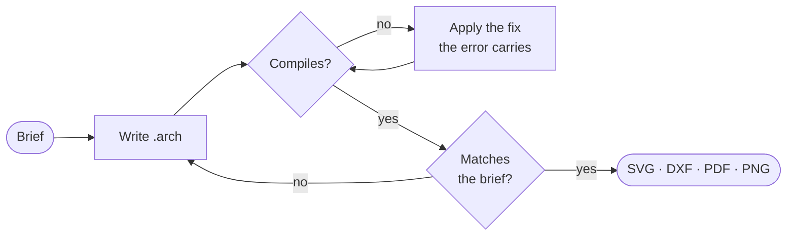

<div align="center">

<picture>
  <source media="(prefers-color-scheme: dark)" srcset="./brand/archlang-wordmark.svg" />
  
</picture>

### Floor plans as code.

Write a floor plan as text. Get a precise, dimensioned drawing back.

<a href="https://playground.archlang.uk"></a> <a href="https://archlang.uk"></a> <a href="https://archlang.uk/gallery"></a> <a href="https://www.npmjs.com/package/@chanmeng666/archlang"></a>

</div>

<br>

## Send this to your agent
Paste this into any coding agent. The skills are listed on skills.sh: https://skills.sh/ChanMeng666/archlang
```text
1. Run: npx -y skills add ChanMeng666/archlang --yes
2. Run: npx -y @chanmeng666/archlang spec   (read it before writing anything)
3. Write my floor plan as plan.arch from this brief: <describe rooms, areas, adjacencies>
4. Run: npx -y @chanmeng666/archlang compile plan.arch -o plan.svg --json
   then describe plan.arch --json, validate plan.arch --strict --json (same prefix); fix, recompile
5. Run: npx -y @chanmeng666/archlang finish plan.arch, then compile again to export.
```
For MCP clients: `claude mcp add archlang -- npx -y @chanmeng666/archlang-mcp`.

<a href="https://playground.archlang.uk"></a>

<br>


https://github.com/user-attachments/assets/a60f3174-6a8c-4a42-b24a-fac030d39627


## Try it

```bash
npx skills add ChanMeng666/archlang
```

Then ask your coding agent:

> *Design a one-bedroom flat of about 54 m², with the front door on the north wall.*

It writes the plan, compiles it and checks it. This one is 57 lines of text:

<div align="center">
<a href="https://playground.archlang.uk/#z=jVZLbhtHEN3PKR7IjQ1QdIsS9UlsA05iIIAFJ3BsGFlpiuwip6NhN9Hd1FAxBHiVAwQ5Qw6QI-QoPklQ3TP8SLYcroY9Va_eq990Hy_gLB9MWHvnFqjJckM3mLoYac749PEvHJ9j8e8_iBVFeCYdQEGcsPRu7mkxLPpFH69drIydo2LPMAFLF0w0zrLG5AYVWT3Ey2v2N3BLtmIpRsaKQXQg-JWFNiGSnTKodnYOKvqwtGCNhuoaj0pn8VQen4Mini5deF4-HoAT7Mys48ozPAdXX3MAzcnYEAVapDkPSjhFH49KY_FUjp-D7LRyHp8-_l0OUHZOKaCcPR6ArEasGBOK1ZMuU0syXiTUZDTcKmJyU_RRhujNshyiDCYyPiBEzxxhnY8VbsskJyS02DjMaEq6_b-sySKuvJXkfpOOtHO-6ItVayPlGaSneU0h7LyZk9dsh0VC6V20ZfzRrQL38KEAVtbEgMWiAObeaIwVdn59LMnHVLAA8oxDpRArM70aIEh1ylm9ClW5yXJNVgtRkGRprAq0GlfLAtBmEUArqWtdF8Bnk1EUyGk2-llzKdIA8DqyN84jR7ccAkZK4QMeqYF6jEenY5Uebve8mUJ82Lvzyw8nY3UPI6fwYQbZ78sYDX-NRybxee9KnrAtxY73YfY-HrUq0sPnMKRJ_wfGaEfIqIUpkCfF6Gf-sjbXLFOWCQfzO0Mc1xITNU24Ru_CXMsgP8ErE6cV2x5WgQPqfHyVD6X8MhTQrrEJsRMxpyUUGqNjhaMjIVdIL245JC0p9Ggn6ncUq54YpmBic9eNNVrGasctD27LsR3jAlm3TJo468uZdzZCOrvtSYoYSeYyz3OlIHuOYZk8QiQfEZq0z2x0yInbQ2z7KtRGi1lCbs8E-3SDfXimVDJj1DyLeyBJU0srtQlFjE82rmcbWuK5T2jCupAJL7NnKVurofqKddonn_74M7NJk17m-N7Mq1gisEx52k5kuc4llL_B1SZv5QQ94do16cVvtJh826EIlxKNW9UaZBYwMdFWCotF3qrSF-X7y59_-v7Vy7eXb969Lof7sttudtMrjvvqz_fE79BOe8VY7Zrs0M6k5Pp4m-uRUnfstjWRknR26gG78dl4g3dyz67dSRRxON7EFbMCmK28NWmRzrzRc27X8N7Xp2XuZrPAEUdSbGO3DbaFCNFddwgPQYjmL0C0s3oZjL16CGKkvggxdSsb2X-VhdRgD6KPtxXDr9KNgCzevf7h5ZuLF78OoD01FhOeOc-5Cw3nDx5FGT2rJdMmSuPmrpyR9FUCjTSpWb48uDbBTOobsY1uCU-xYi8gFlWeSRPTTSdfBfKFRPBkQwxQm6tMM90z8i2H68DpqjOAlWMQps55bSxFHu7lRYTtCO7uGxMXo1scpHE1tktMXnZnSq2PjlNDbXGynh2gKUu-WWenwyOl1ufbdfdWzHv7fSLp-QqV9JlvCY3GLaFzpdap8h34L25G-9jtfurqnrbOMI1jS2_cYWzX8T6CdxPu2CW0ll10y0xNfnv0unzJ3lyf7NB7T14L3B35lWvYtwFkr-wEyEw3ATaqz-8UoZnijkyK1TAnsGvw0y5tx0qtT-8ATCgYi_sk2hpkHjskTpRaH4_Tzogm1nKLWnr3G0_jvVtempbLyQ16L_y0uiA770FTZPRGanRyoM4ODk96uC1ui_8A"></a>

<sub>Click the drawing to open this exact plan in the playground. Change a number and it redraws.</sub>
</div>

## Why text

- **Change one number, and one thing moves.** Nothing else is redrawn.
- **The same source gives the same drawing**, byte for byte.
- **An agent can check its own plan** without ever looking at an image.



## For your agent

This page is all a person needs. Everything else is written for agents: clone the repo and point yours at [`AGENTS.md`](AGENTS.md), or give it the whole language in one call:

```bash
npx -y @chanmeng666/archlang context
```

<sub>[Full overview](docs/overview.md) · [Language reference](docs/language-reference.md) · [Release notes](https://github.com/ChanMeng666/archlang/blob/main/CHANGELOG.md) (installed: `node_modules/@chanmeng666/archlang/CHANGELOG.md`) · [Contributing](CONTRIBUTING.md) · [MIT](LICENSE)</sub>

<sub>ArchLang is the engine behind [ArchCanvas](https://github.com/archcanvas/archcanvas). Built by [Chan Meng](https://github.com/ChanMeng666).</sub>
