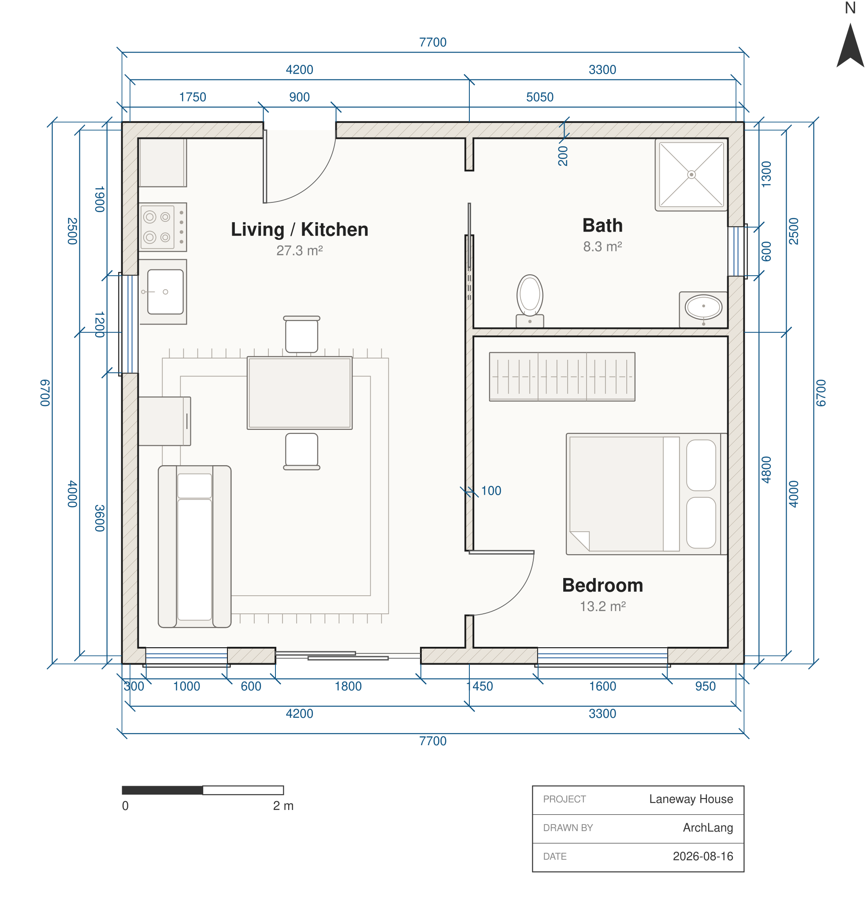
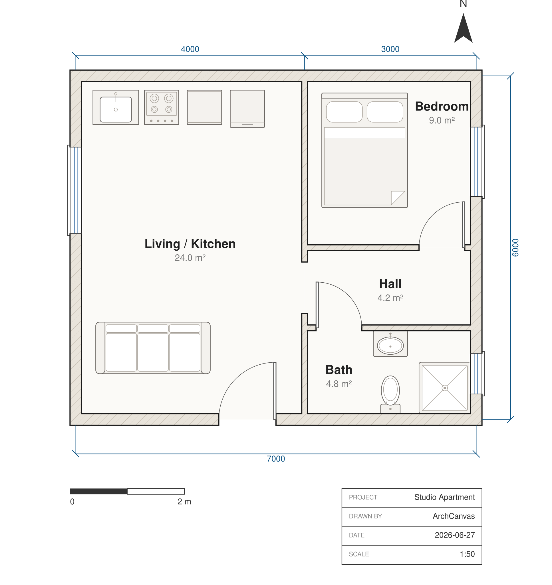
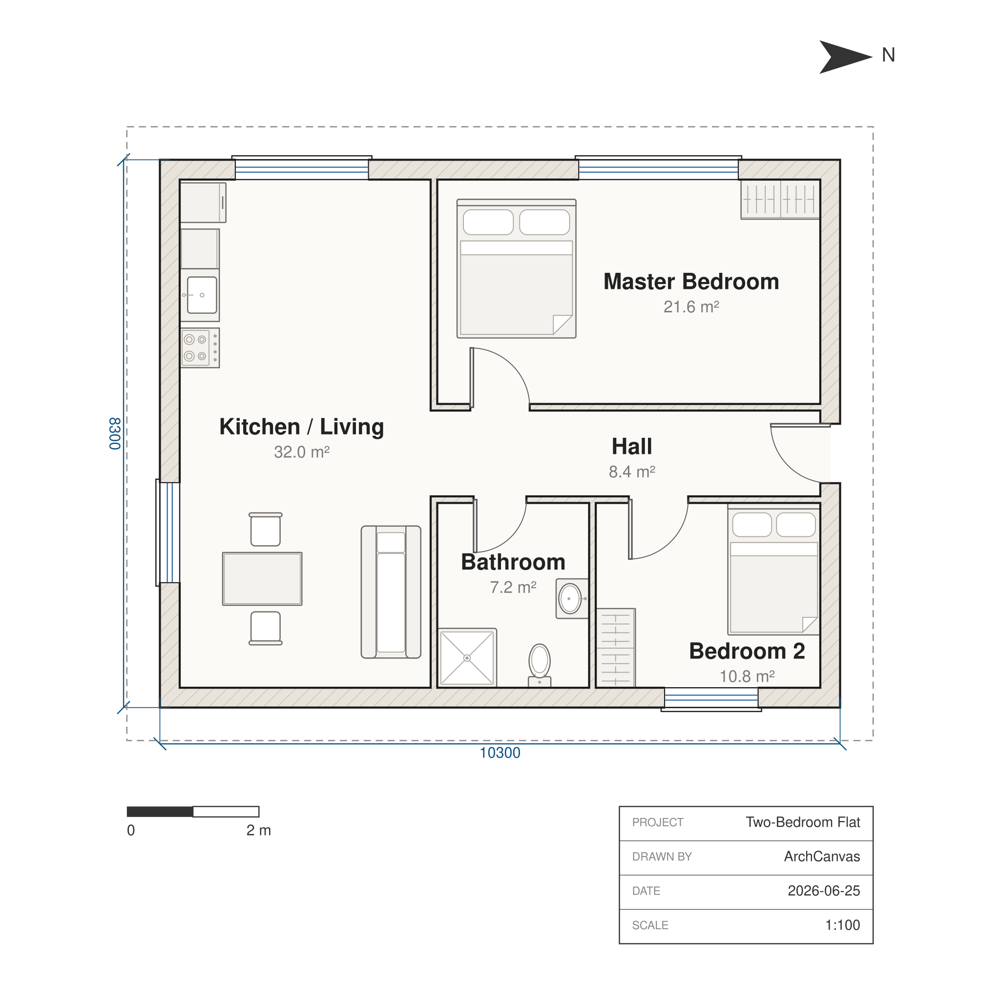
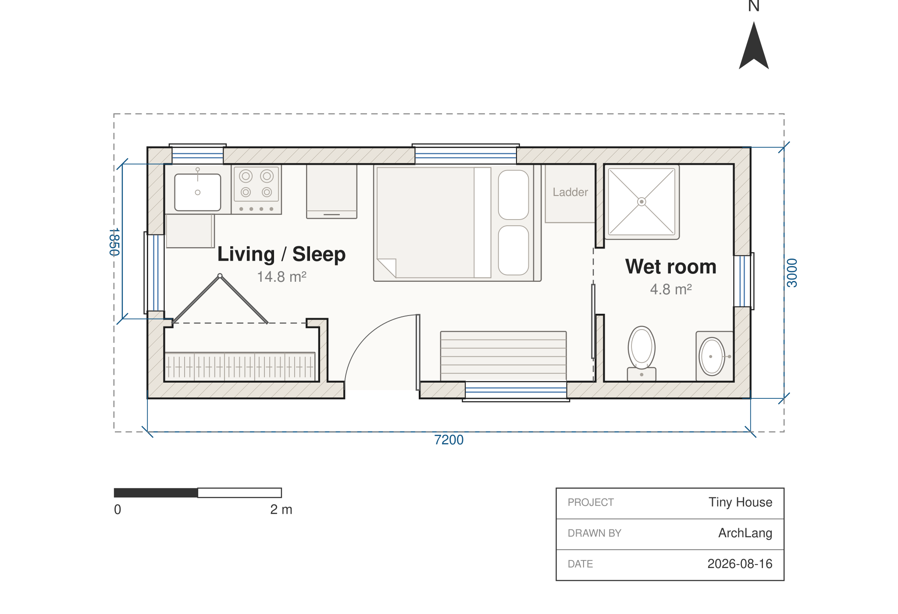
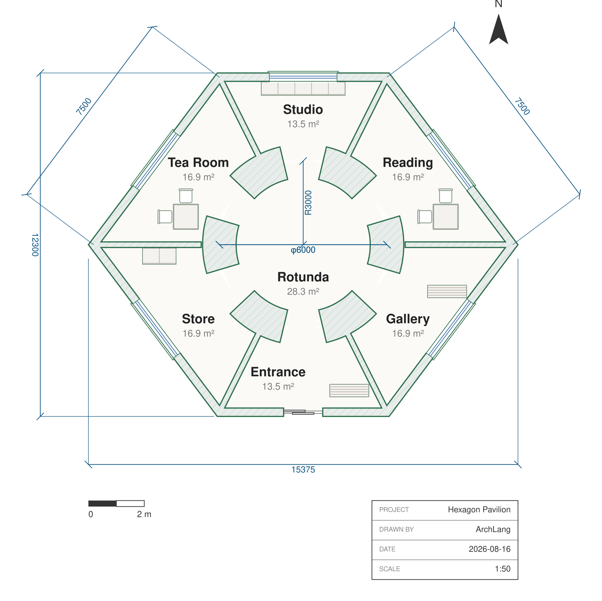

<div align="center">

<picture>
  <source media="(prefers-color-scheme: dark)" srcset="./brand/archlang-wordmark.svg" />
  
</picture>

# Floor plans as code.

ArchLang is an open-source (MIT) DSL for floor plans that compiles `.arch` source to SVG/DXF/PDF with linting and geometric validation — diffable, reproducible, and LLM-writable.

<a href="https://playground.archlang.uk"></a> <a href="https://archlang.uk"></a> <a href="https://archlang.uk/gallery"></a> <a href="https://www.npmjs.com/package/@chanmeng666/archlang"></a>

</div>

<a href="https://playground.archlang.uk"></a>

<!-- doors:start -->
## Try it

Just looking? [Open the playground](https://playground.archlang.uk) — no install.

**Your coding agent:** paste this prompt.

```text
1. Run: npx -y skills add ChanMeng666/archlang --yes
2. Run: npx -y @chanmeng666/archlang spec   (read it before writing anything)
3. Write my floor plan as plan.arch from this brief: <describe rooms, areas, adjacencies>
4. Run: npx -y @chanmeng666/archlang compile plan.arch -o plan.svg --json
   then describe plan.arch --json, validate plan.arch --strict --json (same prefix); fix, recompile
5. Run: npx -y @chanmeng666/archlang finish plan.arch, then compile again to export.
Starting from a photo or PDF? Read https://archlang.uk/from-an-image. To change one room without moving the others, use `impact --lock` (https://archlang.uk/edit-one-room).
```

Or add the MCP server: `claude mcp add --transport http archlang https://mcp.archlang.uk/mcp` (locally, `claude mcp add archlang -- npx -y @chanmeng666/archlang-mcp`). The skills are listed on [skills.sh](https://skills.sh/ChanMeng666/archlang). (A root `.mcp.json` file is provided for MCP directory detection.)

- **ChatGPT, no install:** [ArchLang app in ChatGPT](https://chatgpt.com/plugins/plugin_asdk_app_6acf8381cca08191bfb3eb7305fb6970), then ask, for example: "Draw a two-bedroom flat of about 75 m² as an ArchLang plan, and check it."
- **claude.ai, no install:** add `https://mcp.archlang.uk/mcp` as a custom connector ([the steps](https://archlang.uk/start#door-claudeai))
- **VS Code:** [Marketplace](https://marketplace.visualstudio.com/items?itemName=ChanMeng.archlang) or [Open VSX](https://open-vsx.org/extension/ChanMeng/archlang)
- **Playground, in the browser:** https://playground.archlang.uk
<!-- doors:end -->

## What you get

Each drawing is compiled from a file in [`examples/`](examples). Click a plan to open its source in the playground, then change a number and watch it redraw; click a 3D preview to open it on the 3D view.

<table>
<tr>
<td align="center" width="50%"><a href="https://playground.archlang.uk/#z=rVddjhs3En7vU3yQHjxGNApHMxrP7NoGvLsGFojhDbIOgn2aZjdLamYoskGyR9IaBvK0BwhyhhwgR8hRfJJFkd36GY_HeYieKKrqq69-WRrjFZyl04qUd24FIy2t5Ra1i1EuCR9_-gUX11j9_htiIyM8SRUgAyuh9W7p5WpajIsx3rrYaLtEQ56gA1oXdNTOkkK1RSOtmuL1HfktXEuWJVlIWxaIDhK-s1A6RGlrgjTOLiGLMaxckcJaGoOT0lk85-NLyIjnrQsvy6cTUIJd6E3sPMFTcOaOAuRSahsiQ7NrzkMmnGKMk1JbPOfrl5C2bpzHx59-LScoB6VkkO-eTiCtQmwIlYzN10OkWqk9u2CkVnBdRLUtxihD9LotpyiDjoT3CNETRVjnY4MPZXInJLS4dljIWqr-e2ukRey85eD-JV0p53wxZqlehtMzSaelkSEc_LKUXpGdFgll9KZP4z9dF2iE9wXQWR0DVqsCWHqtMBc4-IzRSh9TwgKkJ5wJgdjo-naCwNkpF6YLTbmLspFWMVFIjtJcFOh97NoCUHoVIDvOqzEF8GAwigI5zFq9WN-wawBoE8lr55GtWwoBMyHwHidiIp7i5NlcpMOHI22SIT6uPejlw-VcfIKRQ_g4g6z3eYw1fYlHJvGwdsMn7FNxoH2WtS9mvRfp8BAGF-kfwJgdODLrYQrkTtHqhb8x-o64yzLhoP9LYMUN24SRFRmM3ug7buSv8Y2OdUN2hC5QgMnXt_mS089NAeXWNiEOTixlC4G1VrHB-TmTK7gW9xySL8n07MDq32RsRiyYjLHMfTVS6BmLA7XcuD3Hvo0LZL-501hZ3Sy8sxFc2X1NyogZRy7zvBYCPOcIlqRHiNJHhHWaZzY65MAdIfZ1FYxWLJaQ-zvGfrbDPrsSIokRDC3iEUjyqaeVykRGzC93qlc7Wqx5TKgiVXCHl1mz5Km1luaWVJonH__3c2aTOr3M9r1eNrFEIO7yNJ2kJZNTyF-DMzpP5QRdkXHr9MOPclX9dUBhLiXWrjMKUq-gY6ItBFarPFW5Lsofbr7919-_ef3u5rvv35bTY7f7anb1LcVj76-PnD-gneaKtsqts0Lfkxzri32sZ0Lck9vnhFMyyIlH5OZX8x3e5Sdy_UySEWfznV0WK4BF561Og3ThtVpSP4aPXp-euVssAkWcc7K13RfYHiJEdzcgPAbBPn8Gou_Vm6Dt7WMQM_FZiNp1NpL_IgvOwRHEGO8agu_SRiAtvn_7j9ffvXn1nwmUl2uLihbOU65CTfnBk5FbzyqOtI5cuLkqF5LrKoFGWRnilwd3OujKbFk2uhZexoY8g1g0uSd1TJtOXgXyQsJ4PCEmMPo200x7Rt5yyARKq84Elq8hUTvnlbYy0vQoLuzYgcPDvlG5GN3qNLWrtkNg8rC7EmJzfpEKao-j1Yt4o3RanbJve8yaOPSksv7ZuRCb6_3ke8fSo-OS4Uh9gVV68Xtus3nP7VqITSqCAfzfbiGPsftRNZRAGkDT1Jk9vfmAsZ_MxwjeVTSwS2g9u-jaTI0_R_SG0PEI3Vwe0PtBesVw99xv3Jp8b4BHzIGBzHRnYOf19b18rGvcc1PGZpoDONT6syFsF0Jsnt0DqGTQFp-S6HOQeRyQuBRic5E2rdwxdSO1z9vaQ4WL6Nwk1XyTCyT9zqXwJEBudJjwDrhKXMG7Ia_cCTxoRSFtoLzicoCzlQH5SejxYHit4DZsTRfQSLPIq21v5TpPekVtbPIemfAVUcsNmIrYEuUnJuSV2Harinxg7-ySN38dG-g4xckrlIZ270ktvd-y3mqCqou85oSErnfr9HbpXWfVkwBFC9mZmHbsvM-zw1WnTTzVFi3_1eFhE2Adbq2rwvTp8XDjWD_QLzxPcgnm-2m9xelw5h9PcTEXOMV8qAQufn4OFrJOndy39J9j7atk7St8yVgBRB0N7-Stdz9SHT_5z5Bm7021xeiVr5s30i5HUDISRjMxuzwVV6dnlyN8KD4U_wc"></a><br><sub>Laneway house</sub></td>
<td align="center" width="50%"><a href="https://playground.archlang.uk/#z=rVddjhs3En7vU3yQHjxGNApHMxrP7NoGvLsGFojhDbIOgn2aZjdLamYoskGyR9IaBvK0BwhyhhwgR8hRfJJFkd36GY_HeYieKKrqq69-WRrjFZyl04qUd24FIy2t5Ra1i1EuCR9_-gUX11j9_htiIyM8SRUgAyuh9W7p5WpajIsx3rrYaLtEQ56gA1oXdNTOkkK1RSOtmuL1HfktXEuWJVlIWxaIDhK-s1A6RGlrgjTOLiGLMaxckcJaGoOT0lk85-NLyIjnrQsvy6cTUIJd6E3sPMFTcOaOAuRSahsiQ7NrzkMmnGKMk1JbPOfrl5C2bpzHx59-LScoB6VkkO-eTiCtQmwIlYzN10OkWqk9u2CkVnBdRLUtxihD9LotpyiDjoT3CNETRVjnY4MPZXInJLS4dljIWqr-e2ukRey85eD-JV0p53wxZqlehtMzSaelkSEc_LKUXpGdFgll9KZP4z9dF2iE9wXQWR0DVqsCWHqtMBc4-IzRSh9TwgKkJ5wJgdjo-naCwNkpF6YLTbmLspFWMVFIjtJcFOh97NoCUHoVIDvOqzEF8GAwigI5zFq9WN-wawBoE8lr55GtWwoBMyHwHidiIp7i5NlcpMOHI22SIT6uPejlw-VcfIKRQ_g4g6z3eYw1fYlHJvGwdsMn7FNxoH2WtS9mvRfp8BAGF-kfwJgdODLrYQrkTtHqhb8x-o64yzLhoP9LYMUN24SRFRmM3ug7buSv8Y2OdUN2hC5QgMnXt_mS089NAeXWNiEOTixlC4G1VrHB-TmTK7gW9xySL8n07MDq32RsRiyYjLHMfTVS6BmLA7XcuD3Hvo0LZL-501hZ3Sy8sxFc2X1NyogZRy7zvBYCPOcIlqRHiNJHhHWaZzY65MAdIfZ1FYxWLJaQ-zvGfrbDPrsSIokRDC3iEUjyqaeVykRGzC93qlc7Wqx5TKgiVXCHl1mz5Km1luaWVJonH__3c2aTOr3M9r1eNrFEIO7yNJ2kJZNTyF-DMzpP5QRdkXHr9MOPclX9dUBhLiXWrjMKUq-gY6ItBFarPFW5Lsofbr7919-_ef3u5rvv35bTY7f7anb1LcVj76-PnD-gneaKtsqts0Lfkxzri32sZ0Lck9vnhFMyyIlH5OZX8x3e5Sdy_UySEWfznV0WK4BF561Og3ThtVpSP4aPXp-euVssAkWcc7K13RfYHiJEdzcgPAbBPn8Gou_Vm6Dt7WMQM_FZiNp1NpL_IgvOwRHEGO8agu_SRiAtvn_7j9ffvXn1nwmUl2uLihbOU65CTfnBk5FbzyqOtI5cuLkqF5LrKoFGWRnilwd3OujKbFk2uhZexoY8g1g0uSd1TJtOXgXyQsJ4PCEmMPo200x7Rt5yyARKq84Elq8hUTvnlbYy0vQoLuzYgcPDvlG5GN3qNLWrtkNg8rC7EmJzfpEKao-j1Yt4o3RanbJve8yaOPSksv7ZuRCb6_3ke8fSo-OS4Uh9gVV68Xtus3nP7VqITSqCAfzfbiGPsftRNZRAGkDT1Jk9vfmAsZ_MxwjeVTSwS2g9u-jaTI0_R_SG0PEI3Vwe0PtBesVw99xv3Jp8b4BHzIGBzHRnYOf19b18rGvcc1PGZpoDONT6syFsF0Jsnt0DqGTQFp-S6HOQeRyQuBRic5E2rdwxdSO1z9vaQ4WL6Nwk1XyTCyT9zqXwJEBudJjwDrhKXMG7Ia_cCTxoRSFtoLzicoCzlQH5SejxYHit4DZsTRfQSLPIq21v5TpPekVtbPIemfAVUcsNmIrYEuUnJuSV2Harinxg7-ySN38dG-g4xckrlIZ270ktvd-y3mqCqou85oSErnfr9HbpXWfVkwBFC9mZmHbsvM-zw1WnTTzVFi3_1eFhE2Adbq2rwvTp8XDjWD_QLzxPcgnm-2m9xelw5h9PcTEXOMV8qAQufn4OFrJOndy39J9j7atk7St8yVgBRB0N7-Stdz9SHT_5z5Bm7021xeiVr5s30i5HUDISRjMxuzwVV6dnlyN8KD4U_wc&3d"></a><br><sub>Laneway house, 3D preview</sub></td>
</tr>
<tr>
<td align="center" width="50%"><a href="https://playground.archlang.uk/#z=jVfbbhtHEn3nVxxQDyJhSh5SvPgCL-DYWuxilRVgOfGj3Jyp4XTU0010N0UqgYE87RfkX_KeT8mXBFU9Qw4lL2K9aDjsc7q66tTp4gneInf1WuURIW4K7aDWyseabMSfv_6GWBFyZZ3VuTJ46_PqStkVaKfqtaHz3knvBO-pVBsTYbSN8LR2PgZYh63yVtvVa3ze3J15CrogG7UyZ6q418H5h8_71c4SPt1-uL7-_vbj9fXtzfdvr64wiBX1TrCkwjtXD8_xsSKU3tmIwjkPtyYboG10EqbR99quwGtHUMhVoELW8NufnOa1EWlx7wSVMuZ1Sw5lCyxVrEAqr1Cpe4JqdilLoef15_ivS2_DlmjNcUeHcuOtjhvP6cANmfIsdzYqbanAwDroWg45PO-tjbLo36REj7_70McvPWBjdQyo6x6w8rrALOsBIVeGMH4lH6zzscJm3esBJ7jcRfKag6jIGDwDV0xH7WxIOdq9mWZZhkLf64I8_MYGOcI_f7i6QkV6VUWElDQ-s5DqgK0yhlNWlpzlupvUsFY5vZY3XuC5M5vaIqwNxy41aFP5XFKF58J93oPwgtqgESud31kKAZMswy8YZKNsiMEiyzoP8yzj5_YhNy4QvrRk-wN3yMaJbNrSTA8034y7SLsuDs_fDJ1OD9D0_IWrJRnRxRt_22RSxebA6S_onwlMsONQYdSSDPpXae1z_EfHvCLbxyZQaItxl14esS-pYDpmbzPQsvNBdhcd9u9Sofo4_Al9U8AjXillhzdl5cA7nh54_6WM6ZI2tExxHCv3WYczpavDOe_EqmL1FU6RbWoGG72yOT3xgY5k5RBG27uOAxx1ftsJ50LZZP_P__2WkDo8sZNBrn2-MUoEYYkKMTxxBkOqHL7ubiGkxwazoggFT8p8xWR6SC8BzldxWyttm3xdHES91UWsWILZ4wartF0RDJURCFsOV7NY2th18cZ11Zjqujhwvsyyx6J_HFJHbvPpXhYJ_uIpvAkpWUcKyW3iE9KOLuZ7XfwdafecTMoNq23htk2rTSQ0oE3Y7HHCjgHSwLxon-HJNwBmkwNgsQ91DxAFNL3MdgxlnF1JxZO18_JXCNre4Y_fEaK7J37I3cZG8vxYel2sCIPCq62FCggP9dIZvlVwuIFab7gVqkYxo8mMMyAN9iI5zRGm3QVtSccvZw1IMPOvYFKI6GAm2d9hmiMcMJPFU8ws63Wb8Nm-T_c8I9zROiI3pLhxJIvNnaztKhznI7hSpTzMstH0Ym80rIqdCL0xmhtXqv4RVDQuYrxICm-gLI7d5NhP-ylodqsUrN4xR_h_sZ4GkI3-AWvW_ODREVjH4mdC2vrC8BVC5bbkoa28LJVH7rwlP8JSBW2hVkrbEOXbfZ-M8OkdXIIEt2nuexGo5bDazUfHYSbG4LCYZahrdsHSE_tsM4M169bKJtvkyePTO4SobBHwuYnlcxoanKtPQ9oeVKxoxMw8OngXk4sOxi8yGTlzHSJ5205qTJ1wHPKQ43h_-eHfP16-F09ljqXK7xC0zJGIlYqy9JTnEksepcoJXsWK-LDK7mmlVJ7yqOzK0GlATtwIRls6BMnhT7KsrtO4dSoXWnl2mAJ0gKV78rCqpuKR_FLBxCfFJw7X58tWgHw5dOp2iWe4kQMEDFJ5h8e6lMIIJ9vOaDo96qDpLHFKUpq7rnps5ge2bZ7asYkg3c7nSxejq_laChTF0dpBZbfImg59r2uygUsXomfZvkoJFRcMUEt3TyO4e_KtF9oYoLzb2CLNqZ5K8mTzVI3BVkdO6BBrp3lp0LHV7XKjTaHt6jTg-oePlx-kpgGD3ZuzcZY9X4yzbISH9GHOY1kpNn3yuHrDtqISjgTP1Q6sWh85p_yl9IaohhXmSRXckVvli5GQpnKv3R07lOR5P3y0gYqSt5U2lPpurSxvoo1BTSqI7R7E1nR6543cyuz7F83_RfNfLn8ZEXTd3N186uHZPwbNE5ezKdxkliHSLqLPC_statFFHSieoi66qGw0byBpQn-0F9-rCbU42mvcTiwMHO9H0yeouaB6QNTRkPwwAtbe_UR53P9metv-OO3L13IZ3i4f0Odfpu-UvVeh-UZFQn-STeZn2fxssuC3X3pfen8B"></a><br><sub>Studio flat</sub></td>
<td align="center" width="50%"><a href="https://playground.archlang.uk/#z=jVfbbhtHEn3nVxxQDyJhSh5SvPgCL-DYWuxilRVgOfGj3Jyp4XTU0010N0UqgYE87RfkX_KeT8mXBFU9Qw4lL2K9aDjsc7q66tTp4gneInf1WuURIW4K7aDWyseabMSfv_6GWBFyZZ3VuTJ46_PqStkVaKfqtaHz3knvBO-pVBsTYbSN8LR2PgZYh63yVtvVa3ze3J15CrogG7UyZ6q418H5h8_71c4SPt1-uL7-_vbj9fXtzfdvr64wiBX1TrCkwjtXD8_xsSKU3tmIwjkPtyYboG10EqbR99quwGtHUMhVoELW8NufnOa1EWlx7wSVMuZ1Sw5lCyxVrEAqr1Cpe4JqdilLoef15_ivS2_DlmjNcUeHcuOtjhvP6cANmfIsdzYqbanAwDroWg45PO-tjbLo36REj7_70McvPWBjdQyo6x6w8rrALOsBIVeGMH4lH6zzscJm3esBJ7jcRfKag6jIGDwDV0xH7WxIOdq9mWZZhkLf64I8_MYGOcI_f7i6QkV6VUWElDQ-s5DqgK0yhlNWlpzlupvUsFY5vZY3XuC5M5vaIqwNxy41aFP5XFKF58J93oPwgtqgESud31kKAZMswy8YZKNsiMEiyzoP8yzj5_YhNy4QvrRk-wN3yMaJbNrSTA8034y7SLsuDs_fDJ1OD9D0_IWrJRnRxRt_22RSxebA6S_onwlMsONQYdSSDPpXae1z_EfHvCLbxyZQaItxl14esS-pYDpmbzPQsvNBdhcd9u9Sofo4_Al9U8AjXillhzdl5cA7nh54_6WM6ZI2tExxHCv3WYczpavDOe_EqmL1FU6RbWoGG72yOT3xgY5k5RBG27uOAxx1ftsJ50LZZP_P__2WkDo8sZNBrn2-MUoEYYkKMTxxBkOqHL7ubiGkxwazoggFT8p8xWR6SC8BzldxWyttm3xdHES91UWsWILZ4wartF0RDJURCFsOV7NY2th18cZ11Zjqujhwvsyyx6J_HFJHbvPpXhYJ_uIpvAkpWUcKyW3iE9KOLuZ7XfwdafecTMoNq23htk2rTSQ0oE3Y7HHCjgHSwLxon-HJNwBmkwNgsQ91DxAFNL3MdgxlnF1JxZO18_JXCNre4Y_fEaK7J37I3cZG8vxYel2sCIPCq62FCggP9dIZvlVwuIFab7gVqkYxo8mMMyAN9iI5zRGm3QVtSccvZw1IMPOvYFKI6GAm2d9hmiMcMJPFU8ws63Wb8Nm-T_c8I9zROiI3pLhxJIvNnaztKhznI7hSpTzMstH0Ym80rIqdCL0xmhtXqv4RVDQuYrxICm-gLI7d5NhP-ylodqsUrN4xR_h_sZ4GkI3-AWvW_ODREVjH4mdC2vrC8BVC5bbkoa28LJVH7rwlP8JSBW2hVkrbEOXbfZ-M8OkdXIIEt2nuexGo5bDazUfHYSbG4LCYZahrdsHSE_tsM4M169bKJtvkyePTO4SobBHwuYnlcxoanKtPQ9oeVKxoxMw8OngXk4sOxi8yGTlzHSJ5205qTJ1wHPKQ43h_-eHfP16-F09ljqXK7xC0zJGIlYqy9JTnEksepcoJXsWK-LDK7mmlVJ7yqOzK0GlATtwIRls6BMnhT7KsrtO4dSoXWnl2mAJ0gKV78rCqpuKR_FLBxCfFJw7X58tWgHw5dOp2iWe4kQMEDFJ5h8e6lMIIJ9vOaDo96qDpLHFKUpq7rnps5ge2bZ7asYkg3c7nSxejq_laChTF0dpBZbfImg59r2uygUsXomfZvkoJFRcMUEt3TyO4e_KtF9oYoLzb2CLNqZ5K8mTzVI3BVkdO6BBrp3lp0LHV7XKjTaHt6jTg-oePlx-kpgGD3ZuzcZY9X4yzbISH9GHOY1kpNn3yuHrDtqISjgTP1Q6sWh85p_yl9IaohhXmSRXckVvli5GQpnKv3R07lOR5P3y0gYqSt5U2lPpurSxvoo1BTSqI7R7E1nR6543cyuz7F83_RfNfLn8ZEXTd3N186uHZPwbNE5ezKdxkliHSLqLPC_statFFHSieoi66qGw0byBpQn-0F9-rCbU42mvcTiwMHO9H0yeouaB6QNTRkPwwAtbe_UR53P9metv-OO3L13IZ3i4f0Odfpu-UvVeh-UZFQn-STeZn2fxssuC3X3pfen8B&3d"></a><br><sub>Studio flat, 3D preview</sub></td>
</tr>
</table>

Same source, plan and 3D preview. The 3D preview is extruded from the same .arch file by the separate archlang-3d package, and checked against the plan: every 3D element comes from the plan's elements, and every solid is closed. [What the 3D preview shows →](https://archlang.uk/3d) · [Try it in 3D →](https://playground.archlang.uk/#z=rVddjhs3En7vU3yQHjxGNApHMxrP7NoGvLsGFojhDbIOgn2aZjdLamYoskGyR9IaBvK0BwhyhhwgR8hRfJJFkd36GY_HeYieKKrqq69-WRrjFZyl04qUd24FIy2t5Ra1i1EuCR9_-gUX11j9_htiIyM8SRUgAyuh9W7p5WpajIsx3rrYaLtEQ56gA1oXdNTOkkK1RSOtmuL1HfktXEuWJVlIWxaIDhK-s1A6RGlrgjTOLiGLMaxckcJaGoOT0lk85-NLyIjnrQsvy6cTUIJd6E3sPMFTcOaOAuRSahsiQ7NrzkMmnGKMk1JbPOfrl5C2bpzHx59-LScoB6VkkO-eTiCtQmwIlYzN10OkWqk9u2CkVnBdRLUtxihD9LotpyiDjoT3CNETRVjnY4MPZXInJLS4dljIWqr-e2ukRey85eD-JV0p53wxZqlehtMzSaelkSEc_LKUXpGdFgll9KZP4z9dF2iE9wXQWR0DVqsCWHqtMBc4-IzRSh9TwgKkJ5wJgdjo-naCwNkpF6YLTbmLspFWMVFIjtJcFOh97NoCUHoVIDvOqzEF8GAwigI5zFq9WN-wawBoE8lr55GtWwoBMyHwHidiIp7i5NlcpMOHI22SIT6uPejlw-VcfIKRQ_g4g6z3eYw1fYlHJvGwdsMn7FNxoH2WtS9mvRfp8BAGF-kfwJgdODLrYQrkTtHqhb8x-o64yzLhoP9LYMUN24SRFRmM3ug7buSv8Y2OdUN2hC5QgMnXt_mS089NAeXWNiEOTixlC4G1VrHB-TmTK7gW9xySL8n07MDq32RsRiyYjLHMfTVS6BmLA7XcuD3Hvo0LZL-501hZ3Sy8sxFc2X1NyogZRy7zvBYCPOcIlqRHiNJHhHWaZzY65MAdIfZ1FYxWLJaQ-zvGfrbDPrsSIokRDC3iEUjyqaeVykRGzC93qlc7Wqx5TKgiVXCHl1mz5Km1luaWVJonH__3c2aTOr3M9r1eNrFEIO7yNJ2kJZNTyF-DMzpP5QRdkXHr9MOPclX9dUBhLiXWrjMKUq-gY6ItBFarPFW5Lsofbr7919-_ef3u5rvv35bTY7f7anb1LcVj76-PnD-gneaKtsqts0Lfkxzri32sZ0Lck9vnhFMyyIlH5OZX8x3e5Sdy_UySEWfznV0WK4BF561Og3ThtVpSP4aPXp-euVssAkWcc7K13RfYHiJEdzcgPAbBPn8Gou_Vm6Dt7WMQM_FZiNp1NpL_IgvOwRHEGO8agu_SRiAtvn_7j9ffvXn1nwmUl2uLihbOU65CTfnBk5FbzyqOtI5cuLkqF5LrKoFGWRnilwd3OujKbFk2uhZexoY8g1g0uSd1TJtOXgXyQsJ4PCEmMPo200x7Rt5yyARKq84Elq8hUTvnlbYy0vQoLuzYgcPDvlG5GN3qNLWrtkNg8rC7EmJzfpEKao-j1Yt4o3RanbJve8yaOPSksv7ZuRCb6_3ke8fSo-OS4Uh9gVV68Xtus3nP7VqITSqCAfzfbiGPsftRNZRAGkDT1Jk9vfmAsZ_MxwjeVTSwS2g9u-jaTI0_R_SG0PEI3Vwe0PtBesVw99xv3Jp8b4BHzIGBzHRnYOf19b18rGvcc1PGZpoDONT6syFsF0Jsnt0DqGTQFp-S6HOQeRyQuBRic5E2rdwxdSO1z9vaQ4WL6Nwk1XyTCyT9zqXwJEBudJjwDrhKXMG7Ia_cCTxoRSFtoLzicoCzlQH5SejxYHit4DZsTRfQSLPIq21v5TpPekVtbPIemfAVUcsNmIrYEuUnJuSV2Harinxg7-ySN38dG-g4xckrlIZ270ktvd-y3mqCqou85oSErnfr9HbpXWfVkwBFC9mZmHbsvM-zw1WnTTzVFi3_1eFhE2Adbq2rwvTp8XDjWD_QLzxPcgnm-2m9xelw5h9PcTEXOMV8qAQufn4OFrJOndy39J9j7atk7St8yVgBRB0N7-Stdz9SHT_5z5Bm7021xeiVr5s30i5HUDISRjMxuzwVV6dnlyN8KD4U_wc&3d)

3D preview: walls, openings, floors, stairs, furniture, outdoor surfaces and fences in plain colours; the ground and the soft contact shadows are the viewer's, not part of the building and not in the file; no pitched roofs or balcony railings yet, and no sections, elevations or BIM.

More plans from `examples/`:

<table>
<tr>
<td align="center" width="33%"><a href="https://playground.archlang.uk/#z=lVfbbttGEH3XVxwoD7EBWaVoS1GcC5AULQq0RR-ad2tEjshNqF1hd2k6DQL0Iwr0g_on_ZJiZklZsh03eZJIzpyd65nZJ3iD2LmzNZfeuS1oRz5u2UZ0JtYgFGyjpwaF896Uzk_QeRMjW4h8wMb4EC9HTwDMpog1p_cT_TsogbbOVvJqixO6fW0CSOVPXyhCPsWqo6YJ2Hi3TUirCbraFDVK9uaagwKHmpsGzsqD8XBtbIxlkC1BEBdMNM7CWYUFwNfsPyLU5LkElxVPEBysgxyHgiwqh60Jwdgq2XKevHE7tsZWYQKmokbtQuQS64-3rsJEvHfGBpysSuc81hw7ZruaYOUsXorQ6-lLOfT1qnf0IoFvWm9NbD1PR0_wg5qoWZBDA9xmo1I1Nc1grn42AV6s4RKx9q6tJFFDBp1XpTXFejraNWQxfte5s7f95x8bimN8GgGtNTFgux0BlTclZlk2AkJBDWN2mZ6s87GGN1UdRyP0p5ev_FVjro2tQBEn2SQ7TUFGMH8wLrIsu1lmWYaG1txg_LOJRc0W3-EX1RqjDRzwoX-doI7Q11zOAEUXtP4ARV8I-vniFv1XCpE9ev_GRzgSuUMc0Ts9wJld3OL8RE1zrC0hPNSeZ3vt_EKsOPDxLUkm7p6_5jIHUvzO3AY9JjWmsohul8DEqmOwPlf5WIL-BO_6IoBvbYCx0WmK-xyEHRWc2tU6aAU2TJtLkB2qF1R4F1LrdLVrWGGPuyGSFLanWLNUEFk0vIkgadGKdtMRcLc1wTeRvXEe51l20HazLMMnPXvoBfS5kAbdF8_nW-823tmYbKe4L_qnAUwhgm35ou9gp-alQj9ojyneJO1AH4OidjV7ltYMkWwpvUlRDMuS_SGSj6tLSAsoxfEkfdC2bu3TgI7T0afiuoKb8lV5lUx1g0tTTa5YLTDs0Zky1nieZaiNrRiWyafjEDpxW_OXlAfgB6OkTXDf6IMDjvBE_HE8Lb0v4S3v4VGs_8--_NvsyyXhnbGl61IAUyFMpROSVp4p7Twgk4oxYj5_6LTZ_J6exEORKSJfDEpsy-Goi4dU8unaxei2A64IaT295TKkJksjp2Yqg6iRtsULrDZNG-oVtkyh9Rxuy6lLpWysZY8NFSwFtad-Ie7Ensbus26LWnjc7c7Ub4WGsYGjtprSxmyZZTf57Ig2xkfIHfnSuzU_jJwKN0EnwDzLbhYalUesyx_HEGLMs28xag-YIn_o8cDUN2IavBOOQv6sT8kwV3xrQU2_YKS21al-or1sbPU0IHClW835sE0olWqKTrLJUpm93SE6RdaZdjpB0UjzusQzqVJeHFJvTc1m-KycFOkDC2EGt6F-G4m0bu5kfONNWXE_M6kiYweT94S6t1doTtL-bD7kXeLxLMtS_PbD8xY9RHc9gH8t-vz8EcB-UF8FYz98LeBi9ghg4Vqlym-xcLF8zGUJtw7qfDnPJvOL_aB-fqccf3cbGuOLQKZ8Fa9KozNTE6egSxn-yz3m7DwtOAPmOxEcH2EeW1e7jn1f70rCj9a7mPz8Thd2xVGsEs5AVX2EZouhQi5ShRz3MQVjcd-Iex08f4AEipqMTwGWTpzM830wRFwpmQoN2hC9L-b-DtTi2TdB7TcGpmsOl9p56WJQ9pcCk9Yc2XyfCkEzisYF2XOG2hJKmKY9bQN3zb4mW8npCf23a_ZDLdoYJnK7CKZkpW5Ed_R8iZX8hBV2bag5pFsC23LnjKwJbVRMN-xsWuUm3m5yutirwd5Y2cDCjuzgRPQtY5ZJc_7zN5byG-u0vK1b05QSnf28-ffPv1RJ5nGSz5Q03Tbt97umDYmxRErHiAaM4t7oqUL_cENFbNINh7yJ9ZajKUCoyZZnw_VvFfkmrlBxDOi8SyEtzVbDEvasevb6RA3qOXZgMy2wI2kVfUBsBEQTG9Y7C7Dz7j0X8YFLjX4uPXX2av0R4ze-qL8ne02h_yKzY5xn-eIsW5zlc3n7efR59B8"></a><br><sub>Two-bedroom flat</sub></td>
<td align="center" width="33%"><a href="https://playground.archlang.uk/#z=rVrvctvGEf_Op9iRpiMpJRnor22lTkexlcZTj9SR1fH0k3AAlsSVwB17dxDFZjKTh-gz9MHyJO3u3gGgnKRpU33w0MRh7_bfb3-7x324ghfzE3iC03kGLbS6dHZW2xbBGrAGocFHbOCH7_8BoUZ4e3t7N_vju5u3H2ZXN29nb95fX91d3by5BnxS7brB-WR_sg9XELTZQm07j6A9v1l0uqm0WcKmRoeAj-i20Oqm0S0Gx8uUW3ZYgX1ENwVvQYf0stPLOkz2Yd0oA8GCr-2GH4TaIUKjzLJTS4SFdS29oQIoh6AK2wX4bKHDZ-BUqNHRMwO-Vmu85KMCVNY6KJQzAPDD9_8Eu0YD2fwCABQ0qBYir1Zm6ckotO3XV2-uwS7480Y1DWjjA6qKvtMGdBhJ1gvbVCx5o6tQw_FFlkHYWJL9iPG0vEabYEmkdmA3hg-izVJE6RbKBpUDgEN1NPvysDgC4CNWukXjtTWw7poGSQyIHN7l3c3N9Z0ccqFK9Kz1x3oLSpTmQypTgbEBFNTaLMkHBn8P96QdBnDWtuSJ4_n5ObSkBs7hKi0lE032wW-0WZJ_tYGF7Rpx3Mc3XwxPyBk6gN8gruWxNc2WzrbaqC2fu0aJGpJPx5vsiwviO8YG2hXIv41EZU4KfKAtDo9ycBg6ZzyYjvS1LsaZsWYWj7vSpqLomuxD_vHhw8d3N394uP3qw_3dn9_cX7_NoVSGLIGPaECt182WjKkD70VmWiu36uNAfB-gVC3Cwtl2TmJ9o6sYszl4NJWnNcFulKv61w48LJQDNBUc0neeRDS4CJ_zi1Ba84gmaEs2yPnwOXQe_RQcRZpqrFmOpVHIBKce0XnVQKUdlvT20RQ2tS5r4LRLydgosyKn2S7UM1Se9nMGXQrqRj-Sndnz48wpVLniBJVVdhGgUVWFThI_T8mT005v767IvLPbm_d_mcNN9F2LyncOK1aDLHPJFqT8Qg-U2GSXXr3JvliZ9lsrgw1JrpzamBS1LBUbCpp3jBgbp0NAIxoXWCqCoXG48-ukft3xC9pU2gdtlp32tSoa8eVONpDH12pNyETb8mmsNiEZjERy9PvJfo9QAnVsKQripUVP35mIbGQssRtnmnKVs4UgIcNlmGkDDkv0fhrTkx3CoRjgeP4KnsjYlJQikSzXmUrcM9mHM2hPYNGQznmjTcgBn9ZYBk_HFmmiT6maho8fWNmN7f6NWQVZbaE5jKJtyWi65azYWMqFoOmpZyEKckG7nM18OUK5KaCiGFSNmItBMALcdLLP-JcgosfV7RhWexR5mWXQtgKWCpaqaXArIMoQ9bKHqGhZthR_S6FB_817NCXAWFsX_ByuDFhXaaPclhfkKVA9FBg2iCZBKtUhcr2Hre1g42zALyCP8giDvSiLppIQ0VRJIyRrQ1n2Sf0Qd8UdWzQBXGe8KEnu7gMp6ktQPgiIgbNw1oQ-PGUnWjjZT0uNdaEGX2METy-HMl1boBtX6hCrDZesKVTo9CNWUzDIub9dY0VQd69WCBfiELuAjXWrYNfJi1oOc3xy3i9IUO8Z6hI0sWO20QgLp6slDnVpR8VYM0uCIhtqClGGHEVxW-KQTQWash5yQZAONtpUdkP7nWUZVIhrSayLLLuMBYkdshIAoG_EqHQaSewwLorspBQeerD9wto-jguyGz2gLcc1n_eRaJ7sw-EFP17wYaZUm_50df_Nw_3t7cPN1d3d7cf8aD5h_rN3T-TqGyqTe_DtBKAzOniSArAP-dLpCs6zXDQ7Js2kCPbZ2peCY2IitS5XTLco159C55BoVokV5Ium83XOYtVSUTIKJVRU0qwhgFTNYsYiDHoPh_P5_Dw7gtJKLgWcRmSgrfhkAi3eqDXL_Xdl5Zry7ub-tk-H-QQgqjGBGLTdesIvzGazWYzg3_YkZ60JJcnif7XakLLCAcsAyoMPritZsdnuHwt8cZJlxH8zQqRU2WwXYvL4L-DiJa84IQ9p45n-UIzJKQjIDULZWI8VS7RdaLRBobA-VlYPrQ4u2iMiHxtRC1dNRStXAQ6fptsjAQbeQ1wgDISYdhmgRBMc8jYMMimVKDOMhdZy6QO7WMwiwCgDuTVMRFWA362t_5LZDhlbeEz1WjTCp4BOWweDY8lG38JhNs2O4PBFlo0-nLzM6HP6wHaA78RZYwZJFIXoXh-Gc7hRLSVHKtGcLX2R1h7qjkoCm6jYUrKxUKrVypSxSJOFF9r5kOxweH7KxxvrtXmgUwwJMCh2LIrFd-IH0WSsQ8SfS0qSHmVVpJtzuKYEEyISatwCGjGDpuDTTRP51IzswEKlJiup2Epwl5NbU7yYEp3BSjz-jAH4tSKc29GNeCX8nHrZ9CRjL52wxzJR77mMB_w5GaNX4-exlTgtST3_PMn-6z-Wd2tQILYi0iTmm4JvENfcABBnsXbF346KCFV3IsmJwK50KGs0kkBebf1lZEoqPeIugTE7gp_rGkx8ZkyD-25iRDgnEJuj6rV7aJXmQiRZAgBe_x2BAuqJTAWNKrCBvfci83P4QMrs8RvH51k2pTp5BD9y-p1dKJD5nRSyvMvxi2e7fIxZtwfyx2ILFeqRuyjN_k_uut-plIlJcL6P2sSdFm8g0ryMK68ONYU4UT2pOq6kmrtCXAshuYRXPdv4W6dcQDertC93OFrPFiQ9-32YE5DP5IzV6-ohJnOAw5MXfUhLn04bDRAsakiB9sL0zacYN4ecH-ZSHUcdB0UxJXCLyrCKpFKcqkgxNmQB-kYHlmtUi36YNvRdRBpEiP1ybfJk7tgI_tZY16oGqFBdjro5liqUv29MIg8YKBx3hnFcEBNDuq7AdH8FlgvGTqtHvY8fLb3IfjMm8amVU0H602bXBWQ7NpQ1IDhNjP2crM9-oKBOFodRa90Paj6FaZ4ecCdy4MejFp6yjPrw5Cxm02R6nlBEqs5ShW7vlKjkLYGBAmst4dWSifo5zjMdacc4CRI16QvF9Cwbz4VEUduFUZoKaf21iUpoH9lv9do8xD6CIv9FlgBrFPnj0GdOk5iR12b1TFaBFY-iAhyeDsKiVie7abQjq2DCNIjaPCy5-44oenyWjUU9O9bOm_5BCD-_eXb6LJWfHWLnTRREhWSKbEqxl968eLbn4BUx4CXNuhyUKqjG8vQylhGu1yMe_BPui6m0WHgMfR73BCcmEbPbAw9vrm_u765jPok5PS65W8z6CS2zZUn1zky5yaBTEVWSwpQGWalPWTvuZUsbR1j8oFeIOwNjYyMo_AvXoQbrhqHieOhS8Rxqo8tEkoN9pH-5Z1jTpIlxge1_4KlJnhJLZcl8pIZw7wDKzgWlzVAlYl_Itftc8Mo3uiUKzEV9xRNClZrQAw-n2XnqinrF5DgkU4gZT-eGOQ2FcoFLbbycPnW0MlVky8Q52RglNuiDWOMwOeT0E9NzQB5N-zbTdUbKSYGE1H1yXYJioWeiY2urrhE3SP9PCRLDV1QmBuzLGmkdBLWUSkkAtOic0UxqIpN4oA36Xm6UlkMcSSyyhQlwhdbsyBITxr9fIuv47Dz7CVnRqb9c1snpeRaJVZY9Xfyk4NJ2hlq4_yT4tD8kwQsLPiPB2VjwCItT5__rKdOfpMnuI1Mqs7cyPOKcH0ZQ_SpqlvkWRWr9MOSJY9qYR8r0I8zdDt3bFmXC5yg4qeAVW-IUlQT8xzcpV2OODYNYptA8RsFqiVPpbYc29CxNeWLlTznBg-6SW6c1NaeIlQdsCrsRyrQbW7Xd0CSKTM9UwJQ10RC7nnGuAAAPJcRTr7Ls6VWW7UjYlDsuZzHzwoZg23Fs955-kWUDgSiU12Zgr_h8IlJsPxltMCNY2Igf9E68LvIQrNgsqIBsLYLGxFqlccyd5acZjxuNhz2ehsQ5E2P5HgdFWvgqoxlj8NHP2suZD3wczRve6Prqwz17SdA-2iKkmcU0EfFP5_-9o8URPW8NaoU8wxc9KywbRUP8nAzJlUs1G7UdOtmZeqKBdCowlz3A-21b2CYiqoxTQAfBRbqzUGbZYL_xbniIf6hSX5ydZ9OT4yw1QGfnkrS9mfoYGmVvk1qvvo_8n7P3PZplqDfa42jIKLAsmcF6xWsimWAx-lDI0OOaxtrjKyEMw3Rg6MIPR36fiovJW0eXNJHJgHOTZ6xnwiNxDn82ZFqaq_TXSr0XpH473FBzghWcxFm5yJifQcsimT9jxTrMLF8nqjgroAob-wu6451xK8diG7W1XZCkoLuG_n6H5hvW4DNPCmcU2kWTtSn7UpxJuj2xSrGb_Qqr2Mg-8-8nuB9pYGSjZ0QET_sgIWb3RGIHuaasWfKPS-s7SW7SWdh5f8rjl1n2ROWo77nj6r10yuOXu8cUkBndmh14qFUo62lEtWG-zMEwnpVdRAePLrR4W5mipiuxdzcf3r297sFmSD_Ye8877g0pvSDXwKnAdmGfejwT9ogU1ugYyWiiiMHp0svdliMaoYM07NKzpsGu3A4RueFbgET101h3sK1YIHrq7OJ8JwIuBJmht206PfxoWe7vwH9Vl8TyvuHRUk2IuXPzSXdCHlQXbH4p3b38GIEg2LfphpKetyroEv7w1ef34FFSTmxjuzAjN-38HmIO1-me6Pbu7fUdrHW58pENVtjzeq6xNGvmGibTkf4K-P311_cpLe2CS__sy3h1lBiFNBN-h6zHMtBfFif2QLXCUc9J94Gjnhha5ZbaCFWQGyK-S1POaY4qyAM-hVzGDpvaNnE8naKUZR-_JNrmh5vgxBmoVR9-qSATT75rooMW22Th2jK7HX4TQfPIaUa_ijjpZ5Sx1l8wPaClLLMn4rMvx9PrgRjsLh6WpPW7i4cIpKPJkOH_ME3LZeqfiAgF2sH4lmGY0DsZi3KLlpPpcigbFX92Q1QLq0RDKu1VW-hlJ2yEMH70a58NKiethLN2Iftcxh4kOqKWqz4Fvis6VyiJlqIzS9XYDf2opkIRsWzU35mk6lDHGemCoYBmVySUDBd0aJDvrwDWzv4Vy7BztcUPGNUeii3sXbmyfq_MMn5PSuydZCcXs-zl7PiCvv1u8t3kXw"></a><br><sub>Tiny house</sub></td>
<td align="center" width="33%"><a href="https://playground.archlang.uk/#z=pVrvcttGkv_Op-iSKmX7jmRIUbRk7TlVTETb2tNJLkk5J19OGgJNYlbDGezMQCCzlao8xD3DPlie5Kp7ZgBQku29hB9sEWj09P8_P3AfZlDgRqyMFgpWwuaooRQPUkmjT8DJDXgrSvzFyJwJlEIr0YGVeiX1CgRk0maVEhas8ZXOxbC339uH-QPaLRhfoAXciHWpEKROf7pvQTpYVFJ5WFqzBouZF3ql0PVhgZmoHIIvhCeymv4XvX1YKmMslEpoqFwllNqCdEO4KaQDo5FotfGJF8s0u_j504f51bwPQucgPeBGOu_AG3CFqXv74RRfIPjagDZ6QI9LJTWySmYNS2PXDjKzLo1DqKUvSOvKPmAOtVDqhBWGQPz7b_-E0qjtymh4uelvX_GVzkeQEUolM-nZiPD7b_9LZsk8SYRKZAjCouiDEgtUIDwz__qHdMhQe2tk3gdtYGEqndMJC7MBobd1gZadQJRCuxrtrtzkSYUgPLzMNv1s-wqsyGXlSGqwxC24oM8CwhqFqyzmIFxQQG2hlFf_c8Bchc2iASKTq8cCN0b8NDs_h_np-3kfcitqTQwFeFshXP_3-29Pf3pH3NjKNx_m8GH-0-z95QWcXcPF5Q1czd__eD676sPs4hRuPsxu6AbRfbw8u7gZwgwshmCIgQ5mGYJ2nSTr7UMmLMf10lSWCKR38IDWywwdWWQLb-Hfvx3A1b-5v1v_cvLq2wP2nNAgrRVecgLpar1AS8ZfWZlDJnRvn9xt0Tkmd4Y5O2VKzGEpMpGjA40PaJM9G1sLvfWF1KsTcOg5wE3lSZYreAtH09Gotw9Gg4DpCNbrcCJFOYqsAG3WkiQiOsB8hRTA6GAhsnu6eEiGIWtTgHAOZEIpx3_29sNj0oHaSr0KyUMCdAilZzagjLl3oOQ9Cb6Wzot7HMK1AU9p6QpUqsn1JPBkcDiYgreSUx6kdh5FPoxFY8c44DyWDg5JHpFZ4xwL83o0GkFuat2HupBZ0dunQ1IUkvRBaGSO5EjcgBI6p0rBCUDmSpkL8HJMHPtHo9HoFbwcj4nBOHyZdv4ed4jC9cnOE_yNmb6jOEr-NcsoEtUYs2Tp-0CPjGAD4wP63zygFUrFoEqSx4CKMrsC0QdVBdSFUQhrqZRco-e4ISPnaCnuQsxUPtUrL0oMlXkGDjOj8yYdhG8MVwi1BJcJheAoTqV2MkeQnqoscjtoW4CwFBBINTS1CAffz28-zecXqaKehIQqjdTecWRGI1QebSfBdN7UYKk1a4yutw8LLGS4t2bLcFwaG_wfrRKs3A_Cc4TGG0H6Pkw4WBDLIVzLDdcjoXr74EpzT62s0iCU4TxA-JuR2oXgEbAWzmi7hdxWa1jKkCBk9DxX0ZxkF74tw71SWA-1sb4Ai4Lrr69lhkM4C93MSu-Ra9zlxZwbCIUEae5wLVM37e3DnbDZHeeug5c-FG_qcJAp43Ag9IBqLHWnE6qldDEPJTXJQkwLoR6Q01W6V30wVJFEaBRIXY4Oj3WQ7USKU0RS_mb3w3AxdlYBS4sIWWFkhieBZ7S05mYSQ-qFg7OLq9np2Y_XfSp5PtroheseHJ-NXUdql1m5wDx0KOETsz4FmKmygscNpTgKyWKUxCkYX8SwYWtRsHZGB4U-nBQHFFhQzN5x24uHU_frGOGOY40zTqyxI3OsNkl0Y3Ophd3CzGbFudAraiRGP6CmfhC0ENxfX7jQjolYOu4B5Pkdg_SbNLBIcRcKeVBxy5wrSiLhYHb619kP84sbGmO6ilnB85YvhCY9qCu4wlgfGlrI4ZB5SxozuB5SOHiYvKaKVArnW392vJkZq9FyI5xMpoc7TgVHmpjaPfII1anGJ6nGkyQKxUMcHS060p-uVprYYBwxUuJLz1Yhf-VyDbkUayT5o8Z3sRlxY4xtsywkl4e2ZGWCMsOUqKVehbpVGifJR8isjQ6aCA__UWb-u7vk51qo-6AX5-liC7OrH-B8fvH-5kPq58fDyWTyDXl1QlVmZZGGWPf3SljkhhedFIoGqSqSU1MFoaTiVk91PZVlT-6n2rgg7WYXF5c3s5uzy4thbFrjIdvEgai8Se3jrglNrbbhztrkGAtSEQxPpYSzdyWpNBA5dw7JAcwfavbN_JgVQuo-X7si71GLKdFCLp2XOvM866URgcxPNztrgVkPE98bjlazZnK2KTN3JBpSbRMbydO5khiLchhxJoNg2qbahwhMfMPwTjqmnktezuUatWM3w_c_w4fZxekQ5jrndgSXV6fzq6ZKlFVsUEC52Nih8qGHtEsJuXBJ3dVW2nUax_n83Q3JsBZc0GmtGXznDYcJFX0ElJSeiXUppOVxrBY2b1tgKo1hEvaFNdWq2PERvLz7dHt69l-3ZxfXZ6dzClbu8YnxWlCtxIEoac0QC2rmtShfDWEWz7h89-56fgOFYFMvEBZytUqFQ_ow052E0lKpxhhxQHUx9Uk-kvaFo9gONhUr8qbfkfeFY5cPcOORCtj3lz-x-7gVxU3AlUps26EvUyisjIblMIkdCDWbg2w6Pg6NyXlJ98Ok0gmJZqXsNz2MEinuP2thV1JD2IlEGymwQPKoCxF7MISL4DUoyEFUg9KmIODO48bfcepZDhIi0ZFeI_KwiSedIaWVLW6vcS7kYO60rGRgMoET2yjNhGb2tFxyFvGKyO0E1ZLKFzUW6gxXl2enQR5WsLsbpgpRG-ua3bIMe-eDkIoDhqdQttuABqd2wqOx0zXFjOVNB3AJXVSK5hXqJIm39CEHCqkCIZUIqtsD9kcK9cswNKYS32-G0vaEWPVfuCY9aw2aWnRtKpXDyvDmEUZnNlBJtYWMwlSLbXAj58td2K_3fv_tn3u889KyetfvZH6aI-NkwB5aSIeZDzzp9Jq6W5_sUYstLNDXiLo1B_fZmNqJcwiFdkgJ5RqjDzg-paNpEzuqi8oXxsK9pkbrzBq5X3TZNv7NDXKytPNpKRR6H8oKWkk7N6MuApzkDSwzisb0YBcatjEQ7O0fLF8vD3EvTEQkZYEbeBCqQp7Ow1LJ4cTrCG8dS07ZPpQmK7AfGzoP1Fobz7sySH3vhj3GcvY-xI73MeJOe_CPHkClycbrdQ_Cajsd9SDuJuMT_hIKflX2AJ40wl6PEZEnitD1fRgMBoOwm4bsDENR6ryD_8-H-X0S6j4ZlfghDVJx68yUye5r6TCFUylWTf_i-SS1LFtp5jYa8JrD6g2IVZ_LxGA8aS73gb8MDmgjjZQ1EiVfGRwcE6kzVbrOjPnqYHLY3OsDfxkc8goayOnAOCqmiYlqYv1obgqBahwy53YNdTtTaImW4lKsusCe6CIx1Ll5QlSoV75w3JW0Ya4xOlsmIQfXKLSDvcdDVTDj3rAHsWXkbwP8QI3HSmPDSqMJi6HpmIJsd_OPF9rtP1yYPvo-fvRABwnY4dBe4eWsB_BrJ_xSjTjhtFpWNAvxNtLv7oiUA5017rnwS8pywaH1U8btIynL69w_uqK1wjNMN22udbeg9n7noUcEjxWicI5r9eCPfZjfnOYwnq9CndK7G0lKLarRcbpuAQXcwAK3Ji4PcUwkpp1lkWeFsFnH4uzCnNGgGmHzI3VoxHE7QUX63SI8a2s2NbwcHxxMWzipgy39-oSRxi8yGtGzh09xqWcY1V9idNTy2cG0nvKpv6jZ4VGj2A4e9pSP-7o8rN0jLO0ZRv-ChRKnburtRCeNA384KLvRyXOFzN-mpbuDmh8_myYRyN-7Cg_staTHEyKtHFLVCz0rcV9xXKQXCZ9HJ3fjo406Tt50cMChwsGBhgp-PFlJWgp3j4bO0Z_DQo-6B7dSdA--9lUuTUfhg1Zhs1zKDHePrdtjP4e6dsKvI0H30BsUcGXMOhzL9B1tc6kfa-s6x34W4N0J11aIXW2Nxc6pb46bU503Vqx2tXXwWNtnsOTH4d0Ro3v0XHsrdBZPPyIwZzw-ao6nyXC7ezg-8fDkabF6VMZGzx_-PoAZ3fDqqB7Dq03E0lgvlDt5DpqJE1IAMb-WiPEpUqikbOmgOBGTgVrmvoDxIfeqXXro0h9Mv-EZ-gv0dZf-cDx8_fromy_Qux36aRToC_Q78hx9VR63o--bp_K0BscYHNzqVkr8Qkz-WF-mqbBh55TMCWydESa0JHFoJUEXlzFX0-IoYDw8hDUQHObRDnLpsvQiJzXmdohLqxAHagCBA0bhvNgGVOAvtHjT0VKv7sLJfBKvPAEj9gQTh4nXESwEjhdpgjKAQRFkntI3oEuj0z1zSssdby7U-nPaYGjEul0LqSEeTyqHCZNwUcqijgOCeUDh0pMvaqlzUxOPWuoYre2zR9NRcvZBcPYjetihH4_as56nr3fpjw6mX6R3u_QHVL--SP9I_uNH_Nvga4CVP9V7w4b3BP6Nl7s1a_DdTseKUF2cVpm47SxE2xY72CFuNVCGAI9lZbX09Hr2T4y1HzvYjQOLy4QoCp3Rdh9-afByfvvxfPbD_Pbj5fnPEYnRBOhFiC3QBnxJMN8G6nrFA2_AP-hVzcB5ETDcUmKGkF4iCQ1i4YyqPMKd8Hdh36M9I4AcIrtnxgxet2gDiXuXID6a0RqgnPLTgcIVgZ8E2O7AVGnxkz7ke8IRm32ZfwHA6Jnx7dWAHAPs81MzzeDwQCi5ov0zaCTpMAZhEqjegTXTO9AksoDr88uP89OIT9CLBeJM6b4UNr7laEA4GwF4NglPpEtpXQCzSE56jA4ewvfGF7BAzeRhWXYi6DrmvZ1fxUSIUgReziiZQ6W9VHD36fbdj1cXZzc_Xs1vyRa3P1yen59dn11ecImzpC9B-ekXAsya2STYkF_Pdczzl6YcFiK8TIaswOwe8yH8JyN69EqVoAHGaxLOtA2c-QXB8pZVCmU3gDzx1XwLFDRw_PLWIf02INCmuZ2812aOzN8ub3N09xDeZaGFbjDFeuJwtaZ3QuNuPoKTvyD_tZm2E_UnY--D3fcoEFa3-ul5xHT5mfPiuhPPCVWbzqGFefO6Pee6QNq-4yGufnoKveoF8Iyd8hhE7aA_nU6psDDPN6PR5s1o1I6pRJvExqccPQrocpwctww_wxHFHsGtzPEZGYM3w79hVHszHfWPD1sZyQKbw2mj9_cd07pnZGSXdzi-OZyO-vxzhn-J4w5Deg9ko-0mpCpzYSbT6PWlyCigo7Wfs1yHyQENwdOj6Z9hcjj6iiDspOcM3vKYTL4ixw4PQi2lVxjhmtKav2Hmn4FI-TYD57eLLeylF9DxuvAIewejg9eD0fFg_HqPkZpfe_8H"></a><br><sub>Hexagon pavilion</sub></td>
</tr>
</table>

## Why text

- **Exact.** Areas and reachability are computed, not estimated; the same text gives the same drawing, byte for byte.
- **Change one line, see what moved.** Edit a number and just what depends on it moves; `impact --lock` proves the rest didn't.
- **It checks itself.** An unreachable room or an opening off its wall comes back as a message with a code and a fix your AI can apply; checks other than reachability and area are advisory. [The checks →](https://archlang.uk/analysis) · [Error codes →](https://archlang.uk/errors)

**What writing it as a language gives you.** Rooms, walls, doors and windows have names, so the compiler can measure each room and check how the rooms connect; some mistakes come back as a message with a code that points at the exact place in the text, often with a fix (other checks are advisory); the same text gives the same bytes every time, and `impact` shows which parts of the drawing a change moved. [More →](https://archlang.uk/#what-a-language-gives)

Limits: plan drawings in the core; no BIM or IFC, not permit drawings; it does not read images; clearances are advisory. The 3D preview's limits, as the line under the plan pairs above says: "3D preview: walls, openings, floors, stairs, furniture, outdoor surfaces and fences in plain colours; the ground and the soft contact shadows are the viewer's, not part of the building and not in the file; no pitched roofs or balcony railings yet, and no sections, elevations or BIM."

Starting from a photo? [archlang.uk/from-an-image](https://archlang.uk/from-an-image) · Change one room? [archlang.uk/edit-one-room](https://archlang.uk/edit-one-room)

## For your agent

This page is all a person needs. Everything else is written for agents: clone the repo and point yours at [`AGENTS.md`](AGENTS.md), or give it the whole language in one call:

```bash
npx -y @chanmeng666/archlang context
```

MCP clients: [archlang.uk/mcp](https://archlang.uk/mcp) · Agents: [archlang.uk/agents](https://archlang.uk/agents) · [Full overview](docs/overview.md) · [Language reference](docs/language-reference.md)

Local MCP server: [Install in VS Code](https://vscode.dev/redirect?url=vscode%3Amcp%2Finstall%3F%257B%2522name%2522%253A%2522archlang%2522%252C%2522type%2522%253A%2522stdio%2522%252C%2522command%2522%253A%2522npx%2522%252C%2522args%2522%253A%255B%2522-y%2522%252C%2522%2540chanmeng666%252Farchlang-mcp%2522%255D%257D) · [Install in VS Code Insiders](https://vscode.dev/redirect?url=vscode-insiders%3Amcp%2Finstall%3F%257B%2522name%2522%253A%2522archlang%2522%252C%2522type%2522%253A%2522stdio%2522%252C%2522command%2522%253A%2522npx%2522%252C%2522args%2522%253A%255B%2522-y%2522%252C%2522%2540chanmeng666%252Farchlang-mcp%2522%255D%257D). Hosted MCP server: [Install in VS Code](https://vscode.dev/redirect?url=vscode%3Amcp%2Finstall%3F%257B%2522name%2522%253A%2522archlang%2522%252C%2522type%2522%253A%2522http%2522%252C%2522url%2522%253A%2522https%253A%252F%252Fmcp.archlang.uk%252Fmcp%2522%257D) · [Install in VS Code Insiders](https://vscode.dev/redirect?url=vscode-insiders%3Amcp%2Finstall%3F%257B%2522name%2522%253A%2522archlang%2522%252C%2522type%2522%253A%2522http%2522%252C%2522url%2522%253A%2522https%253A%252F%252Fmcp.archlang.uk%252Fmcp%2522%257D). Install in Cursor: [the links on archlang.uk/mcp](https://archlang.uk/mcp#install-the-floor-plan-mcp-server).

https://github.com/user-attachments/assets/879a4b71-415e-4848-a4af-db9c879d6a71

[Watch the full film on YouTube (3:16)](https://youtu.be/oCg3tBTlVvI)

[What's new →](https://archlang.uk/whats-new)

<sub>[Release notes](https://github.com/ChanMeng666/archlang/blob/main/CHANGELOG.md) (installed: `node_modules/@chanmeng666/archlang/CHANGELOG.md`) · [Contributing](CONTRIBUTING.md) · [MIT](LICENSE)</sub>

<sub>ArchCanvas is a hosted app built on ArchLang. Maintained by [Chan Meng](https://github.com/ChanMeng666), a single maintainer; written with AI coding agents and checked in CI. [Governance](GOVERNANCE.md).</sub>

<sub>Current releases are published from [`release.yml`](https://github.com/ChanMeng666/archlang/blob/main/.github/workflows/release.yml) by tokenless OIDC, with npm provenance: an SLSA v1 attestation that names the tag and commit a release was built from. An older version may have none, so check before you pin. In a project that installs it, `npm audit signatures --json --include-attestations` lists the package under `verified` only when it is attested, and `npm view @chanmeng666/archlang@<version> dist.attestations` shows a `predicateType` of `https://slsa.dev/provenance/v1` (it prints nothing for a version without one). Pin a version in a skill or CI with `npx -y @chanmeng666/archlang@<version> <cmd>`.</sub>
