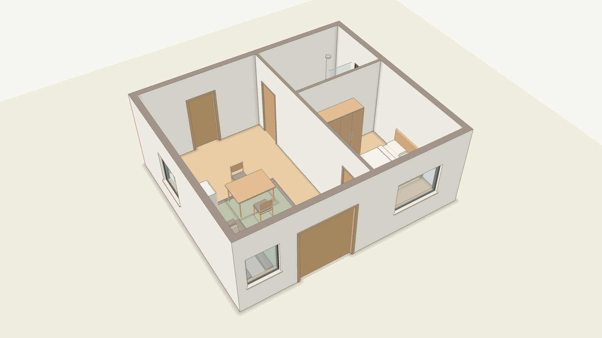
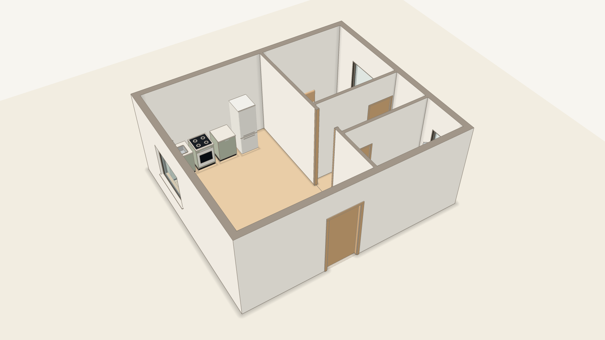

<div align="center">

<picture>
  <source media="(prefers-color-scheme: dark)" srcset="./brand/archlang-wordmark.svg" />
  
</picture>

# Floor plans as code.

ArchLang is an open-source (MIT) DSL for floor plans that compiles `.arch` source to SVG/DXF/PDF with linting and geometric validation — diffable, reproducible, and LLM-writable.

<a href="https://playground.archlang.uk"></a> <a href="https://archlang.uk"></a> <a href="https://archlang.uk/gallery"></a> <a href="https://www.npmjs.com/package/@chanmeng666/archlang"></a>

</div>

<a href="https://playground.archlang.uk"></a>

<!-- doors:start -->
## Try it

Just looking? [Open the playground](https://playground.archlang.uk) — no install.

**Your coding agent:** paste this prompt.

```text
1. Run: npx -y skills add ChanMeng666/archlang --yes
2. Run: npx -y @chanmeng666/archlang spec   (read it before writing anything)
3. Write my floor plan as plan.arch from this brief: <describe rooms, areas, adjacencies>
4. Run: npx -y @chanmeng666/archlang compile plan.arch -o plan.svg --json
   then describe plan.arch --json, validate plan.arch --strict --json (same prefix); fix, recompile
5. Run: npx -y @chanmeng666/archlang finish plan.arch, then compile again to export.
Starting from a photo or PDF? Read https://archlang.uk/from-an-image. To change one room without moving the others, use `impact --lock` (https://archlang.uk/edit-one-room).
```

Or add the MCP server: `claude mcp add --transport http archlang https://mcp.archlang.uk/mcp` (locally, `claude mcp add archlang -- npx -y @chanmeng666/archlang-mcp`). The skills are listed on [skills.sh](https://skills.sh/ChanMeng666/archlang). (A root `.mcp.json` file is provided for MCP directory detection.)

- **ChatGPT, no install:** [ArchLang app in ChatGPT](https://chatgpt.com/plugins/plugin_asdk_app_6acf8381cca08191bfb3eb7305fb6970), then ask, for example: "Draw a two-bedroom flat of about 75 m² as an ArchLang plan, and check it."
- **claude.ai, no install:** add `https://mcp.archlang.uk/mcp` as a custom connector ([the steps](https://archlang.uk/start#door-claudeai))
- **VS Code:** [Marketplace](https://marketplace.visualstudio.com/items?itemName=ChanMeng.archlang) or [Open VSX](https://open-vsx.org/extension/ChanMeng/archlang)
- **Playground, in the browser:** https://playground.archlang.uk
<!-- doors:end -->

## What you get

Each drawing is compiled from a file in [`examples/`](examples). Click a plan to open its source in the playground, then change a number and watch it redraw; click a 3D preview to open it on the 3D view.

<table>
<tr>
<td align="center" width="50%"><a href="https://playground.archlang.uk/#z=jVZdbhs3EH7fU3yQXhxAVmjZ8k-bBEjbAAVipEWaIOiTdySOtKxXpEBSltzAQJ56gKJn6AF6hB4lJymG3NWfY6d6orgz33zzy-niJZzlwxFr79wMNVle0i3GLkaaMj5_-gsnF5j9-w9iRRGeSQdQECXMvZt6mvWLbtHFGxcrY6eo2DNMwNwFE42zrDG6RUVW9_Hqhv0t3JytSIqQsSIQHQh-YaFNiGTHDKqdnYKKLizNWGNJdY2D0lk8k-MLUMSzuQsvyic9cIKdmFVceIbn4OobDqApGRuiQItrzoMSTtHFQWksnsn1C5AdV87j86e_yx7KVikZlLsnPZDViBVjRLF62kZqTsaLCzUZDbeIGN0WXZQhejMv-yiDiYyPCNEzR1jnY4W7MrkTElpcOkxoTLr5P6_JIi68leB-k660c77oilQjI-nppdO0phC2vkzJa7b9IqF0Lps0_ugWgTv4WAALa2LAbFYAU280hgpbvy7m5GNKWAB5xpFSiJUZX_cQJDvlpF6EqlxHuSarhShIojRUBRofF_MC0GYWQAvJa10XwBeDURTIYTb6-fJKXAPAq8jeOI9s3XIIGCiFjzhQPfUEB2dDlQ53O9pMIT6u3erlw-lQ3cPIIXycQdZ7GGPJX-ORSXxZu5ITNqnY0j7K2ieDxot0-BKGFOn_wBhsOTJoYArkTjH6ub-qzQ1Ll2XCwfzOEMWV2ERNI67RuTQ30shP8drEccW2g0XggDpfX-dLSb80BbRb2oTYOjGlORSWRscKx8dCrpBa3HBIviTTgy2r31GsOiKYjInMvhprNIzVllpu3IZj08YFst_SaaKsrybe2Qip7KYmKWIgkcs8L5SCzDmGZfIIkXxEWKZ5ZqNDDtwOYlNXoTZaxBJycyfYZ2vso3Olkhij5kncAUk-NbRSmVDE8HSter6mJZq7hEasC-nwMmuWMrWWVF-zTvPk8x9_Zjap08ts35tpFUsEli5P04ks1zmF8je42uSpnKBHXLtl-vAbzUbftijCpcTSLWoNMjOYmGgrhdksT1Wpi_LD1c8_ff_61burt-_flP1dt5tqduNrjrveX-w4v0U7zRVjtVtmhaYnJdYnm1gPlNqT2-REUtLKqUfkhufDNd7pPblmJlHE0XBtV8QKYLLw1qRBOvFGT7kZwzuvT8PcTSaBI44l2cZuCmwDEaK7aREegxCfH4BoevUqGHv9GMRAPQgxdgsb2X-VheRgB6KLdxXDL9JGQBbv3_zw6u3ly1970J6WFiOeOM-5Cg3nB4-itJ7VEmkTpXBzVU5I6iqBRhrVLC8Pbkwwo_pWZKObw1Os2AuIRZV70sS06eRVIC8kgicToofaXGeaac_IWw7XgdOq04OVaxDGznltLEXu78RFHNtyuN03Ri5GNztM7WpsG5g87M6VWh2fpILa4GR_toDGLPFmnZWOjpVaXWzG3TsR7-zWiYTnK1TSM98QGgwbQhdKrVLmW_Bf3IR2sZv51OY9TZ1-aseG3rDF2IzjXQTvRtyyS2gNu-jmmZr8dui18ZK5uTrdoveBvBa4Pfcrt2TfGJC5smUgM10bWHt9sZeE5Rh7blKs-jmAbYGftWE7UWp1tgcwomAs7pNocpB5bJE4VWp1MtzFGFeye6an9Oj8bNgbHKv1Ez1M4g-16J7i8dlwX9G7SDGFdAujAKKJtaxwc-9-43G8t2KmVr0a3aLz0o-rS7LTDrQgdQZqcHqozg-PTju4K-6K_wA"></a><br><sub>Laneway house</sub></td>
<td align="center" width="50%"><a href="https://playground.archlang.uk/#z=jVZdbhs3EH7fU3yQXhxAVmjZ8k-bBEjbAAVipEWaIOiTdySOtKxXpEBSltzAQJ56gKJn6AF6hB4lJymG3NWfY6d6orgz33zzy-niJZzlwxFr79wMNVle0i3GLkaaMj5_-gsnF5j9-w9iRRGeSQdQECXMvZt6mvWLbtHFGxcrY6eo2DNMwNwFE42zrDG6RUVW9_Hqhv0t3JytSIqQsSIQHQh-YaFNiGTHDKqdnYKKLizNWGNJdY2D0lk8k-MLUMSzuQsvyic9cIKdmFVceIbn4OobDqApGRuiQItrzoMSTtHFQWksnsn1C5AdV87j86e_yx7KVikZlLsnPZDViBVjRLF62kZqTsaLCzUZDbeIGN0WXZQhejMv-yiDiYyPCNEzR1jnY4W7MrkTElpcOkxoTLr5P6_JIi68leB-k660c77oilQjI-nppdO0phC2vkzJa7b9IqF0Lps0_ugWgTv4WAALa2LAbFYAU280hgpbvy7m5GNKWAB5xpFSiJUZX_cQJDvlpF6EqlxHuSarhShIojRUBRofF_MC0GYWQAvJa10XwBeDURTIYTb6-fJKXAPAq8jeOI9s3XIIGCiFjzhQPfUEB2dDlQ53O9pMIT6u3erlw-lQ3cPIIXycQdZ7GGPJX-ORSXxZu5ITNqnY0j7K2ieDxot0-BKGFOn_wBhsOTJoYArkTjH6ub-qzQ1Ll2XCwfzOEMWV2ERNI67RuTQ30shP8drEccW2g0XggDpfX-dLSb80BbRb2oTYOjGlORSWRscKx8dCrpBa3HBIviTTgy2r31GsOiKYjInMvhprNIzVllpu3IZj08YFst_SaaKsrybe2Qip7KYmKWIgkcs8L5SCzDmGZfIIkXxEWKZ5ZqNDDtwOYlNXoTZaxBJycyfYZ2vso3Olkhij5kncAUk-NbRSmVDE8HSter6mJZq7hEasC-nwMmuWMrWWVF-zTvPk8x9_Zjap08ts35tpFUsEli5P04ks1zmF8je42uSpnKBHXLtl-vAbzUbftijCpcTSLWoNMjOYmGgrhdksT1Wpi_LD1c8_ff_61burt-_flP1dt5tqduNrjrveX-w4v0U7zRVjtVtmhaYnJdYnm1gPlNqT2-REUtLKqUfkhufDNd7pPblmJlHE0XBtV8QKYLLw1qRBOvFGT7kZwzuvT8PcTSaBI44l2cZuCmwDEaK7aREegxCfH4BoevUqGHv9GMRAPQgxdgsb2X-VheRgB6KLdxXDL9JGQBbv3_zw6u3ly1970J6WFiOeOM-5Cg3nB4-itJ7VEmkTpXBzVU5I6iqBRhrVLC8Pbkwwo_pWZKObw1Os2AuIRZV70sS06eRVIC8kgicToofaXGeaac_IWw7XgdOq04OVaxDGznltLEXu78RFHNtyuN03Ri5GNztM7WpsG5g87M6VWh2fpILa4GR_toDGLPFmnZWOjpVaXWzG3TsR7-zWiYTnK1TSM98QGgwbQhdKrVLmW_Bf3IR2sZv51OY9TZ1-aseG3rDF2IzjXQTvRtyyS2gNu-jmmZr8dui18ZK5uTrdoveBvBa4Pfcrt2TfGJC5smUgM10bWHt9sZeE5Rh7blKs-jmAbYGftWE7UWp1tgcwomAs7pNocpB5bJE4VWp1MtzFGFeye6an9Oj8bNgbHKv1Ez1M4g-16J7i8dlwX9G7SDGFdAujAKKJtaxwc-9-43G8t2KmVr0a3aLz0o-rS7LTDrQgdQZqcHqozg-PTju4K-6K_wA&3d"></a><br><sub>Laneway house, 3D preview</sub></td>
</tr>
<tr>
<td align="center" width="50%"><a href="https://playground.archlang.uk/#z=jVfbbhtHEn3nVxxQDyJhSh5SvPgCL-DYWuxilRVgOfGj3Jyp4XTU0010N0UqgYE87RfkX_KeT8mXBFU9Qw4lL2K9aDjsc7q66tTp4gneInf1WuURIW4K7aDWyseabMSfv_6GWBFyZZ3VuTJ46_PqStkVaKfqtaHz3knvBO-pVBsTYbSN8LR2PgZYh63yVtvVa3ze3J15CrogG7UyZ6q418H5h8_71c4SPt1-uL7-_vbj9fXtzfdvr64wiBX1TrCkwjtXD8_xsSKU3tmIwjkPtyYboG10EqbR99quwGtHUMhVoELW8NufnOa1EWlx7wSVMuZ1Sw5lCyxVrEAqr1Cpe4JqdilLoef15_ivS2_DlmjNcUeHcuOtjhvP6cANmfIsdzYqbanAwDroWg45PO-tjbLo36REj7_70McvPWBjdQyo6x6w8rrALOsBIVeGMH4lH6zzscJm3esBJ7jcRfKag6jIGDwDV0xH7WxIOdq9mWZZhkLf64I8_MYGOcI_f7i6QkV6VUWElDQ-s5DqgK0yhlNWlpzlupvUsFY5vZY3XuC5M5vaIqwNxy41aFP5XFKF58J93oPwgtqgESud31kKAZMswy8YZKNsiMEiyzoP8yzj5_YhNy4QvrRk-wN3yMaJbNrSTA8034y7SLsuDs_fDJ1OD9D0_IWrJRnRxRt_22RSxebA6S_onwlMsONQYdSSDPpXae1z_EfHvCLbxyZQaItxl14esS-pYDpmbzPQsvNBdhcd9u9Sofo4_Al9U8AjXillhzdl5cA7nh54_6WM6ZI2tExxHCv3WYczpavDOe_EqmL1FU6RbWoGG72yOT3xgY5k5RBG27uOAxx1ftsJ50LZZP_P__2WkDo8sZNBrn2-MUoEYYkKMTxxBkOqHL7ubiGkxwazoggFT8p8xWR6SC8BzldxWyttm3xdHES91UWsWILZ4wartF0RDJURCFsOV7NY2th18cZ11Zjqujhwvsyyx6J_HFJHbvPpXhYJ_uIpvAkpWUcKyW3iE9KOLuZ7XfwdafecTMoNq23htk2rTSQ0oE3Y7HHCjgHSwLxon-HJNwBmkwNgsQ91DxAFNL3MdgxlnF1JxZO18_JXCNre4Y_fEaK7J37I3cZG8vxYel2sCIPCq62FCggP9dIZvlVwuIFab7gVqkYxo8mMMyAN9iI5zRGm3QVtSccvZw1IMPOvYFKI6GAm2d9hmiMcMJPFU8ws63Wb8Nm-T_c8I9zROiI3pLhxJIvNnaztKhznI7hSpTzMstH0Ym80rIqdCL0xmhtXqv4RVDQuYrxICm-gLI7d5NhP-ylodqsUrN4xR_h_sZ4GkI3-AWvW_ODREVjH4mdC2vrC8BVC5bbkoa28LJVH7rwlP8JSBW2hVkrbEOXbfZ-M8OkdXIIEt2nuexGo5bDazUfHYSbG4LCYZahrdsHSE_tsM4M169bKJtvkyePTO4SobBHwuYnlcxoanKtPQ9oeVKxoxMw8OngXk4sOxi8yGTlzHSJ5205qTJ1wHPKQ43h_-eHfP16-F09ljqXK7xC0zJGIlYqy9JTnEksepcoJXsWK-LDK7mmlVJ7yqOzK0GlATtwIRls6BMnhT7KsrtO4dSoXWnl2mAJ0gKV78rCqpuKR_FLBxCfFJw7X58tWgHw5dOp2iWe4kQMEDFJ5h8e6lMIIJ9vOaDo96qDpLHFKUpq7rnps5ge2bZ7asYkg3c7nSxejq_laChTF0dpBZbfImg59r2uygUsXomfZvkoJFRcMUEt3TyO4e_KtF9oYoLzb2CLNqZ5K8mTzVI3BVkdO6BBrp3lp0LHV7XKjTaHt6jTg-oePlx-kpgGD3ZuzcZY9X4yzbISH9GHOY1kpNn3yuHrDtqISjgTP1Q6sWh85p_yl9IaohhXmSRXckVvli5GQpnKv3R07lOR5P3y0gYqSt5U2lPpurSxvoo1BTSqI7R7E1nR6543cyuz7F83_RfNfLn8ZEXTd3N186uHZPwbNE5ezKdxkliHSLqLPC_statFFHSieoi66qGw0byBpQn-0F9-rCbU42mvcTiwMHO9H0yeouaB6QNTRkPwwAtbe_UR53P9metv-OO3L13IZ3i4f0Odfpu-UvVeh-UZFQn-STeZn2fxssuC3X3pfen8B"></a><br><sub>Studio flat</sub></td>
<td align="center" width="50%"><a href="https://playground.archlang.uk/#z=jVfbbhtHEn3nVxxQDyJhSh5SvPgCL-DYWuxilRVgOfGj3Jyp4XTU0010N0UqgYE87RfkX_KeT8mXBFU9Qw4lL2K9aDjsc7q66tTp4gneInf1WuURIW4K7aDWyseabMSfv_6GWBFyZZ3VuTJ46_PqStkVaKfqtaHz3knvBO-pVBsTYbSN8LR2PgZYh63yVtvVa3ze3J15CrogG7UyZ6q418H5h8_71c4SPt1-uL7-_vbj9fXtzfdvr64wiBX1TrCkwjtXD8_xsSKU3tmIwjkPtyYboG10EqbR99quwGtHUMhVoELW8NufnOa1EWlx7wSVMuZ1Sw5lCyxVrEAqr1Cpe4JqdilLoef15_ivS2_DlmjNcUeHcuOtjhvP6cANmfIsdzYqbanAwDroWg45PO-tjbLo36REj7_70McvPWBjdQyo6x6w8rrALOsBIVeGMH4lH6zzscJm3esBJ7jcRfKag6jIGDwDV0xH7WxIOdq9mWZZhkLf64I8_MYGOcI_f7i6QkV6VUWElDQ-s5DqgK0yhlNWlpzlupvUsFY5vZY3XuC5M5vaIqwNxy41aFP5XFKF58J93oPwgtqgESud31kKAZMswy8YZKNsiMEiyzoP8yzj5_YhNy4QvrRk-wN3yMaJbNrSTA8034y7SLsuDs_fDJ1OD9D0_IWrJRnRxRt_22RSxebA6S_onwlMsONQYdSSDPpXae1z_EfHvCLbxyZQaItxl14esS-pYDpmbzPQsvNBdhcd9u9Sofo4_Al9U8AjXillhzdl5cA7nh54_6WM6ZI2tExxHCv3WYczpavDOe_EqmL1FU6RbWoGG72yOT3xgY5k5RBG27uOAxx1ftsJ50LZZP_P__2WkDo8sZNBrn2-MUoEYYkKMTxxBkOqHL7ubiGkxwazoggFT8p8xWR6SC8BzldxWyttm3xdHES91UWsWILZ4wartF0RDJURCFsOV7NY2th18cZ11Zjqujhwvsyyx6J_HFJHbvPpXhYJ_uIpvAkpWUcKyW3iE9KOLuZ7XfwdafecTMoNq23htk2rTSQ0oE3Y7HHCjgHSwLxon-HJNwBmkwNgsQ91DxAFNL3MdgxlnF1JxZO18_JXCNre4Y_fEaK7J37I3cZG8vxYel2sCIPCq62FCggP9dIZvlVwuIFab7gVqkYxo8mMMyAN9iI5zRGm3QVtSccvZw1IMPOvYFKI6GAm2d9hmiMcMJPFU8ws63Wb8Nm-T_c8I9zROiI3pLhxJIvNnaztKhznI7hSpTzMstH0Ym80rIqdCL0xmhtXqv4RVDQuYrxICm-gLI7d5NhP-ylodqsUrN4xR_h_sZ4GkI3-AWvW_ODREVjH4mdC2vrC8BVC5bbkoa28LJVH7rwlP8JSBW2hVkrbEOXbfZ-M8OkdXIIEt2nuexGo5bDazUfHYSbG4LCYZahrdsHSE_tsM4M169bKJtvkyePTO4SobBHwuYnlcxoanKtPQ9oeVKxoxMw8OngXk4sOxi8yGTlzHSJ5205qTJ1wHPKQ43h_-eHfP16-F09ljqXK7xC0zJGIlYqy9JTnEksepcoJXsWK-LDK7mmlVJ7yqOzK0GlATtwIRls6BMnhT7KsrtO4dSoXWnl2mAJ0gKV78rCqpuKR_FLBxCfFJw7X58tWgHw5dOp2iWe4kQMEDFJ5h8e6lMIIJ9vOaDo96qDpLHFKUpq7rnps5ge2bZ7asYkg3c7nSxejq_laChTF0dpBZbfImg59r2uygUsXomfZvkoJFRcMUEt3TyO4e_KtF9oYoLzb2CLNqZ5K8mTzVI3BVkdO6BBrp3lp0LHV7XKjTaHt6jTg-oePlx-kpgGD3ZuzcZY9X4yzbISH9GHOY1kpNn3yuHrDtqISjgTP1Q6sWh85p_yl9IaohhXmSRXckVvli5GQpnKv3R07lOR5P3y0gYqSt5U2lPpurSxvoo1BTSqI7R7E1nR6543cyuz7F83_RfNfLn8ZEXTd3N186uHZPwbNE5ezKdxkliHSLqLPC_statFFHSieoi66qGw0byBpQn-0F9-rCbU42mvcTiwMHO9H0yeouaB6QNTRkPwwAtbe_UR53P9metv-OO3L13IZ3i4f0Odfpu-UvVeh-UZFQn-STeZn2fxssuC3X3pfen8B&3d"></a><br><sub>Studio flat, 3D preview</sub></td>
</tr>
</table>

Same source, plan and 3D preview. The 3D preview is extruded from the same .arch file by the separate archlang-3d package, and checked against the plan: every 3D element comes from the plan's elements, and every solid is closed. [What the 3D preview shows →](https://archlang.uk/3d) · [Try it in 3D →](https://playground.archlang.uk/#z=jVZdbhs3EH7fU3yQXhxAVmjZ8k-bBEjbAAVipEWaIOiTdySOtKxXpEBSltzAQJ56gKJn6AF6hB4lJymG3NWfY6d6orgz33zzy-niJZzlwxFr79wMNVle0i3GLkaaMj5_-gsnF5j9-w9iRRGeSQdQECXMvZt6mvWLbtHFGxcrY6eo2DNMwNwFE42zrDG6RUVW9_Hqhv0t3JytSIqQsSIQHQh-YaFNiGTHDKqdnYKKLizNWGNJdY2D0lk8k-MLUMSzuQsvyic9cIKdmFVceIbn4OobDqApGRuiQItrzoMSTtHFQWksnsn1C5AdV87j86e_yx7KVikZlLsnPZDViBVjRLF62kZqTsaLCzUZDbeIGN0WXZQhejMv-yiDiYyPCNEzR1jnY4W7MrkTElpcOkxoTLr5P6_JIi68leB-k660c77oilQjI-nppdO0phC2vkzJa7b9IqF0Lps0_ugWgTv4WAALa2LAbFYAU280hgpbvy7m5GNKWAB5xpFSiJUZX_cQJDvlpF6EqlxHuSarhShIojRUBRofF_MC0GYWQAvJa10XwBeDURTIYTb6-fJKXAPAq8jeOI9s3XIIGCiFjzhQPfUEB2dDlQ53O9pMIT6u3erlw-lQ3cPIIXycQdZ7GGPJX-ORSXxZu5ITNqnY0j7K2ieDxot0-BKGFOn_wBhsOTJoYArkTjH6ub-qzQ1Ll2XCwfzOEMWV2ERNI67RuTQ30shP8drEccW2g0XggDpfX-dLSb80BbRb2oTYOjGlORSWRscKx8dCrpBa3HBIviTTgy2r31GsOiKYjInMvhprNIzVllpu3IZj08YFst_SaaKsrybe2Qip7KYmKWIgkcs8L5SCzDmGZfIIkXxEWKZ5ZqNDDtwOYlNXoTZaxBJycyfYZ2vso3Olkhij5kncAUk-NbRSmVDE8HSter6mJZq7hEasC-nwMmuWMrWWVF-zTvPk8x9_Zjap08ts35tpFUsEli5P04ks1zmF8je42uSpnKBHXLtl-vAbzUbftijCpcTSLWoNMjOYmGgrhdksT1Wpi_LD1c8_ff_61burt-_flP1dt5tqduNrjrveX-w4v0U7zRVjtVtmhaYnJdYnm1gPlNqT2-REUtLKqUfkhufDNd7pPblmJlHE0XBtV8QKYLLw1qRBOvFGT7kZwzuvT8PcTSaBI44l2cZuCmwDEaK7aREegxCfH4BoevUqGHv9GMRAPQgxdgsb2X-VheRgB6KLdxXDL9JGQBbv3_zw6u3ly1970J6WFiOeOM-5Cg3nB4-itJ7VEmkTpXBzVU5I6iqBRhrVLC8Pbkwwo_pWZKObw1Os2AuIRZV70sS06eRVIC8kgicToofaXGeaac_IWw7XgdOq04OVaxDGznltLEXu78RFHNtyuN03Ri5GNztM7WpsG5g87M6VWh2fpILa4GR_toDGLPFmnZWOjpVaXWzG3TsR7-zWiYTnK1TSM98QGgwbQhdKrVLmW_Bf3IR2sZv51OY9TZ1-aseG3rDF2IzjXQTvRtyyS2gNu-jmmZr8dui18ZK5uTrdoveBvBa4Pfcrt2TfGJC5smUgM10bWHt9sZeE5Rh7blKs-jmAbYGftWE7UWp1tgcwomAs7pNocpB5bJE4VWp1MtzFGFeye6an9Oj8bNgbHKv1Ez1M4g-16J7i8dlwX9G7SDGFdAujAKKJtaxwc-9-43G8t2KmVr0a3aLz0o-rS7LTDrQgdQZqcHqozg-PTju4K-6K_wA&3d)

3D preview: walls, openings, floors, stairs, furniture, outdoor surfaces and fences in plain colours; the ground and the soft contact shadows are the viewer's, not part of the building and not in the file; no pitched roofs or balcony railings yet, and no sections, elevations or BIM.

More plans from `examples/`:

<table>
<tr>
<td align="center" width="33%"><a href="https://playground.archlang.uk/#z=lVfbbttGEH3XVxwoD7EBWaVoS1GcJkBStCjQFn1o3qMROSI3oXaF3aVptwjQjyjQD-qf9EuKmSV1sV23ebJFzpyd2zk7fIa3iJ27WHPpnduCduTjlm1EZ2INQsE2empQOO9N6fwEnTcxsoXYB2yMD_F69AzAbIpYc3o-0X8HJ9DW2UoebXFGh8cmgNT-_JUi5FOsOmqagI1324S0mqCrTVGjZG9uOChwqLlp4Kz8MB6ujY2xDLIlCJKCicZZOKuwAPiG_R1CTZ5LcFnxBMHBOshxKMiictiaEIytUiyXKRu3Y2tsFSZgKmrULkQusb47pAoT8dEZG3C2Kp3zWHPsmO1qgpWz-FqM3ky_lkPfrPpErxL4pvXWxNbzdPQM32qI2gU5NMBtNmpVU9MM4eprE-AlGi4Ra-_aSho1dNB5dVpTrKejXUMW4_edu3jXv_6uoTjGbyOgtSYGbLcjoPKmxCzLRkAoqGHMrtMv63ys4U1Vx9EI_enla_-hMTfGVqCIs2ySnaciI5hfGVdZlt0usyxDQ2tuMP7BxKJmi6_wo3qN0QYO-NQ_TlAn6GsuZ4CiC1p_gKIvBP1ycUD_iUJkjz6_8QmOVO4YR_zOj3BmVwec76lpTr2lhMfe82zvnV9JFEc5viPpxP3z11zmQKrfhdugx6TGVBbR7RKYRHUK1vcqH0vRn-F9PwTwrQ0wNjptcd-DsKOCE12tg05gw7S5BtlhekGFdyFRp6tdwwp7yoZIMtieYs0yQWTR8CaChKIV7aYj4D41wbeRvXEel1l2RLtZluE3PXvgAvpeCEH3w_P5kN3GOxtT7BT3Q_88gClEsC1f9Qx2Gl4a9CN6TPE2eQe6C4ra1exZqBki2VK4SVECy1L8IZKPq2sIBVTieJJeKK1b-zyg43T0uaSu4KZ8XX5Iobohpak2V6IWGPboTBlrvMwy1MZWDMvk03EInaSt_UvOA_CjVVISPAz66IATPDF_Gk9H79_wlg_wKNb_FV_-ZfHl0vDO2NJ1qYBpEKbChOSVZyo7j9ikYYyYzx87bTZ_4Cf1UGSKyBeDE9tyOOrqMZd8unYxuu2AK0Y6T--4DIlk6cqpmcogbqS0eIXVpmlDvcKWKbSew2GcujTKxlr22FDBMlB76RfhTupp7L7rtqhFx93uQvNWaBgbOCrVVDZmyyy7zWcnsjE-Qe7Il96t-XHkNLgJOgHmWXa70Ko8EV3-NIYIY559SVB7wFT544wHpb6V0OCdaBTyF31LhnvFtxbU9AtGoq3e6mfKZWOr5wGBK91qLodtQqVUW3SWTZaq7O0O0Smy3mnnExSNkNclnUmT8upYemtqNsNr1aRIn1gEM7gN9dtIpHVzr-Mbb8qK-zuTKjJ2CHkvqPt4Reak7S_mQ9-lHi-yLNVvf3ke0EN0NwP4_0WfXz4B2F_UH4Kxn_4v4GL2BGDhWpXKL4lwsXwqZSm3XtT5cp5N5lf7i_rlvXH8xW1ojH8F0mYp0FIu_KXgHJFjeQB6L5bjE6DTkGrXse-HXJX3ySGXOF_eo15XnBQo4Qz61JdlthjG4iqNxSl5KRiLh0E8oO38EeYXNRmfqirJT-b5vqpiPn-qwfdcFy8euPZkni2z-zVMGwHTDYdrZVZa_Mt-6TdpjZHN9rkIMKNoXJA9Zpgdofw07WEbuBv2NdlKDk7oP9-wH2bNxjCRr4dgSlZpRnQnv6-xkj9hhV0bag7pK4BtuXNG1oA2KqYbdjKdYhMPm5ou7hqwN1Y2rLAjOyQRfcuYZUK-v_7EUv7GOi1n69Y0pWjM_j75-_c_1Enu22SfaR3dNu3vu6YNSZHESq8JLRjFfdBThf72lorYpC8Y8ibWW46mAKEmW14Mn3eryLdxhYpjQOddKmlptlqWsFfNizdnGlCvoYNa6SydWKvpI2YjIJrYsH6TADvvPnIRH_lo0delp85-WN9h_NYX9Tdkbyj0b2ScxnmWLy6yxUU-l6efR59H_wA"></a><br><sub>Two-bedroom flat</sub></td>
<td align="center" width="33%"><a href="https://playground.archlang.uk/#z=rVrvctvGEf_Op9iRpiMpJRnor22lTkexlcZTj9SR1fH0k3AAlsSVwB17dxDFZjKTh-gz9MHyJO3u3gGgnKRpU33w0MRh7_bfb3-7x324ghfzE3iC03kGLbS6dHZW2xbBGrAGocFHbOCH7_8BoUZ4e3t7N_vju5u3H2ZXN29nb95fX91d3by5BnxS7brB-WR_sg9XELTZQm07j6A9v1l0uqm0WcKmRoeAj-i20Oqm0S0Gx8uUW3ZYgX1ENwVvQYf0stPLOkz2Yd0oA8GCr-2GH4TaIUKjzLJTS4SFdS29oQIoh6AK2wX4bKHDZ-BUqNHRMwO-Vmu85KMCVNY6KJQzAPDD9_8Eu0YD2fwCABQ0qBYir1Zm6ckotO3XV2-uwS7480Y1DWjjA6qKvtMGdBhJ1gvbVCx5o6tQw_FFlkHYWJL9iPG0vEabYEmkdmA3hg-izVJE6RbKBpUDgEN1NPvysDgC4CNWukXjtTWw7poGSQyIHN7l3c3N9Z0ccqFK9Kz1x3oLSpTmQypTgbEBFNTaLMkHBn8P96QdBnDWtuSJ4_n5ObSkBs7hKi0lE032wW-0WZJ_tYGF7Rpx3Mc3XwxPyBk6gN8gruWxNc2WzrbaqC2fu0aJGpJPx5vsiwviO8YG2hXIv41EZU4KfKAtDo9ycBg6ZzyYjvS1LsaZsWYWj7vSpqLomuxD_vHhw8d3N394uP3qw_3dn9_cX7_NoVSGLIGPaECt182WjKkD70VmWiu36uNAfB-gVC3Cwtl2TmJ9o6sYszl4NJWnNcFulKv61w48LJQDNBUc0neeRDS4CJ_zi1Ba84gmaEs2yPnwOXQe_RQcRZpqrFmOpVHIBKce0XnVQKUdlvT20RQ2tS5r4LRLydgosyKn2S7UM1Se9nMGXQrqRj-Sndnz48wpVLniBJVVdhGgUVWFThI_T8mT005v767IvLPbm_d_mcNN9F2LyncOK1aDLHPJFqT8Qg-U2GSXXr3JvliZ9lsrgw1JrpzamBS1LBUbCpp3jBgbp0NAIxoXWCqCoXG48-ukft3xC9pU2gdtlp32tSoa8eVONpDH12pNyETb8mmsNiEZjERy9PvJfo9QAnVsKQripUVP35mIbGQssRtnmnKVs4UgIcNlmGkDDkv0fhrTkx3CoRjgeP4KnsjYlJQikSzXmUrcM9mHM2hPYNGQznmjTcgBn9ZYBk_HFmmiT6maho8fWNmN7f6NWQVZbaE5jKJtyWi65azYWMqFoOmpZyEKckG7nM18OUK5KaCiGFSNmItBMALcdLLP-JcgosfV7RhWexR5mWXQtgKWCpaqaXArIMoQ9bKHqGhZthR_S6FB_817NCXAWFsX_ByuDFhXaaPclhfkKVA9FBg2iCZBKtUhcr2Hre1g42zALyCP8giDvSiLppIQ0VRJIyRrQ1n2Sf0Qd8UdWzQBXGe8KEnu7gMp6ktQPgiIgbNw1oQ-PGUnWjjZT0uNdaEGX2METy-HMl1boBtX6hCrDZesKVTo9CNWUzDIub9dY0VQd69WCBfiELuAjXWrYNfJi1oOc3xy3i9IUO8Z6hI0sWO20QgLp6slDnVpR8VYM0uCIhtqClGGHEVxW-KQTQWash5yQZAONtpUdkP7nWUZVIhrSayLLLuMBYkdshIAoG_EqHQaSewwLorspBQeerD9wto-jguyGz2gLcc1n_eRaJ7sw-EFP17wYaZUm_50df_Nw_3t7cPN1d3d7cf8aD5h_rN3T-TqGyqTe_DtBKAzOniSArAP-dLpCs6zXDQ7Js2kCPbZ2peCY2IitS5XTLco159C55BoVokV5Ium83XOYtVSUTIKJVRU0qwhgFTNYsYiDHoPh_P5_Dw7gtJKLgWcRmSgrfhkAi3eqDXL_Xdl5Zry7ub-tk-H-QQgqjGBGLTdesIvzGazWYzg3_YkZ60JJcnif7XakLLCAcsAyoMPritZsdnuHwt8cZJlxH8zQqRU2WwXYvL4L-DiJa84IQ9p45n-UIzJKQjIDULZWI8VS7RdaLRBobA-VlYPrQ4u2iMiHxtRC1dNRStXAQ6fptsjAQbeQ1wgDISYdhmgRBMc8jYMMimVKDOMhdZy6QO7WMwiwCgDuTVMRFWA362t_5LZDhlbeEz1WjTCp4BOWweDY8lG38JhNs2O4PBFlo0-nLzM6HP6wHaA78RZYwZJFIXoXh-Gc7hRLSVHKtGcLX2R1h7qjkoCm6jYUrKxUKrVypSxSJOFF9r5kOxweH7KxxvrtXmgUwwJMCh2LIrFd-IH0WSsQ8SfS0qSHmVVpJtzuKYEEyISatwCGjGDpuDTTRP51IzswEKlJiup2Epwl5NbU7yYEp3BSjz-jAH4tSKc29GNeCX8nHrZ9CRjL52wxzJR77mMB_w5GaNX4-exlTgtST3_PMn-6z-Wd2tQILYi0iTmm4JvENfcABBnsXbF346KCFV3IsmJwK50KGs0kkBebf1lZEoqPeIugTE7gp_rGkx8ZkyD-25iRDgnEJuj6rV7aJXmQiRZAgBe_x2BAuqJTAWNKrCBvfci83P4QMrs8RvH51k2pTp5BD9y-p1dKJD5nRSyvMvxi2e7fIxZtwfyx2ILFeqRuyjN_k_uut-plIlJcL6P2sSdFm8g0ryMK68ONYU4UT2pOq6kmrtCXAshuYRXPdv4W6dcQDertC93OFrPFiQ9-32YE5DP5IzV6-ohJnOAw5MXfUhLn04bDRAsakiB9sL0zacYN4ecH-ZSHUcdB0UxJXCLyrCKpFKcqkgxNmQB-kYHlmtUi36YNvRdRBpEiP1ybfJk7tgI_tZY16oGqFBdjro5liqUv29MIg8YKBx3hnFcEBNDuq7AdH8FlgvGTqtHvY8fLb3IfjMm8amVU0H602bXBWQ7NpQ1IDhNjP2crM9-oKBOFodRa90Paj6FaZ4ecCdy4MejFp6yjPrw5Cxm02R6nlBEqs5ShW7vlKjkLYGBAmst4dWSifo5zjMdacc4CRI16QvF9Cwbz4VEUduFUZoKaf21iUpoH9lv9do8xD6CIv9FlgBrFPnj0GdOk5iR12b1TFaBFY-iAhyeDsKiVie7abQjq2DCNIjaPCy5-44oenyWjUU9O9bOm_5BCD-_eXb6LJWfHWLnTRREhWSKbEqxl968eLbn4BUx4CXNuhyUKqjG8vQylhGu1yMe_BPui6m0WHgMfR73BCcmEbPbAw9vrm_u765jPok5PS65W8z6CS2zZUn1zky5yaBTEVWSwpQGWalPWTvuZUsbR1j8oFeIOwNjYyMo_AvXoQbrhqHieOhS8Rxqo8tEkoN9pH-5Z1jTpIlxge1_4KlJnhJLZcl8pIZw7wDKzgWlzVAlYl_Itftc8Mo3uiUKzEV9xRNClZrQAw-n2XnqinrF5DgkU4gZT-eGOQ2FcoFLbbycPnW0MlVky8Q52RglNuiDWOMwOeT0E9NzQB5N-zbTdUbKSYGE1H1yXYJioWeiY2urrhE3SP9PCRLDV1QmBuzLGmkdBLWUSkkAtOic0UxqIpN4oA36Xm6UlkMcSSyyhQlwhdbsyBITxr9fIuv47Dz7CVnRqb9c1snpeRaJVZY9Xfyk4NJ2hlq4_yT4tD8kwQsLPiPB2VjwCItT5__rKdOfpMnuI1Mqs7cyPOKcH0ZQ_SpqlvkWRWr9MOSJY9qYR8r0I8zdDt3bFmXC5yg4qeAVW-IUlQT8xzcpV2OODYNYptA8RsFqiVPpbYc29CxNeWLlTznBg-6SW6c1NaeIlQdsCrsRyrQbW7Xd0CSKTM9UwJQ10RC7nnGuAAAPJcRTr7Ls6VWW7UjYlDsuZzHzwoZg23Fs955-kWUDgSiU12Zgr_h8IlJsPxltMCNY2Igf9E68LvIQrNgsqIBsLYLGxFqlccyd5acZjxuNhz2ehsQ5E2P5HgdFWvgqoxlj8NHP2suZD3wczRve6Prqwz17SdA-2iKkmcU0EfFP5_-9o8URPW8NaoU8wxc9KywbRUP8nAzJlUs1G7UdOtmZeqKBdCowlz3A-21b2CYiqoxTQAfBRbqzUGbZYL_xbniIf6hSX5ydZ9OT4yw1QGfnkrS9mfoYGmVvk1qvvo_8n7P3PZplqDfa42jIKLAsmcF6xWsimWAx-lDI0OOaxtrjKyEMw3Rg6MIPR36fiovJW0eXNJHJgHOTZ6xnwiNxDn82ZFqaq_TXSr0XpH473FBzghWcxFm5yJifQcsimT9jxTrMLF8nqjgroAob-wu6451xK8diG7W1XZCkoLuG_n6H5hvW4DNPCmcU2kWTtSn7UpxJuj2xSrGb_Qqr2Mg-8-8nuB9pYGSjZ0QET_sgIWb3RGIHuaasWfKPS-s7SW7SWdh5f8rjl1n2ROWo77nj6r10yuOXu8cUkBndmh14qFUo62lEtWG-zMEwnpVdRAePLrR4W5mipiuxdzcf3r297sFmSD_Ye8877g0pvSDXwKnAdmGfejwT9ogU1ugYyWiiiMHp0svdliMaoYM07NKzpsGu3A4RueFbgET101h3sK1YIHrq7OJ8JwIuBJmht206PfxoWe7vwH9Vl8TyvuHRUk2IuXPzSXdCHlQXbH4p3b38GIEg2LfphpKetyroEv7w1ef34FFSTmxjuzAjN-38HmIO1-me6Pbu7fUdrHW58pENVtjzeq6xNGvmGibTkf4K-P311_cpLe2CS__sy3h1lBiFNBN-h6zHMtBfFif2QLXCUc9J94Gjnhha5ZbaCFWQGyK-S1POaY4qyAM-hVzGDpvaNnE8naKUZR-_JNrmh5vgxBmoVR9-qSATT75rooMW22Th2jK7HX4TQfPIaUa_ijjpZ5Sx1l8wPaClLLMn4rMvx9PrgRjsLh6WpPW7i4cIpKPJkOH_ME3LZeqfiAgF2sH4lmGY0DsZi3KLlpPpcigbFX92Q1QLq0RDKu1VW-hlJ2yEMH70a58NKiethLN2Iftcxh4kOqKWqz4Fvis6VyiJlqIzS9XYDf2opkIRsWzU35mk6lDHGemCoYBmVySUDBd0aJDvrwDWzv4Vy7BztcUPGNUeii3sXbmyfq_MMn5PSuydZCcXs-zl7PiCvv1u8t3kXw"></a><br><sub>Tiny house</sub></td>
<td align="center" width="33%"><a href="https://playground.archlang.uk/#z=pVrvcttGkv_Op-iSKmX7jmRIUbRk7TlVTETb2tNKLkk5J19OGgJNYlbDGezMQCCzlao8xD7DPlie5Kp7ZgBQku29LD_YItDof9N_f-A-zKDAjVgZLRSshM1RQykepJJGn4CTG_BWlPiLkTkTKIVWogMr9UrqFQjIpM0qJSxY4yudi2Fvv7cP8we0WzC-QAu4EetSIUid_nTfgnSwqKTysLRmDRYzL_RKoevDAjNROQRfCE9kNf0vevuwVMZYKJXQULlKKLUF6YZwU0gHRiPRauMTL9ZpdvHzpw_zq3kfhM5BesCNdN6BN-AKU_f2gxRfIPjagDZ6QI9LJTWySWYNS2PXDjKzLo1DqKUvyOrKPmAOtVDqhA2GQPz7b_-E0qjtymh4uelvX_GVzkeQE0olM-nZifD7b_8gt2SeNEIlMgRhUfRBiQUqEJ6Zf_1DNmSovTUy74M2sDCVzknCwmxA6G1doOVDIEqhXY12V286SYUgPLzMNv1s-wqsyGXlSGuwxC0cQZ8VhDUKV1nMQbhggNpCKa_-94C5CptFB0QmV48Vbpz4aXZ-DvPT9_M-5FbUmhgK8LZCuP6f99-e_vSOuLGXbz7M4cP8p9n7yws4u4aLyxu4mr__8Xx21YfZxSncfJjd0A2i-3h5dnEzhBlYDMEQAx3MMgTtOmnW24dMWI7rpaksEUjv4AGtlxk68sgW3sJ_fjuAq_9wf7P-5eTVtwd8ckKDtFZ4yQmkq_UCLTl_ZWUOmdC9fTpui84xuTPM2SlTYg5LkYkcHWh8QJv82fha6K0vpF6dgEPPAW4qT7pcwVs4mo5GvX0wGgRMR7BeB4kU5SiyArRZS9KI6ADzFVIAo4OFyO7p4iE5hrxNAcI5kAmlHP_Z2w-PSQdqK_UqJA8p0CGUntmAMubegZL3pPhaOi_ucQjXBjylpStQqSbXk8KTweFgCt5KTnmQ2nkU-TAWjR3ngPNYOjgkfURmjXOszOvRaAS5qXUf6kJmRW-fhKQoJO2D0sgc6SBxA0ronCoFJwC5K2UuwMsxcewfjUajV_ByPCYG4_Bl2vl73CEK1yc7T_A3ZvqO4iidr1lGlajGmCVr3wd6ZAQbGB_Q_-YBrVAqBlXSPAZU1NkViD6YKqAujEJYS6XkGj3HDTk5R0txF2Km8qleeVFiqMwzcJgZnTfpIHzjuEKoJbhMKARHcSq1kzmC9FRlkdtB2wKEpYBAqqGpRTj4fn7zaT6_SBX1JCRUaaT2jiMzOqHyaDsJpvOmBkut2WJ0vX1YYCHDvTV7huPS2HD-0SvBy_2gPEdovBG078OEgwWxHMK13HA9Eqq3D64099TKKg1CGc4DhL8aqV0IHgFr4Yy2W8httYalDAlCTs9zFd1JfuHbMtwrhfVQG-sLsCi4_vpaZjiEs9DNrPQeucZdXsy5gVBIkOUO1zJ1094-3Amb3XHuOnjpQ_GmDgeZMg4HQg-oxlJ3OqFaShfzUFKTLsS0EOoBOV2le9UHQxVJhEaB1OVIeKyD7CcynCKS8je7H4aLsbMKWFpEyAojMzwJPKOnNTeTGFIvHJxdXM1Oz3687lPJ89FHL1xXcHw2dh2pXWblAvPQoYRPzPoUYKbKCh43lOIoJI9REqdgfBHDhr1FwdoZHRT6ICkOKLCgmL3jtheFU_frOOGOY40zTqyxo3OsNkl1Y3Ophd3CzGbFudAraiRGP6CmfhCsENxfX7jQjolYOu4BdPI7Duk3aWCR4i4U8mDiljlXlETCwez0z7Mf5hc3NMZ0DbOC5y1fCE12UFdwhbE-NLSQwyHzljRmcD2kcPAweU0VqRTOt-fZOc3MWI2WG-FkMj3cOVRwZImp3aMToTrVnEmq8aSJQvEQR0eLjuynq5UmNhhHjJT40rNX6LxyuYZcijWS_tHiu9iMuDHGtlkWkstDW7IyQZlhStRSr0LdKo2TdEbIrI0OlggP_1Vm_ru7dM61UPfBLs7TxRZmVz_A-fzi_c2H1M-Ph5PJ5Bs61QlVmZVFGmLd3yphkRtePKRQNMhUkQ41VRBKKm71VNdTWfZ0_FQbF2Td7OLi8mZ2c3Z5MYxNazxknzgQlTepfdw1oanVNtxZmxxjQSqC46mUcPauJJUGIufOITmA-UPNvpkfs0JI3edrV3R61GJKtJBL56XOPM96aUQg99PNzlpg1sPE94aj1ayZnH3KzB2phlTbxEbydK4kxqIcRpzJILi2qfYhAhPfMLyTjann0innco3a8THD9z_Dh9nF6RDmOud2BJdXp_OrpkqUVWxQQLnY-KHyoYe0Swkd4ZK6q6206zSO8_m7G9JhLbig01oz-M4bDhMq-ggoKT0T61JIy-NYLWzetsBUGsMk7AtrqlWxc0bw8u7T7enZX27PLq7PTucUrNzjE-O1oFqJA1HSmiEW1MxrUb4awizKuHz37np-A4VgVy8QFnK1SoVD-jDTnYTSUqnGGXFAdTH1ST_S9oWj2A4-FSs6Tb-j7wvHRz7AjUcqYN9f_sTHx60obgKuVGLbDn2ZQmFldCyHSexAqNkd5NPxcWhMzku6HyaVTkg0K2W_6WGUSHH_WQu7khrCTiTaSIEF0om6ELEHQ7gIpwYFHRDVoLQpCLjzuPF3nHqWg4RIdKTXiDxs4klnSGl1i9trnAs5mDstKzmYXODENmozoZk9LZecRbwicjtBtaTyRY2FOsPV5dlp0IcN7O6GqULUxrpmtyzD3vkgpOKA4SmU_Tagwamd8GjsdE0xY32TAC6hi0rRvEKdJPGWPuRAIVUgpBJBdXvA55FC_TIMjanE95uhtJUQq_4L16RnrUFTi65NpXJYGd48wujMDiqptpBTmGqxDcfI-XIX9uu933_75x7vvLSs3vU7mZ_myDgZ8AktpMPMB54kvabu1id_1GILC_Q1om7dwX02pnbiHEKhHVJCucZ4Bhyf0tG0iR3TReULY-FeU6N1Zo3cL7psm_PNDXKytPNpKRR6H8oKWkk7N6MuApzkDSwzisb04BcatjEQ7O0fLF8vD3EvTESkZYEbeBCqQp7Ow1LJ4cTrCG8dS07ZPpQmK7AfGzoP1Fobz7sySH3vhj3GcvY-xI73MeJOe_D3HkClycfrdQ_Cajsd9SDuJuMT_hIKflX2AJ40wl6PEZEnhtD1fRgMBoOwm4bsDENR6ryD_8-H-X0S6j45lfghDVJx68yUye5r6TCFUylWTf_i-SS1LFtp5jYa8JrD5g2IVZ_LxGA8aS73gb8MDmgjjZQ1EiVfGRwcE6kzVbrOjPnqYHLY3OsDfxkc8goayElgHBXTxEQ1sX40N4VANQ6Zc7uGup0ptERLcSlWXWBPdJEY6tw8ISrUK1847kraMNcYnS2TkINrFNrB3uOhKrhxb9iD2DLytwF-oMZjpbFhpdGExdB0TEG2u_nHC-32Hy5MH30fP3qggwTscGiv8HLWA_i1E36pRpxwWi0rmoV4G-l3d0TKgc4a91z4JWO54ND6KeP2kYzlde7vXdVa5RmmmzbXultQe7_z0COCxwZROMe1evDHPsxvTnMYz1ehTundjSSlFtXoOF23gAJuYIFbE5eHOCYS086yyLNC2KxjcXZhzmhQjbD5kTk04ridoCL7bhGe9TW7Gl6ODw6mLZzUwZZ-fcJI4xcZjejZw6e41DOM6i8xOmr57GBaT_nUX7Ts8KgxbAcPe8rHfV0ftu4RlvYMo3_BQ4lTN_V2opPGgT8clN3o5LlC5m_T0t1BzY-fTZMI5O9dhQf2WtLjCZFWDqnqhZ6VuK84LtKLhM-jk7vx0UYdJ28SHHCoIDjQUMGPkpWkpXBXNHREfw4LPeoKbrXoCr72VS5Nx-CD1mCzXMoMd8XWrdjPoa6d8Oto0BV6gwKujFkHsUzfsTaX-rG1riP2swDvTri2Suxaayx2pL45bqQ6b6xY7Vrr4LG1z2DJj8O7o0ZX9Fx7K3QWpR8RmDMeHzXiaTLc7grHJyc8eVqsHpWx0fPC3wcwoxteHdNjeLWJWBrrhXInz0EzcUIKIObXEjE-RQaVlC0dFCdiMlDL3BcwPuRetUsPXfqD6Tc8Q3-Bvu7SH46Hr18fffMFerdDP40KfYF-R5-jr-rjdux981Sf1uEYg4Nb3UqJX4jJH-vLNBU27JySOYGtM8KElqQOrSTo4jLmalocBYyHh7AGgsM82kEuXZZe5KTG3A5xaRXiQA0gcMAonBfbgAr8iRZvEi316i5IZkm88gSM2BNMHCZeR7AQOF6kCcoABkWQeUrfgC6NTffMKS13vLlQ689pg6ER63YtpIYonkwOEybhopRFnQMI7gGFS09nUUudm5p41FLHaG2fPZqO0mEfhMN-RA879ONRK-t5-nqX_uhg-kV6t0t_QPXri_SP9D9-xL8NvgZY-bd6b9jwnsC_8XK3Zg2-2-lYEaqL0yoTt52FaNtiBzvErQXKEOCxrKyWnl7P_htj7ccOduPA4jIhikJntN2HXxq8nN9-PJ_9ML_9eHn-c0RiNAF6EWILtAFfEsy3gbpe8cAb8A96VTNwXgQMt5SYIaSXSEKDWDijKo9wJ_xd2Pdozwggh8jumTGD1y3aQOreJYiPZrQGKKf8dKBwReAnAbY7MFVa_KQP-Z5wxGZf5l8AMHpmfHs1IMcA-_zUTDM4PBBKrmj_DBZJEsYgTALVO7BmegeaVBZwfX75cX4a8Ql6sUCcKd2Xwsa3HA0IZyMAzy7hiXQprQtgFulJj5HgIXxvfAEL1EwelmUngq1j3tv5VUyEKEXg5YySOVTaSwV3n27f_Xh1cXbz49X8lnxx-8Pl-fnZ9dnlBZc4S_YSlJ9-IcCsmU2CDfn1XMc9f2rKYSHCy2TICszuMR_CfzOiR69UCRpgvCbhTNvAmV8QLG_ZpFB2A8gTX823QEEDxy9vHdJvAwJtmtvp9NrMkfnb5W2O7h7Cuyy00A2mWE8crtb0TmjczUdw8hfkvzbTdqL-ZOx98PseBcLqVj-VR0yXn5EX150oJ1RtkkML8-Z1K-e6QNq-oxBXP5VCr3oBPGOnPAZRO-hPp1MqLMzzzWi0eTMatWMq0Sa18SlHjwK6HCfHLcPPcESxR3Arc3xGx3Ca4d8wqr2ZjvrHh62O5IHN4bSx-_uOa90zOvKRdzi-OZyO-vxzhn-J4w5Deg9ko-8mR9P-dER6MZPDaeDxnK86jx28Jg8dHU0fPWYJc0Q4OPoah8NRI_c5wfVnHptMGrlfEVwzKim9wgjHlNb8FTP_DATKtxkYv11sYS-9YI7Xie3ewejg9WB0PBi_3mMk5tfe_wE"></a><br><sub>Hexagon pavilion</sub></td>
</tr>
</table>

## Why text

- **Exact.** Areas and reachability are computed, not estimated; the same text gives the same drawing, byte for byte.
- **Change one line, see what moved.** Edit a number and just what depends on it moves; `impact --lock` proves the rest didn't.
- **It checks itself.** An unreachable room or an opening off its wall comes back as a message with a code and a fix your AI can apply; checks other than reachability and area are advisory. [The checks →](https://archlang.uk/analysis) · [Error codes →](https://archlang.uk/errors)

**What writing it as a language gives you.** Rooms, walls, doors and windows have names, so the compiler can measure each room and check how the rooms connect; some mistakes come back as a message with a code that points at the exact place in the text, often with a fix (other checks are advisory); the same text gives the same bytes every time, and `impact` shows which parts of the drawing a change moved. [More →](https://archlang.uk/#what-a-language-gives)

Limits: plan drawings in the core; no BIM or IFC, not permit drawings; it does not read images; clearances are advisory. The 3D preview's limits, as the line under the plan pairs above says: "3D preview: walls, openings, floors, stairs, furniture, outdoor surfaces and fences in plain colours; the ground and the soft contact shadows are the viewer's, not part of the building and not in the file; no pitched roofs or balcony railings yet, and no sections, elevations or BIM."

Starting from a photo? [archlang.uk/from-an-image](https://archlang.uk/from-an-image) · Change one room? [archlang.uk/edit-one-room](https://archlang.uk/edit-one-room)

## For your agent

This page is all a person needs. Everything else is written for agents: clone the repo and point yours at [`AGENTS.md`](AGENTS.md), or give it the whole language in one call:

```bash
npx -y @chanmeng666/archlang context
```

MCP clients: [archlang.uk/mcp](https://archlang.uk/mcp) · Agents: [archlang.uk/agents](https://archlang.uk/agents) · [Full overview](docs/overview.md) · [Language reference](docs/language-reference.md)

Local MCP server: [Install in VS Code](https://vscode.dev/redirect?url=vscode%3Amcp%2Finstall%3F%257B%2522name%2522%253A%2522archlang%2522%252C%2522type%2522%253A%2522stdio%2522%252C%2522command%2522%253A%2522npx%2522%252C%2522args%2522%253A%255B%2522-y%2522%252C%2522%2540chanmeng666%252Farchlang-mcp%2522%255D%257D) · [Install in VS Code Insiders](https://vscode.dev/redirect?url=vscode-insiders%3Amcp%2Finstall%3F%257B%2522name%2522%253A%2522archlang%2522%252C%2522type%2522%253A%2522stdio%2522%252C%2522command%2522%253A%2522npx%2522%252C%2522args%2522%253A%255B%2522-y%2522%252C%2522%2540chanmeng666%252Farchlang-mcp%2522%255D%257D). Hosted MCP server: [Install in VS Code](https://vscode.dev/redirect?url=vscode%3Amcp%2Finstall%3F%257B%2522name%2522%253A%2522archlang%2522%252C%2522type%2522%253A%2522http%2522%252C%2522url%2522%253A%2522https%253A%252F%252Fmcp.archlang.uk%252Fmcp%2522%257D) · [Install in VS Code Insiders](https://vscode.dev/redirect?url=vscode-insiders%3Amcp%2Finstall%3F%257B%2522name%2522%253A%2522archlang%2522%252C%2522type%2522%253A%2522http%2522%252C%2522url%2522%253A%2522https%253A%252F%252Fmcp.archlang.uk%252Fmcp%2522%257D). Install in Cursor: [the links on archlang.uk/mcp](https://archlang.uk/mcp#install-the-floor-plan-mcp-server).

https://github.com/user-attachments/assets/879a4b71-415e-4848-a4af-db9c879d6a71

[Watch the full film on YouTube (3:16)](https://youtu.be/oCg3tBTlVvI)

[What's new →](https://archlang.uk/whats-new)

<sub>[Release notes](https://github.com/ChanMeng666/archlang/blob/main/CHANGELOG.md) (installed: `node_modules/@chanmeng666/archlang/CHANGELOG.md`) · [Contributing](CONTRIBUTING.md) · [MIT](LICENSE)</sub>

<sub>ArchCanvas is a hosted app built on ArchLang. Maintained by [Chan Meng](https://github.com/ChanMeng666), a single maintainer; written with AI coding agents and checked in CI. [Governance](GOVERNANCE.md).</sub>
