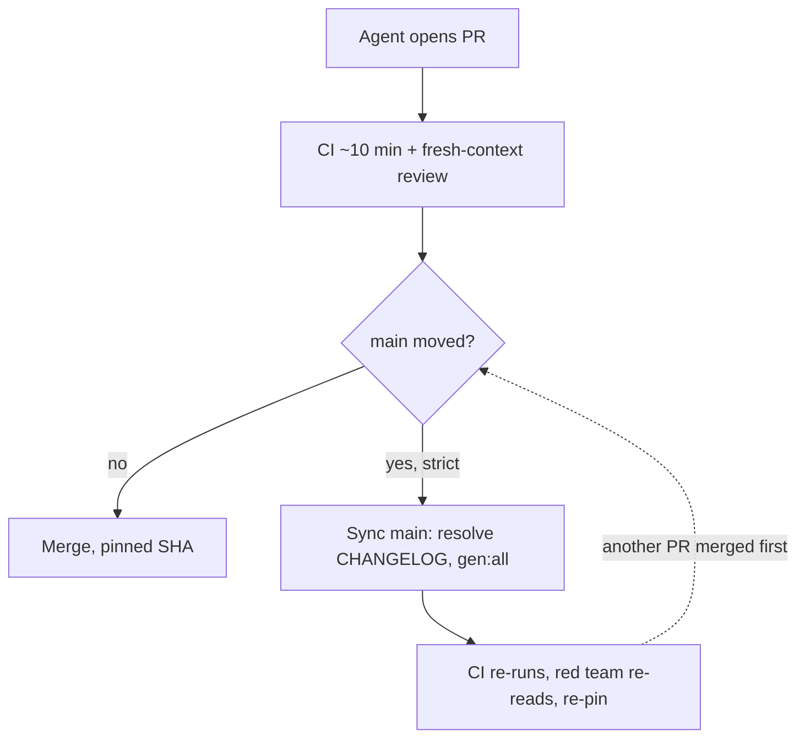

# CI throughput research: what slows the PR cycle now, and what to do about it

Research follow-up to `ci-throughput.md`. Written 2026-11-12 (Pacific/Auckland, NZDT), from data read-only
against `main` at `213e7393` (2026-11-12 17:44 NZDT, PR #732). § 0–9 are the research as written; where
§ 0 calls E and F open owner decisions or suggests a next step, § 10 supersedes it.
**Decided 2026-11-14 (§ 10, RM-D37):** the owner delegated every item to the coordinator; § 10 records each
verdict, its reason and the trigger that would reopen it. The cards are TP1–TP5 in `product-roadmap/cards.md`
(track 9).
**2026-11-15 (§ 12, RM-D48):** a merge train, the proven push and shorter runs were built; § 12 records what
was built, the before and after numbers, the predictions that missed, and each declined item with its reopen
trigger.

## 0. For the agent picking this up

- **Read first:** this file § 1 and § 5; then `ci-throughput.md` (options A–G and the three laws in its § 2,
  which every item here must keep or explicitly ask the owner to change); `docs/agents/commands.md` § CI and
  § Merging a PR; `docs/agents/gotchas.md` § PRs & CI; `.github/workflows/ci.yml` (the header comment above
  `changes`); `.claude/hooks/generated-artifacts.json`; `scripts/check-quick.mjs` and `scripts/nearest-tests.mjs`.
- **Relation to `ci-throughput.md`:** that plan shortened one CI run (A–D, G live). This one measures what
  is left. Its main finding is that the cost has moved from one run's length to serialisation: options
  **E** (merge queue) and **F** (changelog fragments), then open owner decisions (declined 2026-11-14,
  § 10), are now the bottleneck. It adds new items too (a sync-main script, the strict rule, E2E shards, sharded
  main-only legs, affected tests, auto-revert).
- **Verified (measured, reproducible with § 9):** every number in § 4 that has no "estimate" beside it.
- **Estimates:** every "expected effect" in § 5 and the job-hours-per-day figure in § 4.1. They are
  derived from the § 4 numbers, and the derivation is given beside each one.
- **Caveats:** the before/after comparison for the strict rule (§ 4.3) covers only 3 days after the switch,
  and other changes happened in the same window, so it shows a direction, not a cause. The flaky rate is
  understated, because Playwright retries hide E2E flakes.
- **Update (2026-11-15):** § 12 records what was built after § 10 and what it measured; read it before
  acting on a number in §§ 4–7.
- **Next step:** superseded by § 10 (RM-D37) and the TP cards; this line is kept as written: "P0-1 (the
  sync-main script) and P0-3 (E2E shards, splitting `finish.test.ts`) need no rule change. Then ask the
  owner about P0-2 (strict) and P1-1 (organization plus merge queue)."
- **Data window:** `ci.yml` runs 2026-11-05 00:33 → 2026-11-12 17:53 NZDT; PRs: all 688 (#1 to #734);
  git history: `origin/main` since 2026-10-29. `main` has moved since (1.60.0, #735), so refresh with § 9
  before acting on any number.

## 1. Summary

1. **The bottleneck is serialisation, not CI speed.** PR CI median 9.6 min (P90 13.1), queue ≈ 3 s, 3 open
   PRs, PR open → merge median 33 min. There is no PR backlog. The time goes into syncing `main`: in two
   weeks, 297 PR merges came with 266 "merge `origin/main` into the branch" commits, and 165 of those
   needed hand-resolved files.
2. **The conflicts come from records and generated artifacts.** `CHANGELOG.md` was hand-resolved in 98
   merges, then `docs/agents/module-map.md` (42), `llms-full.txt` (32), `docs/error-codes.md` (23) and
   `test/INDEX.md` (22). **82 of the 165 (50%) touched only `CHANGELOG.md` and generated artifacts**, so a
   script can resolve them.
3. **After the strict rule ("require branches to be up to date", 2026-11-10 04:00 NZDT)**, CI runs per PR
   went from 2.11 to 3.02 and P90 open → merge from 113 to 755 min (3-day sample, confounded). Strict does not
   catch main-only breaks either (Node 18, Node 20, Windows run only on `main`).
4. **The merge queue was rejected because the repo is user-owned.** GitHub offers it in public repositories
   owned by an organization. The workflows already trigger on `merge_group`, so moving the repo to a free
   organization would unlock it.
5. **The CI itself still has cheap wins:** shard Playground E2E (the PR long pole, 8.8 min), split
   `test/finish.test.ts` (216 s, the floor of every Node 22 shard), and shard the 23–27 min main-only legs.
   Estimated effect: PR CI 9.6 → about 7 min; the `main` run 27 → about 11 min, so deploys and red-main alarms
   come sooner.

## 2. Anthropic's articles

| Article | Key data | Key practice |
|---|---|---|
| [Agentic coding is straining CI. Here's how we scaled test impact analysis at Anthropic](https://claude.com/resources/articles/agentic-coding-is-straining-ci-heres-how-we-scaled-test-impact-analysis-at-anthropic) (2026-09) | CI jobs ×25 in 6 months; code per engineer ×8; Claude authors 80% of the code; tests ×10 | Deterministic test impact analysis (a listener records results, a selector picks the tests per PR), sharded per package, stateless, horizontally scalable; "give agents a specific set of valid tests so they can self-verify" |
| [Redesigning source control at Anthropic](https://www.anthropic.com/research/redesigning-source-control) (2026-10-13) | Merges per day rose from about 2,500 (May) to over 30,000 (Sep); about 25 million CI checkouts per day; CI checkouts went from minutes to seconds; 25% of CI CPU freed | In-house VCS (Scion). "A proper merge queue doesn't make much sense at agent scale": they invested in post-merge and pre-deploy automated testing, and Claude fixes conflicts |
| [How the Claude Code team does code review](https://claude.dev/blog/solving-code-review-at-anthropic/) (2026-10-15) | Merged PRs to Claude Code more than doubled from June to September, while the share reverted fell by more than 40% | Continuous AI review; risk tiers set by the change, not the author; at most one human per PR for most PRs; revert and incident rates as the guardrail; "use a merge queue, feature flags, … one-step rollback" |

Two lessons apply here. Agents iterate best against a precise test set. The post-merge-verification idea
already exists in `main-red.yml`; at this repo's scale (about 30 merges a day) a merge queue is still the
cheaper tool.

## 3. Industry practice and community discussion

| Company | Practice | Public figures |
|---|---|---|
| Meta | [Predictive test selection](https://engineering.fb.com/2018/11/21/developer-tools/predictive-test-selection/) (gradient-boosted trees) | Runs about a third of the transitively dependent tests and still catches over 99.9% of faulty changes; testing infrastructure efficiency doubled |
| Stripe | [Selective Test Execution](https://stripe.dev/blog/selective-test-execution-at-stripe-fast-ci-for-a-50m-line-ruby-monorepo) (records the files each test opens) | Runs about 5% of tests on average (median 0.5%), under 10% of full-suite compute |
| Uber | SubmitQueue ([large diffs](https://www.uber.com/us/en/blog/bypassing-large-diffs-in-submitqueue/), [CI costs](https://www.uber.com/us/en/blog/slashing-ci-costs-at-uber/)) | 74% lower P95 wait; CI resources −53% and wait −37% |
| GitHub | [Merge queue as the single entry point](https://github.blog/engineering/engineering-principles/how-github-uses-merge-queue-to-ship-hundreds-of-changes-every-day/) | About 2,500 merges a month by 500+ engineers; average wait −33% |
| Shopify | [Merge Queue](https://shopify.engineering/introducing-the-merge-queue), [running fewer tests](https://shopify.engineering/spark-joy-by-running-fewer-tests) | CI starts on enqueue; batched merges; failing PRs leave the queue |
| Google | [TAP flaky-test mitigation](https://testing.googleblog.com/2016/05/flaky-tests-at-google-and-how-we.html) | Reruns only failed tests; quarantines over a threshold and files bugs |
| Linear | [HN thread](https://news.ycombinator.com/item?id=49792067), [summary](https://darkfactory.dev/news/2026-09-21-extra-2/story-2) | Tests about ×4, yet PR wait fell from just over 6 min to just over 5; Vitest `isolate: false` (opt-in) saved about 17% of monthly cost; `tsgo` cut `tsc` 73%; the constraint was written into the agent skills |
| Cursor / Graphite | [Graphite joins Cursor](https://cursor.com/blog/graphite), [Bugbot](https://cursor.com/docs/bugbot), [stacked PRs](https://graphite.com/docs/best-practices-for-reviewing-stacks) | AI review, stacked PRs, a stack-aware merge queue |
| Vercel / Turborepo | [Constructing CI](https://turborepo.dev/docs/crafting-your-repository/constructing-ci), [Remote Caching](https://vercel.com/docs/monorepos/remote-caching) | `--affected` runs only the changed packages; a shallow clone makes every package look changed |
| Netflix | [Develocity case study](https://develocity.ai/customers/story/netflix/) (vendor source) | Build caching, predictive test selection, test distribution; 280,000+ hours a year |

The practices fall into four groups: **verify less** (test selection, affected-only), **verify faster**
(caching, shards, runners), **verify earlier** (local or in-agent checks, AI review) and **merge without
serialising** (merge queue, stacks, post-merge verification plus revert).

Community discussion and pushback:

- HN on the Linear post (317 points, 408 comments): "Why have we not seen an improvements in products?" Throughput is not value.
- [HN on Scion](https://news.ycombinator.com/item?id=50073633) (900 points): the [critique](https://news.ycombinator.com/item?id=50075586) that a server-side VCS gives up git's local history.
- [DORA 2025](https://dora.dev/research/2025/dora-report/): AI adoption now improves delivery throughput but still increases delivery instability.
- [Reddit r/EngineeringManagers](https://www.reddit.com/r/EngineeringManagers/comments/1tax505/how_are_teams_handling_pr_review_now_that_ai_is/): AI doubled output, not reviewers; triage by risk, and auto-merge only low-risk changes.
- X: [from 1–3 to 10–15 PRs per person per day, then a plateau until CI was fixed](https://x.com/dalsanto_c/status/2110270561477939219); [cap concurrent agent branches per repo](https://x.com/liher0505/status/2113445054492938400); [15 → 160 PRs a day, and CI broke first](https://x.com/_ethanleonard/status/2117382741721256238).

## 4. This repository: measured state

### 4.1 Headline figures

| Measure | Value | Note |
|---|---|---|
| PR CI wall clock | median 9.6 min, P90 13.1 | 366 successful PR runs |
| `main` push CI wall clock | median 27.1 min, P90 29.0 | 218 successful push runs |
| Queue time per job | median 0.05 min, max 0.10 | 28 sampled runs |
| PR open → merge, last 7 days | median 33 min (0.55 h), P90 about 2 h | 221 merged PRs |
| Open PRs | 3 | 688 total, 638 merged, 47 closed unmerged; 74 by dependabot |
| PR CI failure rate | 23% (111 of 477 decided runs) | 89 more were cancelled by `concurrency` |
| Same-SHA red → green reruns | 0 of 122 failing SHAs | Playwright retries hide E2E flakes |
| `main` red rate | 4.8% (11 of 229 push runs) | |
| PRs that synced `main` at least once | 53% (141 of 297) | 2 weeks |
| CI runs per day | 60–160 | about 167 job-hours a day (estimate: sampled job-minutes per run × runs) |

GitHub Free allows 20 concurrent jobs ([limits](https://docs.github.com/en/actions/reference/limits)), and one
PR run uses 17 jobs, so overlapping runs will start to queue. The sample showed no queueing yet.

CI runs per day (NZDT; the first and last days are partial):

| Day | PR runs | `main` push runs |
|---|---|---|
| 11-05 | 40 | 19 |
| 11-06 | 73 | 39 |
| 11-07 | 46 | 23 |
| 11-08 | 33 | 13 |
| 11-09 | 102 | 51 |
| 11-10 | 114 | 42 |
| 11-11 | 113 | 29 |
| 11-12 | 47 | 15 |

### 4.2 One PR round trip



### 4.3 Before and after the strict rule

| Measure | Before (11-05 → 11-10 04:00) | After (11-10 04:00 → 11-12) |
|---|---|---|
| Merged PRs | 167 | 66 |
| Merges per day | 32.6 | 25.7 |
| Open → merge, median | 32 min | 42 min |
| Open → merge, P90 | 113 min | 755 min |
| CI runs per PR (mean) | 2.11 | 3.02 |

### 4.4 Where the conflicts come from

Hand-resolved files in the 266 "main into branch" merges since 2026-10-29 (`git diff-tree --cc`):

| File | Merges |
|---|---|
| `CHANGELOG.md` | 98 |
| `docs/agents/module-map.md` (generated) | 42 |
| `llms-full.txt` (generated) | 32 |
| `src/error-catalog.ts` | 23 |
| `docs/error-codes.md` (generated) | 23 |
| `test/INDEX.md` (generated) | 22 |
| `docs/language-reference.md` | 17 |
| `docs/whats-new.md` | 14 |
| `spec.llm.md` (generated) | 12 |
| `docs/cli-reference.md` (generated) | 12 |

165 merges had at least one hand-resolved file. In 28 of them every such file was a generated artifact, and in
54 more every such file was a generated artifact or `CHANGELOG.md`: **82 (50%) need no judgement.**

Syncs per merged PR (297 PRs, 2 weeks): 0 syncs for 156, 1 for 60, 2 for 55, 3 for 14, 4 or more for 12.

Commits touching each file, same window: `CHANGELOG.md` 174, `llms-full.txt` 87, `docs/agents/module-map.md` 85,
`docs/error-codes.md` 69, `src/error-catalog.ts` 60.

### 4.5 Job durations (sampled: 18 PR runs, 10 push runs, minutes)

| Job | PR median | PR P90 | Push median | Push P90 |
|---|---|---|---|---|
| Playground E2E (Playwright) | 8.8 | 10.3 | 7.9 | 19.8 |
| Docs site E2E (Playwright) | 5.9 | 7.2 | 5.8 | 7.3 |
| Node 22 tests, slowest of 5 shards | 4.8 | 5.9 | 5.0 | 5.6 |
| 3D package (check:3d) | 2.6 | 3.2 | 2.8 | 4.5 |
| Workspace builds | 2.4 | 3.2 | 2.5 | 2.9 |
| Benchmark (informational) | 2.1 | 2.4 | n/a | n/a |
| Node 22 checks | 0.8 | 0.9 | 0.7 | 0.9 |
| Windows (tests + drift) | 0.1 (skipped) | 0.1 | 26.5 | 27.1 |
| Node 18 | 0.1 (skipped) | 0.1 | 24.1 | 27.6 |
| Node 20 | 0.1 (skipped) | 0.1 | 23.1 | 25.8 |
| CodeQL (separate workflow) | 1.8 | 2.2 | 6.2 | 6.3 |

Playground E2E steps: "Run E2E specs" 4.0–6.4 min (Chromium), Firefox and WebKit specs 0.6–2.0, apt deps
0.1–1.3. On push, Node 18/20/Windows spend 22–26 min in a single `Test` step (the whole suite in one job).
Sampled job-minutes per run: about 45 per PR run and about 117 per push run.

### 4.6 Test suite

`test/.durations.json`: 544 files, 1,856 s in total; the top 10 files take 38% and the top 30 take 58%.

| File | Seconds |
|---|---|
| `test/finish.test.ts` | 215.9 |
| `test/net-area-oracle-corpus.test.ts` | 98.4 |
| `test/finish-furnish.test.ts` | 81.4 |
| `test/lint-fix-texts.test.ts` | 52.9 |
| `test/fuzz.test.ts` | 52.6 |
| `test/rendered-theme.test.ts` | 42.7 |
| `test/cli-validate-next.test.ts` | 42.6 |
| `test/taste-equivariance.test.ts` | 42.1 |
| `test/repair-no-worse.test.ts` | 41.6 |
| `test/taste-digests.test.ts` | 36.3 |

### 4.7 What is already in place

Records-only fast path (C), per-PR `concurrency` (B), coverage moved to nightly (D), Node 22 shards ordered by
recorded durations (G), main-only Node 18/20/Windows legs (G), auto-merge with SHA-pinned `--match-head-commit`
(A), risk tiers (`scripts/risk-tier.mjs`), `REVIEW.md` with two review rounds at most, `check:quick` as the
local gate (nearest tests by import distance), `main-red.yml`, nightly `full-matrix` / `fuzz-deep` / `mutants`,
and `merge_group` triggers. Most of the industry list is here already; what is missing is the merge strategy
and conflict handling.

## 5. Roadmap

Ordered as: remove serialisation first, then verify less, then verify faster. The effects are estimates
derived from § 4.

### P0: quick wins (no owner rule changes except P0-2)

| Id | Change | Expected effect (estimate) |
|---|---|---|
| P0-1 | A `sync-main` script (§ 6.1): generated-artifact conflicts take `main`'s side and then run `gen:all`; `CHANGELOG.md` merges with union and is checked by `scripts/check-changelog-unreleased.mjs`; any other conflict stops and goes to an agent | Scripts away about 82 hand resolutions per 2 weeks (50%) |
| P0-2 | Reconsider strict (owner setting). It costs about 0.9 extra CI runs per PR and does not cover the main-only legs. Either turn it off and rely on PR green plus `main-red.yml` (the state before 11-10), or keep it only until P1-1 | CI runs per PR back to about 2.1 |
| P0-3 | Shard Playground E2E 2-way behind an aggregator that keeps the required check name (§ 6.2); split `test/finish.test.ts` into about 3 files and refresh `.durations.json` | PR CI 9.6 → about 7 min (the long pole becomes Docs E2E at 5.9 and the shards at about 4) |
| P0-4 | Fold records-only PRs ("docs(plans): cards after …") into the code PR they record, or one per stage | `docs/*` branches were about 27% of PRs; fewer PRs that conflict with one another |

### P1: medium term (2–4 weeks)

| Id | Change | Expected effect (estimate) |
|---|---|---|
| P1-1 | Option E for real: move the repo to a (free) organization and add a merge-queue ruleset (§ 6.3); turn strict off. Check afterwards: npm Trusted Publisher (OIDC, bound to owner/repo), repository secrets, Marketplace and Open VSX links, docs links (GitHub redirects the old URLs) | The queue tests the merged result, so update-branch rounds and the re-red-team after a sync mostly disappear; only real textual conflicts leave the queue |
| P1-2 | Option F: `changelog.d/<branch>.md` fragments, assembled by `/release-check`. This needs the AGENTS.md rule "release narrative lives only in `CHANGELOG.md`" amended first (owner) | Removes the source of 98 conflicts |
| P1-3 | Shard the main-only Node 18, Node 20 and Windows legs 3-way, each behind an aggregator that keeps its required check name (as `Node 22` does). Watch the 20-concurrent-job limit | `main` CI 27 → about 11 min, so `deploy.yml` and `main-red.yml` react 2–2.5× sooner |
| P1-4 | Automate "does this sync need a re-review": compare the files `main` brought in with the PR's own files (minus generated artifacts). If they don't overlap, keep the review and only re-pin the SHA | Most re-red-team rounds skipped |

### P2: long term (1–3 months)

| Id | Change | Expected effect (estimate) |
|---|---|---|
| P2-1 | Affected tests on PRs (`vitest related` or `scripts/nearest-tests.mjs`) plus an always-run set: directory-scanning guards, digests, byte-identity, hashing laws (gotcha: select by transitive import closure). The full suite stays in the queue and on `main`. This narrows law 2 of `ci-throughput.md` and needs the owner | PR compute probably less than half; wall clock is limited by E2E |
| P2-2 | Auto-revert: when `main-red.yml` sees exactly one merge between the last green and the red, it opens a revert PR; with several merges, it bisects with the failing leg | Faster recovery; the guardrail that makes P0-2 and P2-1 safe |
| P2-3 | Flaky accounting: persist the `scripts/playwright-flaky.mjs` results as an artifact and trend them; quarantine a test over a threshold and open an issue | Makes the hidden flake rate visible |
| P2-4 | Vitest `isolate: false` on an allow-listed set of stateless files, with the rule written into the agent skills (as Linear did) | Per-file setup saved; verify file by file |

Not recommended now: Bazel, Nx or Turborepo remote caching (Workspace builds take 2.4 min); a custom VCS
(3–4 orders of magnitude below Anthropic's scale); paid larger runners (revisit after P0 and P1).

## 6. Example configuration (sketches; adapt before use)

### 6.1 `scripts/sync-main.sh` (P0-1)

```bash
#!/usr/bin/env bash
# Merge origin/main into the current branch; resolve generated artifacts and CHANGELOG automatically.
set -euo pipefail
git fetch origin main
git merge --no-commit --no-ff origin/main || true
GEN=$(node -e 'console.log(Object.keys(require("./.claude/hooks/generated-artifacts.json").artifacts).join("\n"))')
for f in $(git diff --name-only --diff-filter=U); do
  if [ "$f" = "CHANGELOG.md" ]; then
    git show :1:CHANGELOG.md > /tmp/base; git show :2:CHANGELOG.md > /tmp/ours; git show :3:CHANGELOG.md > /tmp/theirs
    git merge-file --union /tmp/ours /tmp/base /tmp/theirs && cp /tmp/ours CHANGELOG.md
  elif echo "$GEN" | grep -qxF "$f"; then
    git checkout --theirs -- "$f"
  else
    echo "real conflict, needs an agent: $f"; exit 1
  fi
  git add "$f"
done
npm run gen:all && git add -A
node scripts/check-changelog-unreleased.mjs origin/main
git commit --no-edit
```

The union merge can leave a branch's entry inside a released section (gotchas § PRs & CI); the
`check-changelog-unreleased` call above is what catches that.

### 6.2 Sharded Playground E2E keeping the required check name (P0-3)

```yaml
e2e-playground-shard:
  name: Playground E2E ${{ matrix.shard }}/2
  needs: changes
  runs-on: ubuntu-latest
  strategy: { fail-fast: false, matrix: { shard: [1, 2] } }
  steps:
    # ... the existing setup, build and Playwright cache steps, unchanged
    - run: npx playwright test -c playground --shard=${{ matrix.shard }}/2
e2e-playground:            # keeps the required check name
  name: Playground E2E (Playwright)
  needs: [changes, e2e-playground-shard]
  if: always()
  runs-on: ubuntu-latest
  steps:
    - run: test "${{ needs.e2e-playground-shard.result }}" = success -o "${{ needs.e2e-playground-shard.result }}" = skipped
```

The `@engines` Firefox/WebKit step and the `Flaky tests` report step have to move into the shard job (or a
third job).

### 6.3 Merge-queue ruleset after the move to an organization (P1-1)

`gh api -X POST repos/<org>/archlang/rulesets --input ruleset.json`:

```json
{
  "name": "main-queue", "target": "branch", "enforcement": "active",
  "conditions": { "ref_name": { "include": ["~DEFAULT_BRANCH"], "exclude": [] } },
  "rules": [{ "type": "merge_queue", "parameters": {
    "merge_method": "MERGE", "grouping_strategy": "ALLGREEN",
    "max_entries_to_build": 5, "min_entries_to_merge": 1, "max_entries_to_merge": 5,
    "min_entries_to_merge_wait_minutes": 5, "check_response_timeout_minutes": 60 } }]
}
```

The merge command stays `gh pr merge <n> --auto --merge --match-head-commit <sha>`; the PR enters the queue.
`docs/agents/commands.md` § CI already describes how the workflows behave under `merge_group`.

### 6.4 Affected tests on PRs, full suite elsewhere (P2-1)

```yaml
- name: Affected tests (PR only)
  if: github.event_name == 'pull_request'
  run: |
    CHANGED=$(git diff --name-only origin/main...HEAD -- src packages test)
    npx vitest related --run $CHANGED \
      test/*byte-identity*.test.ts test/docs-*.test.ts test/*digest*.test.ts
- name: Full suite (queue / main)
  if: github.event_name != 'pull_request'
  run: npx vitest run --shard=${{ matrix.shard }}/5
```

`changes` needs `fetch-depth: 0` (or a fetched merge base) for the diff. The always-run list has to come
from the scanning guards in `scripts/check-quick.mjs` (`scanningGuards`), not from this sketch.

## 7. Measures and guardrails

| Measure | Now | Target |
|---|---|---|
| CI runs per PR | 3.0 | 1.5 or fewer |
| PRs syncing `main` at least once | 53% | under 15% |
| Hand-resolved merges per 2 weeks | 165 | under 40 |
| PR CI median | 9.6 min | 7 min |
| `main` CI median | 27.1 min | 12 min |
| `main` red rate | 4.8% | no higher |
| Revert rate | not measured | measure it; no higher |

As the Claude Code team does, track the red rate and the revert rate alongside the speed: if they rise, the
time was moved, not saved.

## 8. Method

- **CI runs:** the last 799 `ci.yml` runs; wall clock = `updated_at − run_started_at`; duplicates from
  pagination removed.
- **Jobs and steps:** 28 sampled runs (12 successful PR, 7 successful push, 6 failed PR, 3 failed push);
  queue = job `started_at − created_at`.
- **PRs:** all 688 from the pulls API; open → merge = `merged_at − created_at`; CI runs per PR = PR-event
  runs on the head branch.
- **Strict cut:** 2026-11-10 04:00 NZDT, the commit "docs: merge queue unavailable on a user-owned repo;
  strict up-to-date checks instead".
- **Conflicts:** first-parent merges on `origin/main` since 2026-10-29. A sync merge is any non-"Merge pull
  request" merge; hand-resolved files are those `git diff-tree --cc --name-only -r <merge>` lists (they
  differ from both parents).
- **Flaky:** a SHA with both a failed and a successful run of the same event.
- **Access:** all of it was done read-only; no repository change, comment or PR.

## 9. How to refresh the data

Needs `gh` authenticated with read access, `jq`, `python3`, and a full clone (`git fetch --unshallow` if
shallow). Times from the API are UTC; add 13 h for NZDT.

```bash
R=ChanMeng666/archlang
# 1. CI runs (8 pages of 100 ≈ one week at the current rate)
for p in 1 2 3 4 5 6 7 8; do gh api "repos/$R/actions/workflows/ci.yml/runs?per_page=100&page=$p" > ci_runs_$p.json; done
jq -s '[.[].workflow_runs[]] | unique_by(.id) | map(select(.status=="completed"))
  | group_by(.event+"/"+(.conclusion//"none"))
  | map({k:(.[0].event+"/"+(.[0].conclusion//"none")), n:length,
         median_min:(map(((.updated_at|fromdate)-(.run_started_at|fromdate))/60)|sort|.[length/2|floor])})' ci_runs_*.json
# 2. Jobs of one run (repeat for a sample of run ids)
gh api "repos/$R/actions/runs/<run_id>/jobs?per_page=100" \
  | jq '.jobs[] | {name, min:(((.completed_at|fromdate)-(.started_at|fromdate))/60), queue_s:((.started_at|fromdate)-(.created_at|fromdate))}'
# 3. PRs: open count and open -> merge
gh pr list -R $R --state open --json number,title,author
gh api --paginate "repos/$R/pulls?state=all&per_page=100" \
  | jq -s '[.[][] | select(.merged_at) | ((.merged_at|fromdate)-(.created_at|fromdate))/60] | sort | {n:length, median_min:.[length/2|floor], p90_min:.[(length*0.9)|floor]}'
# 4. Sync merges vs PR merges, and hand-resolved files (a train PR's own merge is counted apart:
#    its members' merges sit on its second-parent side and count as PR merges)
git fetch origin
git log origin/main --since=2026-10-29 --merges --format='%s' \
  | awk '/^Merge pull request #[0-9]+ from [^ \/]+\/train\//{t++;next} /^Merge pull request/{a++;next}{b++}
         END{print "PR merges",a,"train merges",t,"sync merges",b}'
git log origin/main --since=2026-10-29 --merges --format='%H %s' | grep -v 'Merge pull request' | cut -d' ' -f1 \
  | while read h; do git diff-tree --cc --name-only -r "$h" | tail -n +2; done | sort | uniq -c | sort -rn | head -15
# 5. Syncs per merged PR (a train merge on the first-parent line stands for its members: each member's
#    merge sits on the train's own first-parent line, and its syncs are the merges in m^1..m^2)
git log origin/main --since=2026-10-29 --first-parent --merges --format='%H %s' | grep 'Merge pull request' \
  | while read h s; do
      case "$s" in *" from "*/train/*) git log --first-parent --merges --format=%H "$h^1..$h^2" ;; *) echo "$h" ;; esac
    done \
  | while read h; do git rev-list --merges --count "$h^1..$h^2"; done | sort -n | uniq -c
# 6. Slowest test files
node -e 'const d=require("./test/.durations.json");Object.entries(d).sort((a,b)=>b[1]-a[1]).slice(0,10).forEach(([f,s])=>console.log(s.toFixed(1),f))'
```

## 10. Decisions (2026-11-14, RM-D37)

The owner, 2026-11-14: "里面每一项都要你来定，或者排进路线图" (decide every item, or schedule it). These are
the coordinator's verdicts under that delegation, for this research only; the owner can reverse any one in a
sentence. No iron law and no AGENTS.md hard rule changes. Re-measured before deciding, on `main` at `70e5b207`:

- Since the strict rule (2026-11-10 04:00 NZDT): 81 PR merges came with 111 sync merges into branches,
  **1.37 syncs per merged PR** (0.90 over the two weeks of § 4.4). The cost the research found is growing.
- PR CI, successful runs created since 2026-11-12 00:00 UTC (the latest 100 runs of `ci.yml`): median 9.1 min
  over 48; `main` push 28.1 min over 22.
- Job queue time, the 25 latest completed runs in that window: at most 10 s. **Runners are not scarce** (public repo, free
  minutes), so the lever is wall clock and coordinator turns, not compute.
- Six recent code-PR runs, median (range) in minutes: Playground E2E 8.7 (7.1–10.8; Chromium specs 5–6 min,
  then Firefox and WebKit 2.5–3.5 min in the same job, in series); Docs E2E 5.9 (4.6–7.9); `check:3d`
  5.6 (4.6–6.3); the slowest Node 22 shard 5.7 (5.1–6.3). Setup (checkout, `npm ci`, builds, cached
  browsers) is about 1 min a job.

### 10.1 Verdicts

| Item | Verdict | Why | Reopen when |
|---|---|---|---|
| P0-1 sync-main script | **Take: TP1.** Node, not bash (the coordinator runs on Windows); also prints the re-review focus of P1-4 | Removes about half the hand resolutions; `gh pr update-branch` stales generated artifacts (gotchas § PRs & CI) | |
| P0-2 turn strict off | **Decline: strict stays.** | It went on 2026-11-10 because two pairs of green PRs merged blind and broke `main` (EH3.7, `engineering-health/README.md`); `main` must stay green until Show HN. Its cost is extra CI runs, which are free here, and coordinator turns, which TP1 and the one-sync-at-a-time rule cut | after TP1 and TP2, syncs per merged PR stay above 1.0, or P90 open → merge above 4 h, over 7 days of merges (TP5 measures both) |
| P0-3 E2E shards, split `finish.test.ts` | **Take the Playground half: TP2.** Chromium in two shards and Firefox/WebKit in a job of their own, behind an aggregator that keeps the required name. **Decline the `finish.test.ts` split and the Docs E2E shard for now** | Playground's median is 8.7 min; the next three (Docs E2E, `check:3d`, the slowest Node 22 shard) have medians of 5.6–5.9, so after the split cutting one of them alone moves nothing | one of those three has a median more than 1 min above the other two after TP2 |
| P0-4 fold records-only PRs | **Take as a working rule** (`product-roadmap/handoff.md` § 5): the default is one records PR at a session's end; a record may ride in the code PR it records | Each extra PR is one more branch that goes BEHIND. TP1 leaves low-tier paths out of the re-review focus, so a ridden record adds nothing to the red team's reading | |
| P1-1 organization + merge queue (option E) | **Decline.** Also declined: a third-party queue (Mergify and the like) | Moving the repo breaks what is bound to the owner `ChanMeng666`: the MCP registry name `io.github.ChanMeng666/archlang-mcp` (`packages/mcp/server.json`) published by GitHub OIDC (`release.yml`), npm trusted publishing and `repository.url` "byte-for-byte" (`.claude/rules/release-and-packages.md`; npmjs is owner-only), and every listing in `docs/seo.md` § 8. A third-party app would hold write access to a repo whose `main` deploys both sites. At about 19 merges a day (81 in 4.3 days since strict) a scripted, one-at-a-time sync gives the queue's guarantee (CI on the merged tree) | GitHub offers merge queues to user-owned repos, or the P0-2 row's trigger fires and TP1–TP3 cannot fix it |
| P1-2 changelog fragments (option F) | **Decline.** | TP1's union merge plus `scripts/check-changelog-unreleased.mjs` resolves the 98 CHANGELOG conflicts without amending the AGENTS.md rule "release narrative lives only in `CHANGELOG.md`" | `check-changelog-unreleased` refuses a union-merged entry more than twice in a month |
| P1-3 shard the main-only legs | **Take: TP2.** Node 18, Node 20 and Windows three ways each; on a PR the shards skip at job level, so no runner starts for them (except when `changes` failed, the existing fail-open) | `main` 28 → about 11 min (estimate: 22–26 min of tests / 3 + about 1.5 min setup, Windows the slowest). With strict on, a red `main` blocks every PR's sync, so it must show sooner; deploys come sooner too. Cost: a push run peaks at about 21 parallel jobs, over the Free plan's 20 (§ 4.1), so TP2's proof reports job queue time | median job queue time above 1 min after TP2 |
| P1-4 automate "does this sync need a re-review" | **Take as a focus aid, inside TP1; law 3 of `ci-throughput.md` § 2 is unchanged.** After every sync the merged head is red-teamed again; `sync:main` hands the red team a focus list: files both sides changed, hand-resolved files, files `main` brought in that a PR-changed file imports (or is imported by), and exports `main` changed, whose callers the red team greps in the PR. Renames count both paths (`--no-renames`); low-tier paths are left out | A file-overlap test cannot see the case law 3 exists for: a PR calling `doorSwing()` while a parallel PR changed it, with no shared file, a clean merge and a green suite (`docs/agents/gotchas.md` § PRs & CI). A focused read is cheaper; skipping it is not safe | |
| P2-1 affected tests on PRs | **Decline now.** | It narrows law 2 to save compute, and compute is free and unqueued here; the PR wall clock is set by E2E and `check:3d`, not the suite | median job queue time above 1 min, or the suite becomes the PR pole after TP2 |
| P2-2 auto-revert | **Defer: TP4** (off the line) | A red `main` is often not a merge's fault: on 2026-11-11 it was red for about 7 h on the apt "Install Chromium system deps" step, which a revert would not have fixed. The one merge-caused incident since strict (#703's `toReversed` on Node 18, fixed by #708) was on a main-only leg. A revert PR opened with `GITHUB_TOKEN` starts no CI, so it needs an App or a token the owner creates | merge-caused incidents (TP4 counts them: not a re-run pass, not a setup step) exceed two a week for two weeks, or one keeps `main` red for more than 2 h |
| P2-3 flaky accounting | **Take: TP3** (small, off the line) | Playwright retries hide E2E flakes; the hidden rate is not measured | |
| P2-4 Vitest `isolate: false` | **Decline.** | The suite leans on per-file isolation (memoised parse stage, module state); verifying 544 files one by one costs more than the ~17% Linear saw, and the suite is not the pole | the suite becomes the pole and `isolate` is the cheapest lever left |
| Bazel / Nx / Turborepo caching, custom VCS, paid runners | **Decline**, as § 5 recommends | | |

### 10.2 Expected effect and how it is checked (estimates)

PR CI 9.1 → about 6.5 min (the pole moves to Docs E2E, `check:3d` and the Node 22 shards); `main` push
28 → about 11 min; about half the hand resolutions scripted; re-red-team rounds after a sync narrower (a
focus list, not a full re-read); fewer wasted CI runs, because only the next PR to merge is synced. TP5
re-reads § 7's table with § 9's commands after 7 days of merges on TP1 and TP2, adds the measures the
reopen triggers above name (syncs per merged PR, P90 open → merge, job queue time, changelog refusals,
merge-caused incidents), and writes the numbers under this section; the guardrails are
§ 7's `main` red rate and revert rate, and a rise in either means the time was moved, not saved.

**First readings (2026-11-14, one run each, not medians):** TP1 merged as #754 and TP2 as #755. PR run
43535706255: 7.3 min wall clock (Chromium shards 3.0 and 5.1, engines 2.8; the pole is now Docs E2E and a Node 22
shard at 6.0). First `main` push run after #755, 43541609209: **12.8 min** (median 28.1 before), every job queued
4 s or less. Its pole is each main-only leg's shard 1 (Windows 12.5, Node 18 12.2, against 5.8–6.0 for shard 2):
`test/sequencer.ts` puts every file recorded at 0 s in one shard, card TP6. TP5 replaces these with medians.

## 11. Sources

- Anthropic: [test impact analysis](https://claude.com/resources/articles/agentic-coding-is-straining-ci-heres-how-we-scaled-test-impact-analysis-at-anthropic) · [Redesigning source control](https://www.anthropic.com/research/redesigning-source-control) · [Claude Code code review](https://claude.dev/blog/solving-code-review-at-anthropic/)
- GitHub: [merge queue at GitHub](https://github.blog/engineering/engineering-principles/how-github-uses-merge-queue-to-ship-hundreds-of-changes-every-day/) · [merge queue availability (organization-owned public repos)](https://github.com/github/docs/blob/main/data/reusables/gated-features/merge-queue.md) · [Managing a merge queue](https://docs.github.com/en/repositories/configuring-branches-and-merges-in-your-repository/configuring-pull-request-merges/managing-a-merge-queue) · [Actions limits](https://docs.github.com/en/actions/reference/limits)
- Meta: [Predictive test selection](https://engineering.fb.com/2018/11/21/developer-tools/predictive-test-selection/) · Stripe: [Selective Test Execution](https://stripe.dev/blog/selective-test-execution-at-stripe-fast-ci-for-a-50m-line-ruby-monorepo) · Uber: [large diffs](https://www.uber.com/us/en/blog/bypassing-large-diffs-in-submitqueue/), [CI costs](https://www.uber.com/us/en/blog/slashing-ci-costs-at-uber/)
- Shopify: [Merge Queue](https://shopify.engineering/introducing-the-merge-queue) · [Running fewer tests](https://shopify.engineering/spark-joy-by-running-fewer-tests) · Google: [flaky tests](https://testing.googleblog.com/2016/05/flaky-tests-at-google-and-how-we.html)
- Linear: [HN thread](https://news.ycombinator.com/item?id=49792067) · [summary](https://darkfactory.dev/news/2026-09-21-extra-2/story-2) · Cursor: [Graphite](https://cursor.com/blog/graphite), [Bugbot](https://cursor.com/docs/bugbot) · Graphite: [stacked PRs](https://graphite.com/docs/best-practices-for-reviewing-stacks)
- Turborepo: [Constructing CI](https://turborepo.dev/docs/crafting-your-repository/constructing-ci) · Vercel: [Remote Caching](https://vercel.com/docs/monorepos/remote-caching) · Netflix: [Develocity case study](https://develocity.ai/customers/story/netflix/) · Vitest: [affected tests](https://vitest.dev/guide/recipes/affected-tests)
- [DORA 2025](https://dora.dev/research/2025/dora-report/) · HN: [Scion thread](https://news.ycombinator.com/item?id=50073633), [critique](https://news.ycombinator.com/item?id=50075586) · [Reddit](https://www.reddit.com/r/EngineeringManagers/comments/1tax505/how_are_teams_handling_pr_review_now_that_ai_is/) · X: [@dalsanto_c](https://x.com/dalsanto_c/status/2110270561477939219), [@liher0505](https://x.com/liher0505/status/2113445054492938400), [@_ethanleonard](https://x.com/_ethanleonard/status/2117382741721256238)

## 12. 2026-11-15: merge train, proven push, shorter runs

Decided by the coordinator under the owner's words of 2026-11-15 (RM-D48, `product-roadmap/README.md` § 6.18);
the owner can reverse any item in a sentence. Times are UTC. Every number is measured unless marked
"predicted" or "estimate". The FT ids are this session's work items; their PRs are the record.

### 12.1 What was built (all merged)

- **FT1, #785** (landed by train #789, merge `c995acde`, 09:08:20). A same-repo PR whose head branch starts
  with `train/` runs Node 18, Node 20 and Windows in full. A push to `main` is *proven* when its merge commit
  M has two parents, tree(M) = tree(M^2), M^1 is an ancestor of M^2, the push's `before` is M^1, and a
  completed successful `ci.yml` `pull_request` run on M^2 from a `train/*` branch into `main` ran every job
  (no "nothing to run on this leg" marker step, every expected job name present, run no older than 24 h).
  A proven push skips every leaf's work and the ten required names report success. Fail-open.
  `scripts/ci-proven.mjs` (`--run <id>` predicts), `test/ci-proven.test.ts`. `deploy.yml`'s MCP diff base is
  now the head of the previous green push run on `main`.
- **FT2, #788** (train #792, merge `58bd76f0`, 09:27:39). `npm run train` (`scripts/merge-train.mjs`): build,
  `--land [--wait]`, `--abandon`; the shared pieces were moved out of `scripts/sync-main.mjs`.
- **FT3a, #794** (train #796, merge `e3917b01`, 10:42:51). TP6 is done here (the sequencer adds a 2 s
  per-file overhead; unrecorded files sit at the table median after the recorded ones). Shards: Node 22 5 to 7;
  Node 18, Node 20, Windows 3 to 5. `Docs site E2E (Playwright)` is an aggregator over 3 jobs with explicit spec
  lists, `Playground E2E` chromium is 3 jobs likewise, `3D package (check:3d)` is an aggregator over a suite pass
  and a frame-budget pass (`--pass=`). `Benchmark` cannot fail the run (job-level `continue-on-error`).
  `test/.durations.json` was refreshed from nightly run 43671538421; `test/e2e-shards.test.ts`,
  `test/sequencer.test.ts`; the hook regex covers `npm -w <ws> run e2e|bench`.
- **FT3c, #798** (train #799, merge `45c2837d`, 11:42:56). `test/finish.test.ts` split into four files and
  `test/finish-furnish.test.ts` into three; a pure move (19,030 tests passed before and after).
- **FT4, #795** (train #801, merge `4f432ca1`, 11:59:30). After review,
  `check:quick` also selects source-tree scanner guards (budget 15 recorded seconds, ceiling 30 files), tests
  named after a changed module (5 files / 10 s) and the cheapest corpus pins (5 s). `typecheck:all` and a build
  inside the gate were built and then removed on evidence (§ 12.4).
- **Trains landed:** #789 (member #785; built by hand, then synced once by hand), #792 (#788), #796 (#794),
  #799 (#798), #801 (#795), #803 (members #800, low tier, and #802, high tier; base `4f432ca1`, train run
  43712779650 took 8.6 min, merged 12:23:06 as `60e2436c`, both members marked merged at 12:23:08), #808
  (members #805, low tier, and #806, high tier; base `43a04a95`; run 43718257635, 7.5 min; merged
  13:25:59 as `e84870fd`): seven trains today. Abandoned: #786 (hand-built; `main` moved).

### 12.2 Measured before and after

| Measure | Before (2026-11-14/15, after TP1 and TP2) | After |
|---|---|---|
| PR code run, wall clock | median 7.2 min (n=36) | 4.7 min (run 43704031936, one run; 5.7 min on the first version of #794) |
| Full run (train PR or unproven push) | 12.3 min median push (n=26); train runs 14.6 (incl. about 1.5 queued), 12.5, 13.0 min | 8.7 min (train #796, run 43704660304) and 8.4 min (train #799, run 43709558420), 7.0 min (train #801, run 43710988054, first full run with the finish split), 8.6 min (train #803, run 43712779650), 7.5 min (train #808, run 43718257635) |
| `main` push run after a train | median 12.3 min | 28 s, 25 s, 26 s, 24 s, 30 s, about 29 s, about 24 s (seven trains, all proven; train #803's push run 43713564865, train #808's 43718973798, created 13:26:02, updated 13:26:26) |
| Merge to deploy finished | median 13.7 min (n=26, estimate from run times) | 2 min 5 s (train #789: merged 09:08:20, deploy success 09:10:25) |
| Open to merge, non-records PRs | median 35.8 min, 1.2 syncs and 2.6 CI runs per PR (n=27) | not re-measured (needs a week of merges; TR6) |

**Predictions that did not hold.** #794 predicted a PR run of about 4.2, then 3.7 min, and a full run of
about 6.4–6.6 min (predicted); it measured 4.7 and 8.4–8.7. FT3c's own PR run showed no improvement: the
slowest shard took 338 s on a slow runner, and the split files' summed test time rose from about 318 s to
about 389 s because each file starts cold; judge it over several runs. The poles now: PR run, `3D package
frame-budget pass` 267 s and a Node 22 shard 232 s; full run, Windows shards 400–500 s and Node 18 shards
about 400–500 s.

### 12.3 Findings

- **Runner noise follows the job, not the file.** In run 43704660304 shard 4's median ratio to Node 22 was 1.79
  on Node 18 and 1.03 on Node 20 with identical files (shard 3 the reverse, 1.24 vs 1.62); Windows is about
  1.47× slower overall. A per-leg duration table was designed and not built.
- **The 40-concurrent-job limit (GitHub Pro) binds.** A train PR peaks at 38 jobs, an unproven push 36, an
  ordinary code PR 26; a train plus one PR run queue (up to 79 s seen).
- **PR CI failures** (the 60 most recent failed `pull_request` runs, by first failing step): unit tests 41,
  `Type-check every workspace` 13 (11 of them one Dependabot PR; the other 2 were test files the old gate
  already compiled), `check:3d` 10, generated-artifact drift 8, lint 3, E2E 1 + 1. Median 22.5 min from a
  failed run to the next run on the branch. Replaying 11 sampled runs through the gate's selection: 2 were
  already selected by the old gate (the gate was not run or was ignored), 2 are catchable by no rule.
- **FT4's final review** (the reviewer's numbers, of record): the gate is a strict superset of `main`'s previous
  gate. Replay of 11 sampled reds: 7 newly caught, 2 already selected by the old gate, 2 catchable by no rule
  (optimistic: the rules were designed on these runs). The extras add 2 to 35 test files and 1.2 to 25.2 recorded
  seconds. Train #801's slowest jobs: Node 18 tests 5/5 400 s, Windows tests 2/5 389 s, Node 20 tests 5/5 379 s.
  Wall-time cost of the gate: about 30–35 s on a typical `src/` change (estimate, low confidence, no paired
  timing; four gate runs on a loaded machine took 136, 319, 119 and 252 s).
- Setup overhead per job is 20–90 s.
- A documentation audit after the session found the protection is strict while several docs still said PRs
  need not be up to date; the docs-truth PRs fixed them.
- `main` moved under a running train three times (other sessions merged #784, #787, then #797 and #790
  before a build): a train needs every session to check for an open `train/*` PR before merging.

### 12.4 Declined, with the trigger that reopens it

| Item | Verdict | Why | Reopen when |
|---|---|---|---|
| Per-leg duration table | **Designed, not built.** | Noise follows the job (§ 12.3), so a table per leg would fit noise | several nights of per-leg duration artifacts exist |
| Sharing build artifacts across jobs | **Decline.** | The test steps, not setup, are the poles; an artifact hop is serial | none set |
| Self-hosted or local runner | **Decline.** | Runner queue was about 3 s; the owner's laptop had 2.1 GB free of 15.3 GB with 19 node processes; GitHub advises against self-hosted runners on public repositories | none set |
| `typecheck:all` or a build inside `check:quick` | **Built, then removed (FT4).** | The replay (§ 12.3): the `typecheck:all` reds were one Dependabot PR and 2 files the old gate compiled; `check:drift` was already in the gate | none set; re-measure what a red was before building a gate for it |
| 40-job ceiling | **No option taken** (TR5). | Fewer jobs per run, Windows to 7 shards (peak 40), or a main-only leg off trains (weakens the gate: owner decision) | median job queue time on a train run exceeds 1 min |
| "Organization + merge queue", third-party queue | **Stay declined** (§ 10.1). | The train is neither: it lands through an ordinary PR merged with `--match-head-commit` | as § 10.1 |
| Affected tests on PRs, `isolate: false`, changelog fragments | **Stay declined** (§ 10.1). | | as § 10.1 |
| `finish.test.ts` split | **Taken** (FT3c); § 10.1 declined it until a pole emerged. | It became the Node 22 floor | |
| Records-only verdict on a push to `main` | **Deferred** (TR3). | Low value while trains carry code PRs | records merges delay deploys that matter |
| TP5 re-measure | **Replaced by TR6.** | | |

### 12.5 How it is checked

Card TR6 (`product-roadmap/cards.md`, track 9) re-measures after 7 days of merges: PR run and train run
medians, open to merge median and P90, trains per day, members per train, the share of `main` pushes proven,
train reds and their cause, the `main` red rate, the revert rate, the PR CI failure rate, and `check:quick`
wall clock on a typical change. The guardrails are § 7's: if the `main` red rate or the revert rate rises, the
time was moved, not saved. The follow-ups are TR1–TR5, TR8 and TR11 (TR8 holds the paired `check:quick` timing TR6 reads).

### 12.6 Documentation sync (2026-11-15/16)

An audit of `origin/main` after the session found 16 untrue statements and 16 misleading omissions in
instruction and contributor files. The chief ones: several files still said PRs need not be up to date
although protection is strict; pre-change shard counts; `AGENTS.md` did not mention the train. They were
fixed by #805 (low tier) and #806 (high tier: `AGENTS.md`, `docs/agents/commands.md`, workflow comments),
landed by train #808.

The items left for the owner were decided by delegation on 2026-11-16 (RM-D49,
`product-roadmap/README.md` § 6.19; the owner can reverse any item): the #807 sentence in
`docs/agents/iron-laws.md` ("set auto-merge" becomes pinned merges and trains) is reworded in #811
and #807 is closed as superseded by it; in #811 TR9 is done and TR10 in part (`sync:main` allowed, `train`
not). In the sibling repositories: `archcanvas-growth` PR #85 (merged) mirrors RM-D48 as a dated decision
file and adds one sentence to its `AGENTS.md`, and PR #86 (merged) refreshes the outreach prompt's version
facts and labels the investor figures as dated snapshots; `archcanvas` PR #295 (decided: merge; merged as
`d974d9e2`; that repository's `AGENTS.md` is high tier and its `main` deploys production) repoints its
cross-repository handoff pointer at `docs/plans/product-roadmap/handoff.md`; the ecosystem map
(`ChanMeng666/docs/ecosystem/archlang-context.md`) needed no change (generated, topology only, versions
matched). The session's scratch data is archived at
`D:\github_repository\claude-kept\2026-11-15-archlang-ci-speedup\` (not a git repository).

## 13. 2026-11-19: TR6 re-measure, and what followed

Data: merged PRs 2026-11-15T21:39 to 2026-11-18T16:00 (120), and the last 120 `ci.yml` runs
(2026-11-17T10:43 to 2026-11-18T15:56; 92 `pull_request`, 28 `push`), with their jobs and the logs of the
failed ones, fetched with the § 9 commands. Times are UTC; every number is measured. The analysis scripts
were not kept in the repository; refetch with `gh api`.

### 13.1 Measured

| Measure | Baseline (§ 12.2) | 2026-11-19 |
|---|---|---|
| Open to merge, all merged PRs | median 35.8 min (n=27, non-records) | median 25.8, P75 69.5, P90 111.9 (n=120) |
| … train PRs | | median 9.5, P90 10.3 (n=28) |
| … docs and records PRs | | median 15.1 (n=32) |
| … code PRs, not trains | | median 64, P90 190 (n=60); median 72 for the 17 opened after 2026-11-17 11:00 |
| PR code run, wall clock | 4.7 min (one run) | median 6.5–6.8, P90 13.7–15.5 (the tail is apt, § 13.2) |
| `main` push run | 24–30 s proven; 12.3 min unproven | 2 of 26 successful pushes proven (0.5, 0.6 min); the other 24 median 8.9, P90 20.6 |
| Merge to deploy finished | 2 min 5 s (a train) | about 10–11 min for a direct merge: the deploy waits for the push run (`deploy.yml` `workflow_run`), then takes about 1.5 min |
| Trains | seven on 2026-11-15 | 2 (11-15, after 21:39), 24 (11-16), 2 (11-17), 0 (11-18) |
| `main` red rate | | 0 failed of 28 push runs; 2 cancelled (apt timeouts) |
| Reverts | | 0 of 120 |
| PR CI failure rate | | 22 failed and 15 cancelled of 92 `pull_request` runs |
| Job queue | median 3 s | median 3 s, P90 219 s (TR5's trigger, "median above 1 min", is not met) |
| `check:quick` wall clock on a typical change | 30–35 s (estimate) | not measured (TR8 (d) is still open) |

Not measured: members per train and train reds (too few trains in the window).

### 13.2 Findings

- **CI wall time is not where a code PR's time goes.** For the 17 code PRs opened after 2026-11-17 11:00,
  CI ran 366 of their 1,340 open-to-merge minutes (27 %). They took 56 CI attempts, 25 of them red (45 %), so a
  code PR needed about 3.3 runs. The rest of the time is fixing reds, review and waiting for a session.
- **What the reds were** (first failing step, then the log):
  - 6 were apt timeouts: the archive mirror served 139 MB at about 128 kB/s for up to 18 min. The slow part
    was the download, not `apt-get update` (20 s). Steps that only install packages took more than 3 min in
    about 10 % of jobs; the engines install took 16–19.6 min and ffmpeg 8.6–13.8 min.
  - The largest group of real failures: a drawing change moved a pinned corpus digest (byte-identity laws)
    that `check:quick`'s corpus-pin budget does not select. This happened on co1, rm9.2, al1, al6 and al4, and after the window on al3w and al3a. On al3a the digests were for plans held inline in `test/tables/*.ts`, which a sweep of
    `.arch` files and docs fences does not see.
  - Generated drift or a stale backlog index after `main` moved under the PR: rr24, rr9, ev7, co1, rm9.2, af3.
  - Ordinary unit regressions: af3, al5, a docs-table pipe.
- **Most code merges skipped the train.** 28 of 30 merges after 2026-11-17 10:43 were direct
  (`gh pr merge --match-head-commit`), so each `main` push ran the full matrix, and the deploy waited about
  9 min for it. The `main` red rate stayed at 0, so this cost deploy latency, not safety.
- **The Node 22 test shards were the last job** in 30 of 43 PR runs. The slowest shard took 302 s against a
  fastest of 159 s, because the table that balances them (`test/.durations.json`) held only each file's
  run time. One file, `test/no-duplicate-helpers.test.ts`, spent 54–163 s collecting: a regex without an
  anchor (quadratic) ran at describe time.
- **The repository's Actions cache is over its cap:** 10.46 GB of 10 GB in 41 entries; 14
  `codeql-overlay-*` entries on `main` hold 5.3 GB and evict the Playwright and apt caches.

### 13.3 What was built (merged)

- **#963** (merge `ac2657e7`): `.github/actions/apt-debs` restores and saves apt's downloaded `.deb` files,
  keyed on the image, its version and a hash of the install commands. A save writes a run-suffixed key and a
  restore takes the newest by prefix, so an incomplete entry is repaired by the next save.
  `apt-cache-warm.yml` fills the four sets on `main` (scheduled, on push and by hand), because a PR's cache is
  not shared with other PRs. PR runs after the warm-up download 0 B of the 139 MB.
- **#965** (merge `bf3c33de`):
  - `test/durations-reporter.ts` records each file's collect, setup and environment time beside its run time.
  - The Node 22 shards upload the table, and `scripts/gen-test-durations.mjs` merges three runs by median.
  - The sequencer starts a shard's longest recorded file first.
  - `check:quick`'s budgets were rescaled to the new table and pinned so that it selects at least what
    `main` selected before.
  - The regex is anchored and its scan moved to `beforeAll` (0.3 s).
  - Shard maximum and minimum went from 302/159 s to 196/136 s and 225/151 s on the next two runs. What is
    left is runner speed (0.88–1.32× between jobs), which § 12.3 already found.

### 13.4 Proposals (cards TR12–TR15)

Ordered by expected effect on a code PR's open to merge time:

1. **TR12, a corpus digest preview before push.** Byte-identity reds are the largest group of real failures,
   and each costs a full CI cycle plus a fix.
2. **TR13, sync with `main` just before the last push.** This targets the drift and backlog-index reds.
3. **Review at PR open, in parallel with CI.** This is a coordinator habit, not a card; it is in use since
   2026-11-19.
4. **TR14, keep the cache under its cap**, by pruning `codeql-overlay-*`.
5. **TR15, the residue of #965's review.**

Not proposed: more CI parallelism. The wall clock is 27 % of a code PR's time, the queue median is 3 s, and
TR5 is untriggered.
