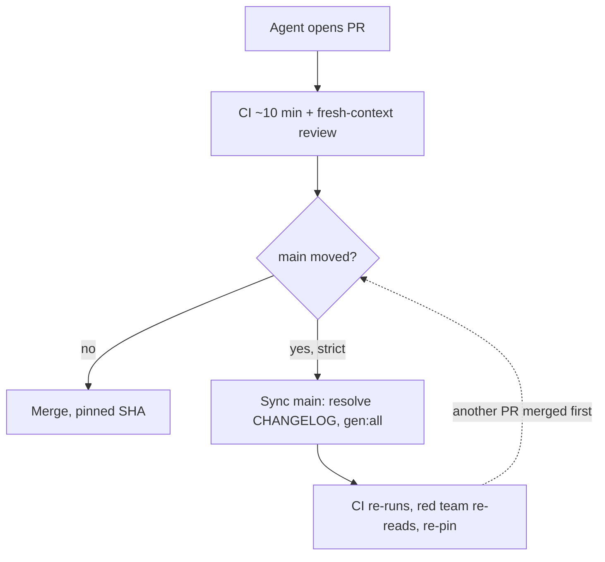

# CI throughput research: what slows the PR cycle now, and what to do about it

Research follow-up to `ci-throughput.md`. Written 2026-11-12 (Pacific/Auckland, NZDT), from data read-only
against `main` at `213e7393` (2026-11-12 17:44 NZDT, PR #732). Nothing here is decided: every roadmap item
changes a workflow, a repository setting or an owner rule, so each one is an owner decision or a card taken
in the order `product-roadmap/` gives (RM-D15).

## 0. For the agent picking this up

- **Read first:** this file § 1 and § 5; then `ci-throughput.md` (options A–G and the three laws in its § 2,
  which every item here must keep or explicitly ask the owner to change); `docs/agents/commands.md` § CI and
  § Merging a PR; `docs/agents/gotchas.md` § PRs & CI; `.github/workflows/ci.yml` (the header comment above
  `changes`); `.claude/hooks/generated-artifacts.json`; `scripts/check-quick.mjs` and `scripts/nearest-tests.mjs`.
- **Relation to `ci-throughput.md`:** that plan shortened one CI run (A–D, G live). This one measures what
  is left. Its main finding is that the cost has moved from one run's length to serialisation: options
  **E** (merge queue) and **F** (changelog fragments), still open owner decisions in `docs/backlog.md`,
  are now the bottleneck. It adds new items too (a sync-main script, the strict rule, E2E shards, sharded
  main-only legs, affected tests, auto-revert).
- **Verified (measured, reproducible with § 9):** every number in § 4 that has no "estimate" beside it.
- **Estimates:** every "expected effect" in § 5 and the job-hours-per-day figure in § 4.1. They are
  derived from the § 4 numbers, and the derivation is given beside each one.
- **Caveats:** the before/after comparison for the strict rule (§ 4.3) covers only 3 days after the switch,
  and other changes happened in the same window, so it shows a direction, not a cause. The flaky rate is
  understated, because Playwright retries hide E2E flakes.
- **Suggested next step:** P0-1 (the sync-main script) and P0-3 (E2E shards, splitting `finish.test.ts`)
  need no rule change. Then ask the owner about P0-2 (strict) and P1-1 (organization plus merge queue).
- **Data window:** `ci.yml` runs 2026-11-05 00:33 → 2026-11-12 17:53 NZDT; PRs: all 688 (#1 to #734);
  git history: `origin/main` since 2026-10-29. `main` has moved since (1.60.0, #735), so refresh with § 9
  before acting on any number.

## 1. Summary

1. **The bottleneck is serialisation, not CI speed.** PR CI median 9.6 min (P90 13.1), queue ≈ 3 s, 3 open
   PRs, PR open → merge median 33 min. There is no PR backlog. The time goes into syncing `main`: in two
   weeks, 297 PR merges came with 266 "merge `origin/main` into the branch" commits, and 165 of those
   needed hand-resolved files.
2. **The conflicts come from records and generated artifacts.** `CHANGELOG.md` was hand-resolved in 98
   merges, then `docs/agents/module-map.md` (42), `llms-full.txt` (32), `docs/error-codes.md` (23) and
   `test/INDEX.md` (22). **82 of the 165 (50%) touched only `CHANGELOG.md` and generated artifacts**, so a
   script can resolve them.
3. **After the strict rule ("require branches to be up to date", 2026-11-10 04:00 NZDT)**, CI runs per PR
   went from 2.11 to 3.02 and P90 open → merge from 113 to 755 min (3-day sample, confounded). Strict does not
   catch main-only breaks either (Node 18, Node 20, Windows run only on `main`).
4. **The merge queue was rejected because the repo is user-owned.** GitHub offers it in public repositories
   owned by an organization. The workflows already trigger on `merge_group`, so moving the repo to a free
   organization would unlock it.
5. **The CI itself still has cheap wins:** shard Playground E2E (the PR long pole, 8.8 min), split
   `test/finish.test.ts` (216 s, the floor of every Node 22 shard), and shard the 23–27 min main-only legs.
   Estimated effect: PR CI 9.6 → about 7 min; the `main` run 27 → about 11 min, so deploys and red-main alarms
   come sooner.

## 2. Anthropic's articles

| Article | Key data | Key practice |
|---|---|---|
| [Agentic coding is straining CI. Here's how we scaled test impact analysis at Anthropic](https://claude.com/resources/articles/agentic-coding-is-straining-ci-heres-how-we-scaled-test-impact-analysis-at-anthropic) (2026-09) | CI jobs ×25 in 6 months; code per engineer ×8; Claude authors 80% of the code; tests ×10 | Deterministic test impact analysis (a listener records results, a selector picks the tests per PR), sharded per package, stateless, horizontally scalable; "give agents a specific set of valid tests so they can self-verify" |
| [Redesigning source control at Anthropic](https://www.anthropic.com/research/redesigning-source-control) (2026-10-13) | Merges per day rose from about 2,500 (May) to over 30,000 (Sep); about 25 million CI checkouts per day; CI checkouts went from minutes to seconds; 25% of CI CPU freed | In-house VCS (Scion). "A proper merge queue doesn't make much sense at agent scale": they invested in post-merge and pre-deploy automated testing, and Claude fixes conflicts |
| [How the Claude Code team does code review](https://claude.dev/blog/solving-code-review-at-anthropic/) (2026-10-15) | Merged PRs to Claude Code more than doubled from June to September, while the share reverted fell by more than 40% | Continuous AI review; risk tiers set by the change, not the author; at most one human per PR for most PRs; revert and incident rates as the guardrail; "use a merge queue, feature flags, … one-step rollback" |

Two lessons apply here. Agents iterate best against a precise test set. The post-merge-verification idea
already exists in `main-red.yml`; at this repo's scale (about 30 merges a day) a merge queue is still the
cheaper tool.

## 3. Industry practice and community discussion

| Company | Practice | Public figures |
|---|---|---|
| Meta | [Predictive test selection](https://engineering.fb.com/2018/11/21/developer-tools/predictive-test-selection/) (gradient-boosted trees) | Runs about a third of the transitively dependent tests and still catches over 99.9% of faulty changes; testing infrastructure efficiency doubled |
| Stripe | [Selective Test Execution](https://stripe.dev/blog/selective-test-execution-at-stripe-fast-ci-for-a-50m-line-ruby-monorepo) (records the files each test opens) | Runs about 5% of tests on average (median 0.5%), under 10% of full-suite compute |
| Uber | SubmitQueue ([large diffs](https://www.uber.com/us/en/blog/bypassing-large-diffs-in-submitqueue/), [CI costs](https://www.uber.com/us/en/blog/slashing-ci-costs-at-uber/)) | 74% lower P95 wait; CI resources −53% and wait −37% |
| GitHub | [Merge queue as the single entry point](https://github.blog/engineering/engineering-principles/how-github-uses-merge-queue-to-ship-hundreds-of-changes-every-day/) | About 2,500 merges a month by 500+ engineers; average wait −33% |
| Shopify | [Merge Queue](https://shopify.engineering/introducing-the-merge-queue), [running fewer tests](https://shopify.engineering/spark-joy-by-running-fewer-tests) | CI starts on enqueue; batched merges; failing PRs leave the queue |
| Google | [TAP flaky-test mitigation](https://testing.googleblog.com/2016/05/flaky-tests-at-google-and-how-we.html) | Reruns only failed tests; quarantines over a threshold and files bugs |
| Linear | [HN thread](https://news.ycombinator.com/item?id=49792067), [summary](https://darkfactory.dev/news/2026-09-21-extra-2/story-2) | Tests about ×4, yet PR wait fell from just over 6 min to just over 5; Vitest `isolate: false` (opt-in) saved about 17% of monthly cost; `tsgo` cut `tsc` 73%; the constraint was written into the agent skills |
| Cursor / Graphite | [Graphite joins Cursor](https://cursor.com/blog/graphite), [Bugbot](https://cursor.com/docs/bugbot), [stacked PRs](https://graphite.com/docs/best-practices-for-reviewing-stacks) | AI review, stacked PRs, a stack-aware merge queue |
| Vercel / Turborepo | [Constructing CI](https://turborepo.dev/docs/crafting-your-repository/constructing-ci), [Remote Caching](https://vercel.com/docs/monorepos/remote-caching) | `--affected` runs only the changed packages; a shallow clone makes every package look changed |
| Netflix | [Develocity case study](https://develocity.ai/customers/story/netflix/) (vendor source) | Build caching, predictive test selection, test distribution; 280,000+ hours a year |

The practices fall into four groups: **verify less** (test selection, affected-only), **verify faster**
(caching, shards, runners), **verify earlier** (local or in-agent checks, AI review) and **merge without
serialising** (merge queue, stacks, post-merge verification plus revert).

Community discussion and pushback:

- HN on the Linear post (317 points, 408 comments): "Why have we not seen an improvements in products?" Throughput is not value.
- [HN on Scion](https://news.ycombinator.com/item?id=50073633) (900 points): the [critique](https://news.ycombinator.com/item?id=50075586) that a server-side VCS gives up git's local history.
- [DORA 2025](https://dora.dev/research/2025/dora-report/): AI adoption now improves delivery throughput but still increases delivery instability.
- [Reddit r/EngineeringManagers](https://www.reddit.com/r/EngineeringManagers/comments/1tax505/how_are_teams_handling_pr_review_now_that_ai_is/): AI doubled output, not reviewers; triage by risk, and auto-merge only low-risk changes.
- X: [from 1–3 to 10–15 PRs per person per day, then a plateau until CI was fixed](https://x.com/dalsanto_c/status/2110270561477939219); [cap concurrent agent branches per repo](https://x.com/liher0505/status/2113445054492938400); [15 → 160 PRs a day, and CI broke first](https://x.com/_ethanleonard/status/2117382741721256238).

## 4. This repository: measured state

### 4.1 Headline figures

| Measure | Value | Note |
|---|---|---|
| PR CI wall clock | median 9.6 min, P90 13.1 | 366 successful PR runs |
| `main` push CI wall clock | median 27.1 min, P90 29.0 | 218 successful push runs |
| Queue time per job | median 0.05 min, max 0.10 | 28 sampled runs |
| PR open → merge, last 7 days | median 33 min (0.55 h), P90 about 2 h | 221 merged PRs |
| Open PRs | 3 | 688 total, 638 merged, 47 closed unmerged; 74 by dependabot |
| PR CI failure rate | 23% (111 of 477 decided runs) | 89 more were cancelled by `concurrency` |
| Same-SHA red → green reruns | 0 of 122 failing SHAs | Playwright retries hide E2E flakes |
| `main` red rate | 4.8% (11 of 229 push runs) | |
| PRs that synced `main` at least once | 53% (141 of 297) | 2 weeks |
| CI runs per day | 60–160 | about 167 job-hours a day (estimate: sampled job-minutes per run × runs) |

GitHub Free allows 20 concurrent jobs ([limits](https://docs.github.com/en/actions/reference/limits)), and one
PR run uses 17 jobs, so overlapping runs will start to queue. The sample showed no queueing yet.

CI runs per day (NZDT; the first and last days are partial):

| Day | PR runs | `main` push runs |
|---|---|---|
| 11-05 | 40 | 19 |
| 11-06 | 73 | 39 |
| 11-07 | 46 | 23 |
| 11-08 | 33 | 13 |
| 11-09 | 102 | 51 |
| 11-10 | 114 | 42 |
| 11-11 | 113 | 29 |
| 11-12 | 47 | 15 |

### 4.2 One PR round trip



### 4.3 Before and after the strict rule

| Measure | Before (11-05 → 11-10 04:00) | After (11-10 04:00 → 11-12) |
|---|---|---|
| Merged PRs | 167 | 66 |
| Merges per day | 32.6 | 25.7 |
| Open → merge, median | 32 min | 42 min |
| Open → merge, P90 | 113 min | 755 min |
| CI runs per PR (mean) | 2.11 | 3.02 |

### 4.4 Where the conflicts come from

Hand-resolved files in the 266 "main into branch" merges since 2026-10-29 (`git diff-tree --cc`):

| File | Merges |
|---|---|
| `CHANGELOG.md` | 98 |
| `docs/agents/module-map.md` (generated) | 42 |
| `llms-full.txt` (generated) | 32 |
| `src/error-catalog.ts` | 23 |
| `docs/error-codes.md` (generated) | 23 |
| `test/INDEX.md` (generated) | 22 |
| `docs/language-reference.md` | 17 |
| `docs/whats-new.md` | 14 |
| `spec.llm.md` (generated) | 12 |
| `docs/cli-reference.md` (generated) | 12 |

165 merges had at least one hand-resolved file. In 28 of them every such file was a generated artifact, and in
54 more every such file was a generated artifact or `CHANGELOG.md`: **82 (50%) need no judgement.**

Syncs per merged PR (297 PRs, 2 weeks): 0 syncs for 156, 1 for 60, 2 for 55, 3 for 14, 4 or more for 12.

Commits touching each file, same window: `CHANGELOG.md` 174, `llms-full.txt` 87, `docs/agents/module-map.md` 85,
`docs/error-codes.md` 69, `src/error-catalog.ts` 60.

### 4.5 Job durations (sampled: 18 PR runs, 10 push runs, minutes)

| Job | PR median | PR P90 | Push median | Push P90 |
|---|---|---|---|---|
| Playground E2E (Playwright) | 8.8 | 10.3 | 7.9 | 19.8 |
| Docs site E2E (Playwright) | 5.9 | 7.2 | 5.8 | 7.3 |
| Node 22 tests, slowest of 5 shards | 4.8 | 5.9 | 5.0 | 5.6 |
| 3D package (check:3d) | 2.6 | 3.2 | 2.8 | 4.5 |
| Workspace builds | 2.4 | 3.2 | 2.5 | 2.9 |
| Benchmark (informational) | 2.1 | 2.4 | n/a | n/a |
| Node 22 checks | 0.8 | 0.9 | 0.7 | 0.9 |
| Windows (tests + drift) | 0.1 (skipped) | 0.1 | 26.5 | 27.1 |
| Node 18 | 0.1 (skipped) | 0.1 | 24.1 | 27.6 |
| Node 20 | 0.1 (skipped) | 0.1 | 23.1 | 25.8 |
| CodeQL (separate workflow) | 1.8 | 2.2 | 6.2 | 6.3 |

Playground E2E steps: "Run E2E specs" 4.0–6.4 min (Chromium), Firefox and WebKit specs 0.6–2.0, apt deps
0.1–1.3. On push, Node 18/20/Windows spend 22–26 min in a single `Test` step (the whole suite in one job).
Sampled job-minutes per run: about 45 per PR run and about 117 per push run.

### 4.6 Test suite

`test/.durations.json`: 544 files, 1,856 s in total; the top 10 files take 38% and the top 30 take 58%.

| File | Seconds |
|---|---|
| `test/finish.test.ts` | 215.9 |
| `test/net-area-oracle-corpus.test.ts` | 98.4 |
| `test/finish-furnish.test.ts` | 81.4 |
| `test/lint-fix-texts.test.ts` | 52.9 |
| `test/fuzz.test.ts` | 52.6 |
| `test/rendered-theme.test.ts` | 42.7 |
| `test/cli-validate-next.test.ts` | 42.6 |
| `test/taste-equivariance.test.ts` | 42.1 |
| `test/repair-no-worse.test.ts` | 41.6 |
| `test/taste-digests.test.ts` | 36.3 |

### 4.7 What is already in place

Records-only fast path (C), per-PR `concurrency` (B), coverage moved to nightly (D), Node 22 shards ordered by
recorded durations (G), main-only Node 18/20/Windows legs (G), auto-merge with SHA-pinned `--match-head-commit`
(A), risk tiers (`scripts/risk-tier.mjs`), `REVIEW.md` with two review rounds at most, `check:quick` as the
local gate (nearest tests by import distance), `main-red.yml`, nightly `full-matrix` / `fuzz-deep` / `mutants`,
and `merge_group` triggers. Most of the industry list is here already; what is missing is the merge strategy
and conflict handling.

## 5. Roadmap

Ordered as: remove serialisation first, then verify less, then verify faster. The effects are estimates
derived from § 4.

### P0: quick wins (no owner rule changes except P0-2)

| Id | Change | Expected effect (estimate) |
|---|---|---|
| P0-1 | A `sync-main` script (§ 6.1): generated-artifact conflicts take `main`'s side and then run `gen:all`; `CHANGELOG.md` merges with union and is checked by `scripts/check-changelog-unreleased.mjs`; any other conflict stops and goes to an agent | Scripts away about 82 hand resolutions per 2 weeks (50%) |
| P0-2 | Reconsider strict (owner setting). It costs about 0.9 extra CI runs per PR and does not cover the main-only legs. Either turn it off and rely on PR green plus `main-red.yml` (the state before 11-10), or keep it only until P1-1 | CI runs per PR back to about 2.1 |
| P0-3 | Shard Playground E2E 2-way behind an aggregator that keeps the required check name (§ 6.2); split `test/finish.test.ts` into about 3 files and refresh `.durations.json` | PR CI 9.6 → about 7 min (the long pole becomes Docs E2E at 5.9 and the shards at about 4) |
| P0-4 | Fold records-only PRs ("docs(plans): cards after …") into the code PR they record, or one per stage | `docs/*` branches were about 27% of PRs; fewer PRs that conflict with one another |

### P1: medium term (2–4 weeks)

| Id | Change | Expected effect (estimate) |
|---|---|---|
| P1-1 | Option E for real: move the repo to a (free) organization and add a merge-queue ruleset (§ 6.3); turn strict off. Check afterwards: npm Trusted Publisher (OIDC, bound to owner/repo), repository secrets, Marketplace and Open VSX links, docs links (GitHub redirects the old URLs) | The queue tests the merged result, so update-branch rounds and the re-red-team after a sync mostly disappear; only real textual conflicts leave the queue |
| P1-2 | Option F: `changelog.d/<branch>.md` fragments, assembled by `/release-check`. This needs the AGENTS.md rule "release narrative lives only in `CHANGELOG.md`" amended first (owner) | Removes the source of 98 conflicts |
| P1-3 | Shard the main-only Node 18, Node 20 and Windows legs 3-way, each behind an aggregator that keeps its required check name (as `Node 22` does). Watch the 20-concurrent-job limit | `main` CI 27 → about 11 min, so `deploy.yml` and `main-red.yml` react 2–2.5× sooner |
| P1-4 | Automate "does this sync need a re-review": compare the files `main` brought in with the PR's own files (minus generated artifacts). If they don't overlap, keep the review and only re-pin the SHA | Most re-red-team rounds skipped |

### P2: long term (1–3 months)

| Id | Change | Expected effect (estimate) |
|---|---|---|
| P2-1 | Affected tests on PRs (`vitest related` or `scripts/nearest-tests.mjs`) plus an always-run set: directory-scanning guards, digests, byte-identity, hashing laws (gotcha: select by transitive import closure). The full suite stays in the queue and on `main`. This narrows law 2 of `ci-throughput.md` and needs the owner | PR compute probably less than half; wall clock is limited by E2E |
| P2-2 | Auto-revert: when `main-red.yml` sees exactly one merge between the last green and the red, it opens a revert PR; with several merges, it bisects with the failing leg | Faster recovery; the guardrail that makes P0-2 and P2-1 safe |
| P2-3 | Flaky accounting: persist the `scripts/playwright-flaky.mjs` results as an artifact and trend them; quarantine a test over a threshold and open an issue | Makes the hidden flake rate visible |
| P2-4 | Vitest `isolate: false` on an allow-listed set of stateless files, with the rule written into the agent skills (as Linear did) | Per-file setup saved; verify file by file |

Not recommended now: Bazel, Nx or Turborepo remote caching (Workspace builds take 2.4 min); a custom VCS
(3–4 orders of magnitude below Anthropic's scale); paid larger runners (revisit after P0 and P1).

## 6. Example configuration (sketches; adapt before use)

### 6.1 `scripts/sync-main.sh` (P0-1)

```bash
#!/usr/bin/env bash
# Merge origin/main into the current branch; resolve generated artifacts and CHANGELOG automatically.
set -euo pipefail
git fetch origin main
git merge --no-commit --no-ff origin/main || true
GEN=$(node -e 'console.log(Object.keys(require("./.claude/hooks/generated-artifacts.json").artifacts).join("\n"))')
for f in $(git diff --name-only --diff-filter=U); do
  if [ "$f" = "CHANGELOG.md" ]; then
    git show :1:CHANGELOG.md > /tmp/base; git show :2:CHANGELOG.md > /tmp/ours; git show :3:CHANGELOG.md > /tmp/theirs
    git merge-file --union /tmp/ours /tmp/base /tmp/theirs && cp /tmp/ours CHANGELOG.md
  elif echo "$GEN" | grep -qxF "$f"; then
    git checkout --theirs -- "$f"
  else
    echo "real conflict, needs an agent: $f"; exit 1
  fi
  git add "$f"
done
npm run gen:all && git add -A
node scripts/check-changelog-unreleased.mjs origin/main
git commit --no-edit
```

The union merge can leave a branch's entry inside a released section (gotchas § PRs & CI); the
`check-changelog-unreleased` call above is what catches that.

### 6.2 Sharded Playground E2E keeping the required check name (P0-3)

```yaml
e2e-playground-shard:
  name: Playground E2E ${{ matrix.shard }}/2
  needs: changes
  runs-on: ubuntu-latest
  strategy: { fail-fast: false, matrix: { shard: [1, 2] } }
  steps:
    # ... the existing setup, build and Playwright cache steps, unchanged
    - run: npx playwright test -c playground --shard=${{ matrix.shard }}/2
e2e-playground:            # keeps the required check name
  name: Playground E2E (Playwright)
  needs: [changes, e2e-playground-shard]
  if: always()
  runs-on: ubuntu-latest
  steps:
    - run: test "${{ needs.e2e-playground-shard.result }}" = success -o "${{ needs.e2e-playground-shard.result }}" = skipped
```

The `@engines` Firefox/WebKit step and the `Flaky tests` report step have to move into the shard job (or a
third job).

### 6.3 Merge-queue ruleset after the move to an organization (P1-1)

`gh api -X POST repos/<org>/archlang/rulesets --input ruleset.json`:

```json
{
  "name": "main-queue", "target": "branch", "enforcement": "active",
  "conditions": { "ref_name": { "include": ["~DEFAULT_BRANCH"], "exclude": [] } },
  "rules": [{ "type": "merge_queue", "parameters": {
    "merge_method": "MERGE", "grouping_strategy": "ALLGREEN",
    "max_entries_to_build": 5, "min_entries_to_merge": 1, "max_entries_to_merge": 5,
    "min_entries_to_merge_wait_minutes": 5, "check_response_timeout_minutes": 60 } }]
}
```

The merge command stays `gh pr merge <n> --auto --merge --match-head-commit <sha>`; the PR enters the queue.
`docs/agents/commands.md` § CI already describes how the workflows behave under `merge_group`.

### 6.4 Affected tests on PRs, full suite elsewhere (P2-1)

```yaml
- name: Affected tests (PR only)
  if: github.event_name == 'pull_request'
  run: |
    CHANGED=$(git diff --name-only origin/main...HEAD -- src packages test)
    npx vitest related --run $CHANGED \
      test/*byte-identity*.test.ts test/docs-*.test.ts test/*digest*.test.ts
- name: Full suite (queue / main)
  if: github.event_name != 'pull_request'
  run: npx vitest run --shard=${{ matrix.shard }}/5
```

`changes` needs `fetch-depth: 0` (or a fetched merge base) for the diff. The always-run list has to come
from the scanning guards in `scripts/check-quick.mjs` (`scanningGuards`), not from this sketch.

## 7. Measures and guardrails

| Measure | Now | Target |
|---|---|---|
| CI runs per PR | 3.0 | 1.5 or fewer |
| PRs syncing `main` at least once | 53% | under 15% |
| Hand-resolved merges per 2 weeks | 165 | under 40 |
| PR CI median | 9.6 min | 7 min |
| `main` CI median | 27.1 min | 12 min |
| `main` red rate | 4.8% | no higher |
| Revert rate | not measured | measure it; no higher |

As the Claude Code team does, track the red rate and the revert rate alongside the speed: if they rise, the
time was moved, not saved.

## 8. Method

- **CI runs:** the last 799 `ci.yml` runs; wall clock = `updated_at − run_started_at`; duplicates from
  pagination removed.
- **Jobs and steps:** 28 sampled runs (12 successful PR, 7 successful push, 6 failed PR, 3 failed push);
  queue = job `started_at − created_at`.
- **PRs:** all 688 from the pulls API; open → merge = `merged_at − created_at`; CI runs per PR = PR-event
  runs on the head branch.
- **Strict cut:** 2026-11-10 04:00 NZDT, the commit "docs: merge queue unavailable on a user-owned repo;
  strict up-to-date checks instead".
- **Conflicts:** first-parent merges on `origin/main` since 2026-10-29. A sync merge is any non-"Merge pull
  request" merge; hand-resolved files are those `git diff-tree --cc --name-only -r <merge>` lists (they
  differ from both parents).
- **Flaky:** a SHA with both a failed and a successful run of the same event.
- **Access:** all of it was done read-only; no repository change, comment or PR.

## 9. How to refresh the data

Needs `gh` authenticated with read access, `jq`, `python3`, and a full clone (`git fetch --unshallow` if
shallow). Times from the API are UTC; add 13 h for NZDT.

```bash
R=ChanMeng666/archlang
# 1. CI runs (8 pages of 100 ≈ one week at the current rate)
for p in 1 2 3 4 5 6 7 8; do gh api "repos/$R/actions/workflows/ci.yml/runs?per_page=100&page=$p" > ci_runs_$p.json; done
jq -s '[.[].workflow_runs[]] | unique_by(.id) | map(select(.status=="completed"))
  | group_by(.event+"/"+(.conclusion//"none"))
  | map({k:(.[0].event+"/"+(.[0].conclusion//"none")), n:length,
         median_min:(map(((.updated_at|fromdate)-(.run_started_at|fromdate))/60)|sort|.[length/2|floor])})' ci_runs_*.json
# 2. Jobs of one run (repeat for a sample of run ids)
gh api "repos/$R/actions/runs/<run_id>/jobs?per_page=100" \
  | jq '.jobs[] | {name, min:(((.completed_at|fromdate)-(.started_at|fromdate))/60), queue_s:((.started_at|fromdate)-(.created_at|fromdate))}'
# 3. PRs: open count and open -> merge
gh pr list -R $R --state open --json number,title,author
gh api --paginate "repos/$R/pulls?state=all&per_page=100" \
  | jq -s '[.[][] | select(.merged_at) | ((.merged_at|fromdate)-(.created_at|fromdate))/60] | sort | {n:length, median_min:.[length/2|floor], p90_min:.[(length*0.9)|floor]}'
# 4. Sync merges vs PR merges, and hand-resolved files
git fetch origin
git log origin/main --since=2026-10-29 --merges --format='%s' \
  | awk '/^Merge pull request/{a++;next}{b++} END{print "PR merges",a,"sync merges",b}'
git log origin/main --since=2026-10-29 --merges --format='%H %s' | grep -v 'Merge pull request' | cut -d' ' -f1 \
  | while read h; do git diff-tree --cc --name-only -r "$h" | tail -n +2; done | sort | uniq -c | sort -rn | head -15
# 5. Syncs per merged PR
git log origin/main --since=2026-10-29 --first-parent --merges --format='%H %s' | grep 'Merge pull request' | cut -d' ' -f1 \
  | while read h; do git rev-list --merges --count "$h^1..$h^2"; done | sort -n | uniq -c
# 6. Slowest test files
node -e 'const d=require("./test/.durations.json");Object.entries(d).sort((a,b)=>b[1]-a[1]).slice(0,10).forEach(([f,s])=>console.log(s.toFixed(1),f))'
```

## 10. Sources

- Anthropic: [test impact analysis](https://claude.com/resources/articles/agentic-coding-is-straining-ci-heres-how-we-scaled-test-impact-analysis-at-anthropic) · [Redesigning source control](https://www.anthropic.com/research/redesigning-source-control) · [Claude Code code review](https://claude.dev/blog/solving-code-review-at-anthropic/)
- GitHub: [merge queue at GitHub](https://github.blog/engineering/engineering-principles/how-github-uses-merge-queue-to-ship-hundreds-of-changes-every-day/) · [merge queue availability (organization-owned public repos)](https://github.com/github/docs/blob/main/data/reusables/gated-features/merge-queue.md) · [Managing a merge queue](https://docs.github.com/en/repositories/configuring-branches-and-merges-in-your-repository/configuring-pull-request-merges/managing-a-merge-queue) · [Actions limits](https://docs.github.com/en/actions/reference/limits)
- Meta: [Predictive test selection](https://engineering.fb.com/2018/11/21/developer-tools/predictive-test-selection/) · Stripe: [Selective Test Execution](https://stripe.dev/blog/selective-test-execution-at-stripe-fast-ci-for-a-50m-line-ruby-monorepo) · Uber: [large diffs](https://www.uber.com/us/en/blog/bypassing-large-diffs-in-submitqueue/), [CI costs](https://www.uber.com/us/en/blog/slashing-ci-costs-at-uber/)
- Shopify: [Merge Queue](https://shopify.engineering/introducing-the-merge-queue) · [Running fewer tests](https://shopify.engineering/spark-joy-by-running-fewer-tests) · Google: [flaky tests](https://testing.googleblog.com/2016/05/flaky-tests-at-google-and-how-we.html)
- Linear: [HN thread](https://news.ycombinator.com/item?id=49792067) · [summary](https://darkfactory.dev/news/2026-09-21-extra-2/story-2) · Cursor: [Graphite](https://cursor.com/blog/graphite), [Bugbot](https://cursor.com/docs/bugbot) · Graphite: [stacked PRs](https://graphite.com/docs/best-practices-for-reviewing-stacks)
- Turborepo: [Constructing CI](https://turborepo.dev/docs/crafting-your-repository/constructing-ci) · Vercel: [Remote Caching](https://vercel.com/docs/monorepos/remote-caching) · Netflix: [Develocity case study](https://develocity.ai/customers/story/netflix/) · Vitest: [affected tests](https://vitest.dev/guide/recipes/affected-tests)
- [DORA 2025](https://dora.dev/research/2025/dora-report/) · HN: [Scion thread](https://news.ycombinator.com/item?id=50073633), [critique](https://news.ycombinator.com/item?id=50075586) · [Reddit](https://www.reddit.com/r/EngineeringManagers/comments/1tax505/how_are_teams_handling_pr_review_now_that_ai_is/) · X: [@dalsanto_c](https://x.com/dalsanto_c/status/2110270561477939219), [@liher0505](https://x.com/liher0505/status/2113445054492938400), [@_ethanleonard](https://x.com/_ethanleonard/status/2117382741721256238)
