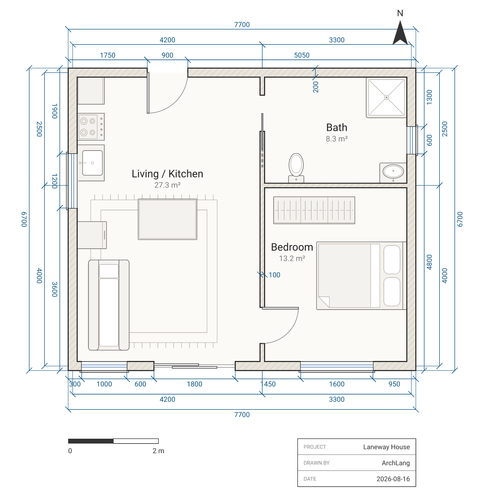
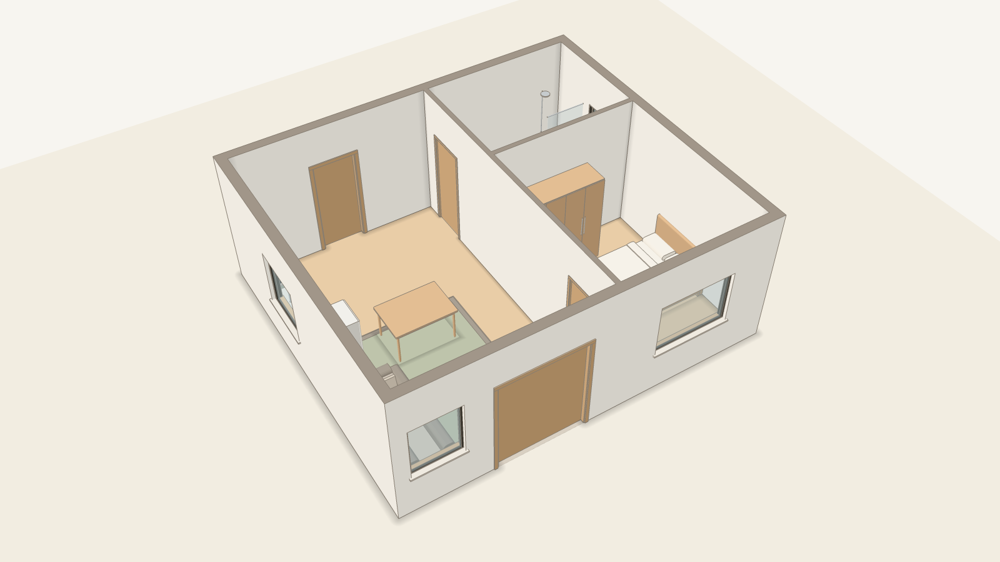

# ArchLang for VS Code

Write floor plans as code. ArchLang is an open-source language that compiles `.arch` text into SVG, DXF or PDF floor plans, and this extension gives `.arch` files full editor support.

<a href="https://archlang.uk/showcase"></a>

<!-- doors:start -->
## Try it

Floor plans as code. Your AI writes ArchLang; the compiler draws a precise, dimensioned plan and tells it what's wrong.

- **ChatGPT, no install:** [ArchLang app in ChatGPT](https://chatgpt.com/plugins/plugin_asdk_app_6acf8381cca08191bfb3eb7305fb6970), then ask, for example: "Draw a two-bedroom flat of about 75 m² as an ArchLang plan, and check it."
- **claude.ai, no install:** add `https://mcp.archlang.uk/mcp` as a custom connector ([the steps](https://archlang.uk/start#door-claudeai))
- **Coding agent:** `claude mcp add --transport http archlang https://mcp.archlang.uk/mcp`; locally, `claude mcp add archlang -- npx -y @chanmeng666/archlang-mcp`; skills, `npx -y skills add ChanMeng666/archlang --yes` ([skills.sh](https://skills.sh/ChanMeng666/archlang))
- **Playground, in the browser:** https://playground.archlang.uk
<!-- doors:end -->

<table>
<tr>
<td align="center" width="50%"><a href="https://archlang.uk/3d"></a><br><sub>Plan</sub></td>
<td align="center" width="50%"><a href="https://archlang.uk/3d"></a><br><sub>3D preview</sub></td>
</tr>
</table>

Same source, plan and 3D preview. The 3D preview is extruded from the same .arch file by the separate archlang-3d package, and checked against the plan: every 3D element comes from the plan's elements, and every solid is closed. [What the 3D preview shows →](https://archlang.uk/3d)

3D preview: walls, openings, floors, stairs and furniture in flat colours; no pitched roofs yet, and no sections, elevations or BIM.

## Features

- **Syntax highlighting** for `.arch` files, including metric unit suffixes such as `4m`, `40cm` and `20mm`.
- **Live diagnostics**: compiler errors and warnings appear as squiggles and in the Problems panel as you type.
- **Hover**: documentation for the element or keyword under the cursor.
- **Completion**: context-aware suggestions.
- **Go to definition**: jump to where an id, binding or component is defined.
- **Rename**: rename an id across the document.
- **Signature help**: parameter hints for functions and components.
- **Quick fixes**: apply a diagnostic's suggested fix with one action.

## Floor plans in Markdown preview

A fenced block tagged `arch` renders as the compiled floor plan in VS Code's built-in Markdown preview (`Ctrl+Shift+V`, or `Cmd+Shift+V` on macOS). `archlang` works as a fence tag too. If the plan has an error, the preview shows the error and your source instead.

````
```arch
plan "Studio" {
  units mm
  wall exterior thickness 200 { (0, 0) (5000, 0) (5000, 4000) (0, 4000) close }
  room id=r_living at (0, 0) size 5000x4000 label "Living" uses living
}
```
````

## Install

Search for "ArchLang" in the Extensions view, or run:

```
code --install-extension ChanMeng.archlang
```

Open any file ending in `.arch` and the extension activates. Everything runs locally; no account or API key is needed.

## Compile from the command line

The extension edits; the `archlang` CLI renders. No install is needed:

```
npx -y @chanmeng666/archlang compile plan.arch -o plan.svg
```

## Use with an AI agent

ArchLang ships an MCP server so agents can write, check and render plans:

```
npx -y @chanmeng666/archlang-mcp
```

See [archlang.uk/agents](https://archlang.uk/agents) for setup. Language docs and a live playground are at [archlang.uk](https://archlang.uk).

## Links

- Source and issues: [github.com/ChanMeng666/archlang](https://github.com/ChanMeng666/archlang)
- License: MIT
