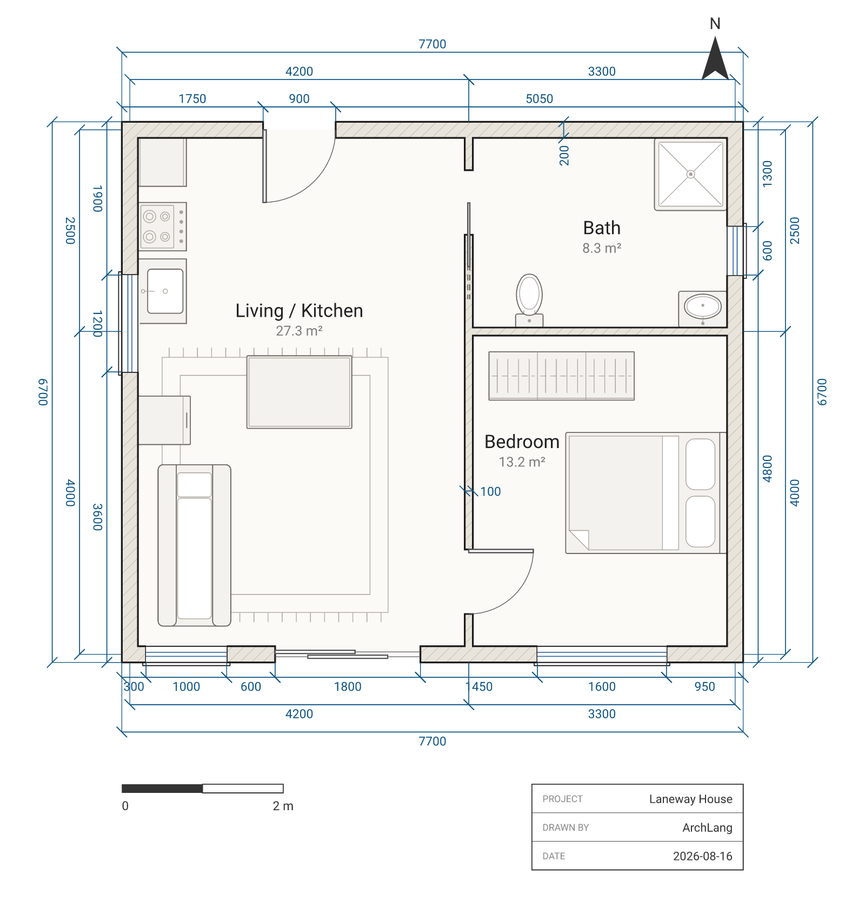
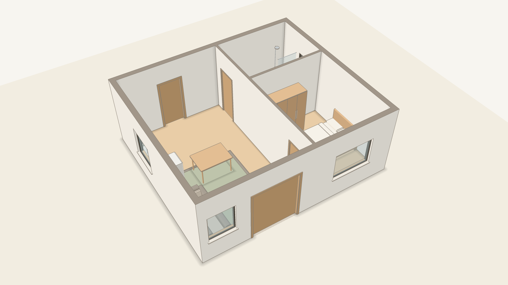

# @chanmeng666/archlang-mcp

A [Model Context Protocol](https://modelcontextprotocol.io) server for
[ArchLang](https://github.com/chanmeng666/archlang) — author, inspect, and repair
architectural floor plans written as code, from any MCP-speaking host.

It is a **thin stdio shim over the `@chanmeng666/archlang` library** (no subprocess,
no re-implementation): each tool wraps one pure, exported function. The core stays
**zero-dependency** — the MCP SDK lives only in this package.

<!-- doors:start -->
## Try it

Floor plans as code. Your AI writes ArchLang; the compiler draws a precise, dimensioned plan and tells it what's wrong.

- **ChatGPT, no install:** [ArchLang app in ChatGPT](https://chatgpt.com/plugins/plugin_asdk_app_6acf8381cca08191bfb3eb7305fb6970), then ask, for example: "Draw a two-bedroom flat of about 75 m² as an ArchLang plan, and check it."
- **claude.ai, no install:** add `https://mcp.archlang.uk/mcp` as a custom connector ([the steps](https://archlang.uk/start#door-claudeai))
- **Coding agent:** `claude mcp add --transport http archlang https://mcp.archlang.uk/mcp`; locally, `claude mcp add archlang -- npx -y @chanmeng666/archlang-mcp`; skills, `npx -y skills add ChanMeng666/archlang --yes` ([skills.sh](https://skills.sh/ChanMeng666/archlang))
- **VS Code:** [Marketplace](https://marketplace.visualstudio.com/items?itemName=ChanMeng.archlang) or [Open VSX](https://open-vsx.org/extension/ChanMeng/archlang)
- **Playground, in the browser:** https://playground.archlang.uk
<!-- doors:end -->

<table>
<tr>
<td align="center" width="50%"><a href="https://archlang.uk/3d"></a><br><sub>Plan</sub></td>
<td align="center" width="50%"><a href="https://archlang.uk/3d"></a><br><sub>3D preview</sub></td>
</tr>
</table>

Same source, plan and 3D preview. The 3D preview is extruded from the same .arch file by the separate archlang-3d package, and checked against the plan: every 3D element comes from the plan's elements, and every solid is closed. [What the 3D preview shows →](https://archlang.uk/3d)

3D preview: walls, openings, floors, stairs and furniture in flat colours; no pitched roofs yet, and no sections, elevations or BIM.

## If your agent has a shell

ArchLang's primary agent interface is the agent-native **`archlang` CLI**, not this
server. A CLI costs **nothing in an agent's context window until it is called**,
whereas an MCP tool schema sits in the window permanently. If your agent already has
a shell, prefer:

```bash
npx -y @chanmeng666/archlang context     # the whole language + workflow + CLI + errors, one call
npx -y @chanmeng666/archlang compile plan.arch -o out.svg --json
```

After `npm i -g @chanmeng666/archlang` the same calls are `archlang context` and
`archlang compile …`. The package also installs an `arch` alias, but on Linux, macOS and
Git Bash coreutils ships its own `arch`, so a bare `arch` there runs the wrong program.

This MCP server exists so MCP-native hosts can **discover** ArchLang through the
registry and drive it without a shell. It is listed on the official MCP registry as
**`io.github.ChanMeng666/archlang-mcp`**. It is the discoverability channel, not a
replacement. See [ADR 0012](https://github.com/chanmeng666/archlang/blob/main/docs/adr/0012-mcp-shim-discoverability.md)
(which amends [ADR 0009](https://github.com/chanmeng666/archlang/blob/main/docs/adr/0009-ai-first-context-and-distribution.md)'s distribution-over-protocol stance).

## Server instructions

At `initialize` the server sends a short `instructions` string, which hosts that support it
add to the model's context: read the `archlang://spec` resource first, then write `.arch` →
`compile` (and `fix`) → `describe` → `validate` with `strict:true` → `finish` before export.
It is `SKILL.md`'s loop, condensed, and a test holds the commands it names to the CLI manifest
and to that loop's order.

## Tools

Every tool takes ArchLang `source` (a `plan "…" { … }` string) and returns
structured JSON. `compile` also accepts `plan_json` (the Plan-JSON / RPLAN shape).
Every result of a call that passed `source` ends with `source_hash`, the SHA-256 (hex) of that
input's UTF-8 bytes; `repair`, `fix` and `finish`, which return a rewritten `source`, add
`output_hash`, the SHA-256 of exactly that returned text. The tools write no files. The hashes are
for the CLI's `--expected-hash`, which refuses to rewrite a file whose bytes no longer hash to the
value given (`E_STALE_SOURCE`): write the returned `source` to the file, then pass its
`output_hash`. For a file that is valid UTF-8 and holds the text unchanged (a BOM and CRLF line
ends included) the MCP hash and the CLI's agree.

| Tool | What it does |
|------|--------------|
| `compile` | Render source (or `plan_json`) to SVG, or to zero-dep ASCII (`format:"txt"`), Plan JSON as an object (`format:"json"`, the shape `plan_json` takes) or a PNG image (`format:"png"`, at `archlang preview`'s width unless `width` overrides it, within a clamped range; needs the optional `@resvg/resvg-js`, which the `.mcpb` bundle leaves out). `accessible`, `overlay:"circulation"` opt-ins. Returns output + diagnostics. A multi-storey plan returns every storey in `pages[]`; `level` renders one. |
| `describe` | Semantic facts (rooms, areas, adjacency, doors, circulation, zones, storeys, the exact `floor_polygon`/`floor_circle` shape, and a `freedom` report of which positions are hand-authored vs resolver-derived) — verify intent without an image. |
| `lint` | Advisory `W_*` soundness warnings (may include the fix-carrying `W_ALIAS_MATCH` for a room use inferred from an indirect label alias); `profile` selects a ruleset. |
| `validate` | Parse + resolve + lint, the ship gate. `strict` fails on warnings; `graph` checks interior-door adjacency against an intended room graph; `intent` gates on a brief's contract (per `archlang://intent-schema`). |
| `score` | The continuous intent METER: how much of a brief a plan satisfies (`satisfied`/`total`/`score`/`subscores`). Measures, never gates. |
| `repair` | Explicit corrector: furniture out of walls/doorways/swings → new `.arch` source + change log. Never adds doors/windows. |
| `finish` | Complete the drawing: furnish the rooms that hold no furniture, then add the missing `paper`, `scale`, `dims auto`, `title`, `schedule rooms` and `legend` → new `.arch` source + change log. Fills only what is missing; `only` runs one stage (`furnish` or `sheet`); `reissue` may replace `paper`/`scale`. |
| `fix` | Apply the machine-applicable fixes on a plan's diagnostics (syntactic corrector; bounded fixpoint). `unsafe` widens to `maybe-incorrect`. |
| `suggest` | Advisory door/window statements (each referencing its wall by a stable ref — an authored id or a unique category — or absolute coordinates, never a re-bindable positional id) to resolve unreachable rooms / windowless bedrooms — data, never applied. |
| `complete` | LSP completion items in scope at a source byte offset. |
| `link` | Two URLs that show the plan in a browser with nothing to install: `playground` (the hosted editor, rendered) and `embed` (the plan alone, for an iframe), plus `bytes`, the compressed plan's size, and `ok` (with an `errors` count when the plan does not compile; it still links and the page shows the diagnostics). The plan rides in the URL fragment. Needs a core that exports `./link`; an older one gets `ok:false` and the version it needs. |

### What `compile`'s `accessible` does here — and what it does not

`accessible: true` gives the SVG its `<title>`/`<desc>` pair and `role="img"` on the root, which
is the whole of the option as this shim exposes it. **The v1.36 element controls are not reachable
through MCP.** They need `annotate` alongside `accessible`, and this tool passes `annotate` only
for `format:"txt"`; it also takes `accessible` as a boolean, so the `{ idPrefix }` form that keeps
several plans on one HTML page from sharing `arch-title`/`arch-desc` cannot be requested either.

A host that needs a keyboard- and screen-reader-operable drawing — `data-arch-primary`,
`role="button"`, `aria-label` on each element — has to call the **library**. The CLI cannot
produce it either: `annotate` has no flag, so `archlang compile --accessible` stops at the
`<title>`/`<desc>` pair too.

```ts
import { compile } from "@chanmeng666/archlang";
compile(src, { annotate: true, accessible: { idPrefix: "plan-7" } });
```

The output contract, what an embedder still owns, and the known screen-reader limitations are in
the [language reference](https://archlang.uk/reference#keyboard-and-screen-reader-operability-annotate--accessible).

## Resources

| URI | Content |
|-----|---------|
| `archlang://spec` | The whole language in one page (`spec.llm.md`). |
| `archlang://context` | Full agent context: spec + workflow + CLI reference + error catalog (`llms-full.txt`). |
| `archlang://schema` | JSON Schema (2020-12) for the Plan-JSON compile input. |
| `archlang://grammar` | GBNF constrained-decoding grammar for guaranteed-parseable generation. |
| `archlang://intent-schema` | JSON Schema (2020-12) for a brief's Intent — the shape `validate`'s `intent` and `score`'s `brief` take. |

## Install

### Claude Code

```bash
claude mcp add archlang -- npx -y @chanmeng666/archlang-mcp
```

### Claude Desktop

Add to `claude_desktop_config.json` (Settings → Developer → Edit Config):

```json
{
  "mcpServers": {
    "archlang": {
      "command": "npx",
      "args": ["-y", "@chanmeng666/archlang-mcp"]
    }
  }
}
```

### Cursor

Add to `.cursor/mcp.json` (project) or `~/.cursor/mcp.json` (global):

```json
{
  "mcpServers": {
    "archlang": {
      "command": "npx",
      "args": ["-y", "@chanmeng666/archlang-mcp"]
    }
  }
}
```

### VS Code

Add to `.vscode/mcp.json`:

```json
{
  "servers": {
    "archlang": {
      "type": "stdio",
      "command": "npx",
      "args": ["-y", "@chanmeng666/archlang-mcp"]
    }
  }
}
```

## License

MIT © Chan Meng
